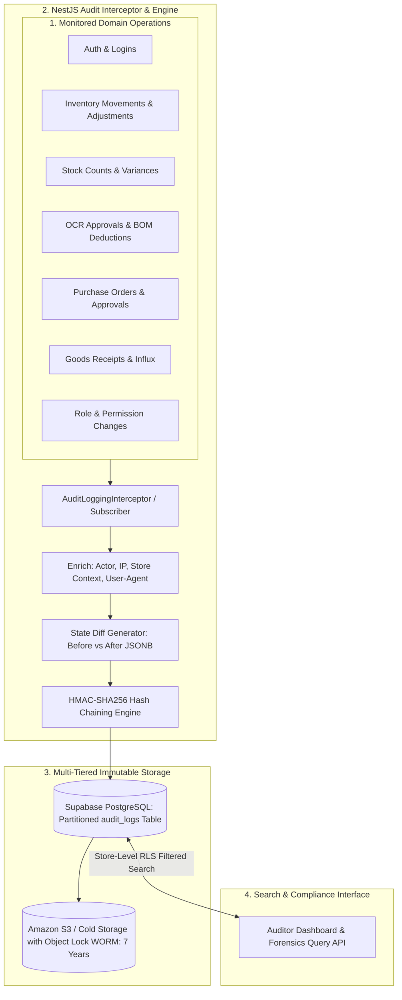
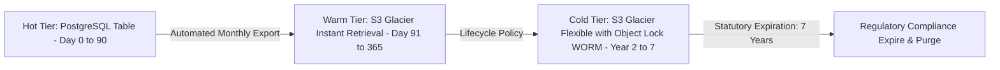

# StockPulse — Immutable Audit Logging & Compliance System

> **Version:** 1.0.0  
> **Compliance Standards:** HACCP Food Traceability, SOC 2 Type II, ISO 27001, European Tax & Accounting Retention (GoBD)  
> **Storage Architecture:** PostgreSQL 16 Append-Only Partitioned Tables + HMAC-SHA256 Hash Chaining + S3 WORM Archive  
> **Companion Documents:**  
> - [RLS_POLICY_DESIGN.md](file:///d:/Project%20Local/fnb-mobile/docs/architecture/RLS_POLICY_DESIGN.md)  
> - [SUPABASE_SCHEMA.md](file:///d:/Project%20Local/fnb-mobile/docs/architecture/SUPABASE_SCHEMA.md)  
> - [NESTJS_MODULE_STRUCTURE.md](file:///d:/Project%20Local/fnb-mobile/docs/architecture/NESTJS_MODULE_STRUCTURE.md)  

---

## 1. System Architecture & Cryptographic Chaining



---

## 2. Event Model & Taxonomy

### 2.1 Tracked Event Taxonomy
| Event Category | Event Action Code | Trigger Condition | Severity |
|---|---|---|:---:|
| **Authentication** | `AUTH.LOGIN_SUCCESS`<br>`AUTH.LOGIN_FAILED`<br>`AUTH.BIOMETRIC_UNLOCK`<br>`AUTH.LOGOUT` | User logs in, unlocks via biometrics, or encounters consecutive failures. | `LOW` / `HIGH` |
| **Inventory** | `INVENTORY.MANUAL_ADJUSTMENT`<br>`INVENTORY.SPOILAGE_DISCARD`<br>`INVENTORY.RECIPE_UPDATED` | Stock adjusted, spoiled cuts logged, or recipe yield ratios modified. | `MEDIUM` |
| **Stock Counts** | `STOCK_COUNT.STARTED`<br>`STOCK_COUNT.SUBMITTED`<br>`VARIANCE.APPROVED_SYNCED` | Count session completed; manager approves shrinkage variance. | `HIGH` |
| **OCR & POS** | `OCR.DOCUMENT_SCANNED`<br>`OCR.MANUAL_OVERRIDE`<br>`OCR.BOM_DEDUCTION_CONFIRMED` | POS report scanned; supervisor verifies and executes stock deductions. | `MEDIUM` |
| **Procurement** | `PO.CREATED`<br>`PO.MANAGER_APPROVED`<br>`PO.DISPATCHED_TO_SUPPLIER`<br>`PO.CANCELLED` | Replenishment order created, commercially approved, or cancelled. | `HIGH` |
| **Goods Receipt** | `GOODS_RECEIPT.CHECKED_IN`<br>`GOODS_RECEIPT.DISCREPANCY_FLAGGED` | Delivery arrives; batch numbers logged; short-shipment recorded. | `HIGH` |
| **IAM & Roles** | `PERMISSION.ROLE_ASSIGNED`<br>`PERMISSION.REVOKED`<br>`USER.DEACTIVATED` | User role elevated, store assignment updated, or user deactivated. | `CRITICAL` |

### 2.2 Standardized Event Payload Schema (JSON)
```json
{
  "eventId": "01915dfa-b1c4-7221-9988-51b72e04e0a1",
  "eventNumber": "AUD-202608-000452",
  "timestamp": "2026-08-18T10:30:00.124Z",
  "organizationId": "01915dfa-9012-7000-8000-000000000001",
  "storeId": "01915dfa-9012-7000-8000-000000000002",
  "storeCode": "STR-BER-01",
  "actor": {
    "userId": "01915dfa-9012-7000-8000-000000000099",
    "name": "Marco Rossi",
    "role": "manager",
    "ipAddress": "194.39.218.10",
    "userAgent": "StockPulse-Expo/1.2.0 (iOS 19.0; iPhone16,2)"
  },
  "action": "VARIANCE.APPROVED_SYNCED",
  "entity": {
    "type": "stock_count_session",
    "id": "01915dfa-b1c4-7221-9988-000000000088",
    "businessIdentifier": "SC-20260818-D01"
  },
  "stateDiff": {
    "totalNetShrinkageEur": { "before": 0.0, "after": -48.50 },
    "adjustedItems": [
      {
        "sku": "SKU-CHK-001",
        "name": "Chicken Breast",
        "theoreticalBefore": 27.0,
        "physicalCounted": 24.5,
        "delta": -2.5,
        "unit": "kg",
        "varianceCostEur": -12.00
      }
    ]
  },
  "reasonCode": "MONTHLY_AUDIT_SHRINKAGE_SYNC",
  "integrity": {
    "prevHash": "e3b0c44298fc1c149afbf4c8996fb92427ae41e4649b934ca495991b7852b855",
    "currentHash": "9b1deb4d3b7d4bad9bdd2b0d7b3dcb6d88a1b2c3d4e5f60718293a4b5c6d7e8f"
  }
}
```

---

## 3. Storage Model & PostgreSQL DDL

### 3.1 Immutability Enforcement
1. **Zero Update/Delete Rules**: RLS policies and table triggers prevent any `UPDATE` or `DELETE` on the `audit_logs` table.
2. **PostgreSQL Monthly Range Partitioning**: Enables fast index scans on high-throughput audit queries and simplifies cold archival.

```sql
-- Partitioned Audit Table Definition
CREATE TABLE audit_logs (
    id UUID DEFAULT gen_random_uuid(),
    organization_id UUID NOT NULL REFERENCES organizations(id) ON DELETE CASCADE,
    store_id UUID NOT NULL REFERENCES stores(id) ON DELETE CASCADE,
    event_number VARCHAR(50) NOT NULL,
    actor_id UUID REFERENCES users(id) ON DELETE SET NULL,
    actor_name VARCHAR(255),
    actor_role VARCHAR(50),
    ip_address INET,
    user_agent TEXT,
    event_action VARCHAR(100) NOT NULL,
    entity_type VARCHAR(100) NOT NULL,
    entity_id VARCHAR(100) NOT NULL,
    entity_identifier VARCHAR(100),
    state_before JSONB,
    state_after JSONB,
    state_diff JSONB,
    reason_code VARCHAR(100),
    prev_hash VARCHAR(64) NOT NULL,
    current_hash VARCHAR(64) NOT NULL,
    created_at TIMESTAMPTZ NOT NULL DEFAULT NOW(),
    PRIMARY KEY (id, created_at)
) PARTITION BY RANGE (created_at);

-- Monthly Partitions
CREATE TABLE audit_logs_2026_08 PARTITION OF audit_logs
    FOR VALUES FROM ('2026-08-01 00:00:00+00') TO ('2026-09-01 00:00:00+00');
CREATE TABLE audit_logs_2026_09 PARTITION OF audit_logs
    FOR VALUES FROM ('2026-09-01 00:00:00+00') TO ('2026-10-01 00:00:00+00');

-- Performance Indexes for Search & Filtering
CREATE INDEX idx_audit_store_action_date ON audit_logs(store_id, event_action, created_at DESC);
CREATE INDEX idx_audit_actor_date ON audit_logs(store_id, actor_id, created_at DESC);
CREATE INDEX idx_audit_entity ON audit_logs(store_id, entity_type, entity_id);
CREATE INDEX idx_audit_diff_gin ON audit_logs USING GIN (state_diff);

-- Block Updates and Deletions
CREATE OR REPLACE FUNCTION prevent_audit_log_mutation()
RETURNS TRIGGER AS $$
BEGIN
    RAISE EXCEPTION 'Audit records are strictly immutable. UPDATE and DELETE operations are forbidden.';
END;
$$ LANGUAGE plpgsql;

CREATE TRIGGER trg_block_audit_mutation
    BEFORE UPDATE OR DELETE ON audit_logs
    FOR EACH ROW EXECUTE FUNCTION prevent_audit_log_mutation();
```

---

## 4. Query Model & Auditor Search APIs

### 4.1 Search API Endpoint: `GET /api/v1/audit/ledger`
- **Auth Roles**: `auditor`, `manager`, `superadmin`
- **Query Parameters**:
  - `storeId`: Filter by store (mandatory for auditors/managers; SuperAdmins can query across all stores)
  - `eventAction`: Filter by action (e.g. `INVENTORY.MANUAL_ADJUSTMENT`, `VARIANCE.APPROVED_SYNCED`)
  - `entityType`: Filter by domain (e.g. `stock_count_session`, `purchase_order`, `user`)
  - `actorId`: Filter by specific user ID
  - `startDate` / `endDate`: ISO date boundaries
  - `search`: Trigram text search matching reason codes, actor names, or entity identifiers
  - `cursor` / `limit`: Base64 cursor pagination (default: 50, max: 100)

### 4.2 Compliance Export Endpoint: `POST /api/v1/audit/export`
- **Description**: Generate signed, tamper-verified PDF/CSV audit packs for statutory accounting or HACCP inspections.

---

## 5. Retention Strategy & Cold Archival Lifecycle



### Retention Tier Specifications:
1. **Hot Tier (PostgreSQL 16)**:
   - **Duration**: **90 Days**.
   - Accessible instantaneously for mobile dashboard analytics and real-time supervisor inspection.
2. **Warm Tier (S3 Standard / Glacier Instant)**:
   - **Duration**: **Day 91 – Day 365**.
   - Archived as compressed JSON lines (`audit_YYYYMM.jsonl.gz`) with SHA-256 checksum manifests.
3. **Cold Tier (S3 Glacier Flexible with Object Lock WORM)**:
   - **Duration**: **Year 2 through Year 7 (Legal Tax Retention)**.
   - Enforced by **S3 Object Lock (Compliance Mode)** to prevent deletion even by AWS root accounts.

---

## 6. Documentation Baseline

The complete Audit Logging System specification has been saved and indexed in the documentation portal:
- 📖 **[AUDIT_LOGGING_SYSTEM.md](file:///d:/Project%20Local/fnb-mobile/docs/architecture/AUDIT_LOGGING_SYSTEM.md)** — Event models, HMAC hash chaining, PostgreSQL partitioned storage, and 7-year WORM retention.
- 📖 **[RLS_POLICY_DESIGN.md](file:///d:/Project%20Local/fnb-mobile/docs/architecture/RLS_POLICY_DESIGN.md)** — Read-only auditor RLS policies.
- 📖 **[docs/README.md](file:///d:/Project%20Local/fnb-mobile/docs/README.md)** — Architecture index portal.
