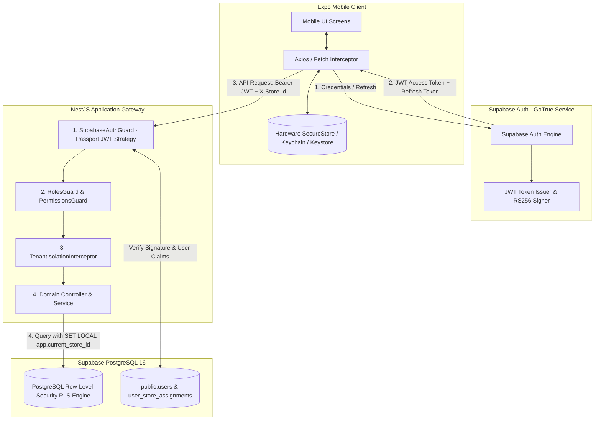
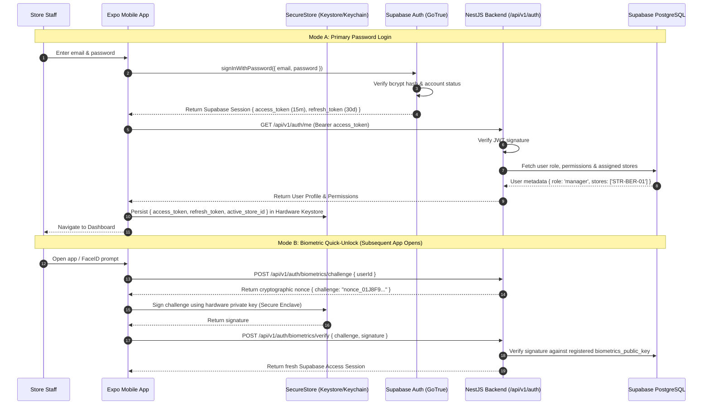
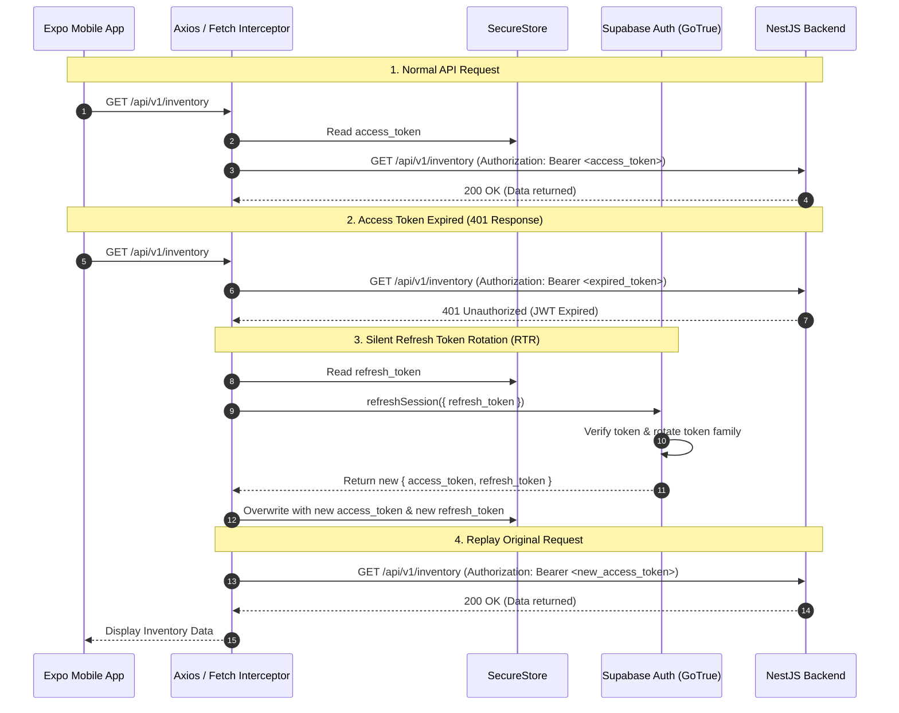
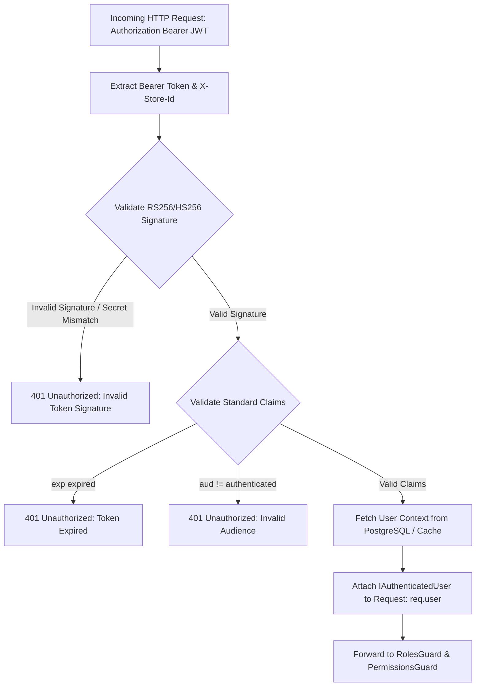
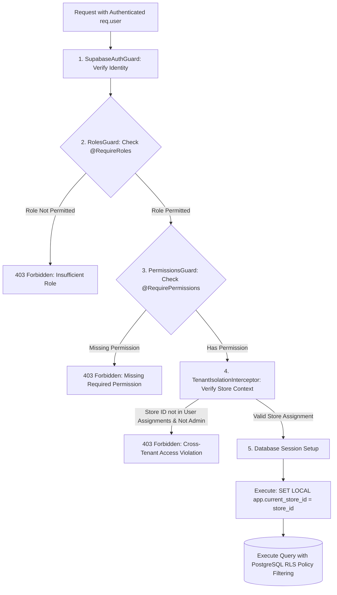

# StockPulse — Authentication & Authorization Architecture
### (Supabase Auth + NestJS Backend + Expo Mobile Client)

> **Version:** 1.0.0  
> **Target Frameworks:** Expo React Native (iOS & Android) + NestJS + Supabase Auth (GoTrue)  
> **Security Standards:** OAuth 2.0 / OIDC, JWT (RFC 7519), Hardware SecureStore, Biometric Challenge-Response  
> **Companion Documents:**  
> - [RLS_POLICY_DESIGN.md](file:///d:/Project%20Local/fnb-mobile/docs/architecture/RLS_POLICY_DESIGN.md)  
> - [NESTJS_MODULE_STRUCTURE.md](file:///d:/Project%20Local/fnb-mobile/docs/architecture/NESTJS_MODULE_STRUCTURE.md)  
> - [BACKEND_ARCHITECTURE.md](file:///d:/Project%20Local/fnb-mobile/docs/architecture/BACKEND_ARCHITECTURE.md)  

---

## 1. High-Level Authentication & Authorization Topology



---

## 2. Flow 1: Login & Biometric Authentication Flow

StockPulse supports two authentication modes:
1. **Primary Credential Login**: Email and password via Supabase Auth.
2. **Biometric Quick-Unlock**: Hardware-backed public/private key challenge-response.



---

## 3. Flow 2: Mobile Session Management & Silent Refresh



### Security & Token Lifecycles:
- **Access Token TTL**: **15 minutes** (short-lived to minimize impact of compromised tokens).
- **Refresh Token TTL**: **30 days** (long-lived, protected by Hardware Keystore).
- **Refresh Token Rotation (RTR)**: Each refresh generates a cryptographically new refresh token and invalidates the previous one.
- **Token Reuse Detection**: If an old/revoked refresh token is presented, Supabase Auth immediately revokes the **entire token family**, forcing manual password re-authentication.

---

## 4. Flow 3: Backend JWT Token Validation Flow

The NestJS backend implements a stateless Passport JWT strategy to validate incoming Supabase tokens:



### Decoded Supabase JWT Payload Structure:
```json
{
  "iss": "https://<supabase-project-id>.supabase.co/auth/v1",
  "sub": "01915dfa-b1c4-7221-9988-51b72e04e0a1",
  "aud": "authenticated",
  "exp": 1773800900,
  "iat": 1773800000,
  "email": "marco.manager@restaurant.de",
  "phone": "+493087654321",
  "app_metadata": {
    "provider": "email",
    "providers": ["email"]
  },
  "user_metadata": {
    "name": "Marco Rossi",
    "role": "manager"
  },
  "role": "authenticated"
}
```

---

## 5. Flow 4: Backend Authorization & Tenant Isolation Flow



### NestJS Authorization Decorators & Usage:

```typescript
@Controller('inventory')
@UseGuards(SupabaseAuthGuard, RolesGuard, PermissionsGuard)
@UseInterceptors(TenantIsolationInterceptor)
export class InventoryController {

  @Get()
  @RequireRoles('admin', 'manager', 'supervisor', 'staff', 'auditor')
  @RequirePermissions('inventory:view')
  async getInventory(
    @CurrentStore() storeId: string,
    @CurrentUser() user: IAuthenticatedUser,
    @Query() query: ItemQueryDto
  ): Promise<PaginatedItemsDto> {
    return this.inventoryService.findAll(storeId, query);
  }

  @Post(':itemId/adjust')
  @RequireRoles('admin', 'manager', 'supervisor')
  @RequirePermissions('inventory:adjust_manual')
  async adjustStock(
    @CurrentStore() storeId: string,
    @CurrentUser() user: IAuthenticatedUser,
    @Param('itemId') itemId: string,
    @Body() dto: StockAdjustmentDto
  ): Promise<ItemResponseDto> {
    return this.inventoryService.adjustManual(storeId, itemId, user.id, dto);
  }
}
```

---

## 6. Summary of Authentication Architecture

| Layer | Technology / Standard | Architectural Role |
|---|---|---|
| **Mobile Storage** | Expo SecureStore (AES-256 / Keychain / Keystore) | Zero plain-text persistence of refresh tokens or biometric keys. |
| **Token Issuer** | Supabase Auth (GoTrue) | Manages credential verification, bcrypt password hashing, and token rotation. |
| **Token Format** | RFC 7519 JSON Web Tokens (RS256 / HS256) | 15-minute access token TTL with cryptographic signature verification. |
| **Backend Validator** | NestJS Passport JWT Strategy (`SupabaseAuthGuard`) | Validates JWT signatures and attaches typed user context to request lifecycle. |
| **Role & Perms Guard**| NestJS `@RequireRoles()` & `@RequirePermissions()` | Enforces granular RBAC before entering domain services. |
| **Tenant Isolation** | NestJS `TenantIsolationInterceptor` + PostgreSQL RLS | Validates `X-Store-Id` header and sets transactional PostgreSQL session variables. |
