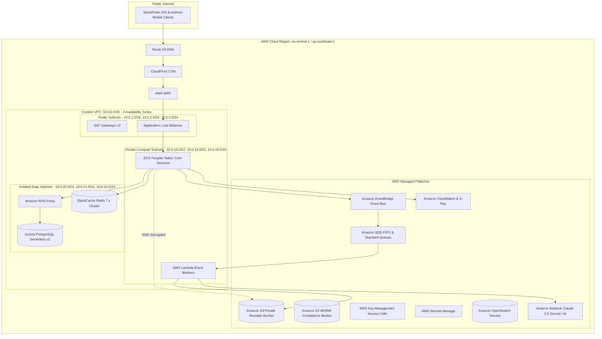
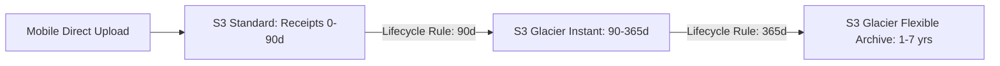
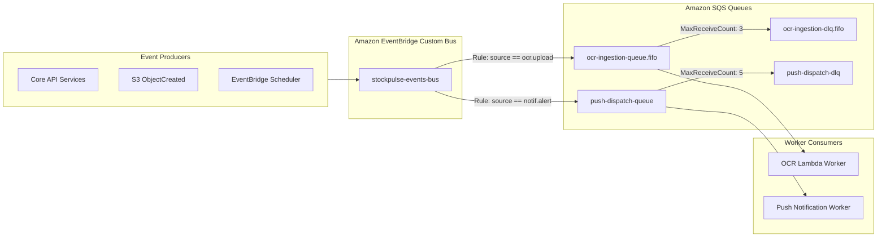
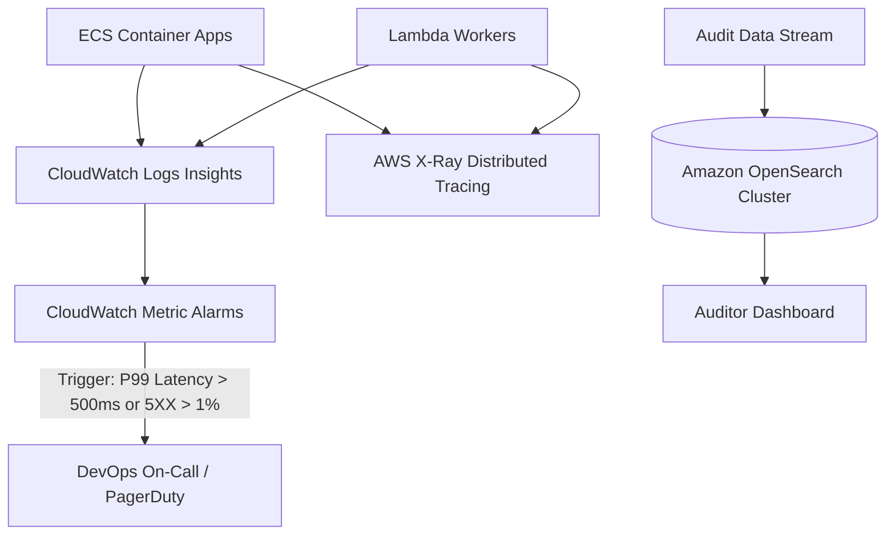

# StockPulse — AWS Production Infrastructure & Cloud Architecture

> **Version:** 1.0.0  
> **Target Cloud Provider:** Amazon Web Services (AWS)  
> **Infrastructure as Code (IaC):** AWS CDK (TypeScript) / Terraform  
> **Companion Document:** [BACKEND_ARCHITECTURE.md](file:///d:/Project%20Local/fnb-mobile/docs/architecture/BACKEND_ARCHITECTURE.md)

---

## 1. AWS Cloud Topology & Network Architecture

---

## 2. Infrastructure Sizing & Compute Specifications

### 2.1 ECS Fargate Task Sizing
| Service Tier | CPU Allocation | Memory Allocation | Base Tasks (Multi-AZ) | Peak Max Tasks | Scaling Metric Trigger |
|---|---|---|:---:|:---:|---|
| **API Core Gateway** | 0.5 vCPU | 1024 MB | 3 (1 per AZ) | 20 | CPU $> 60\%$ or Concurrent Reqs $> 500$ |
| **Inventory & BOM Engine** | 1.0 vCPU | 2048 MB | 3 (1 per AZ) | 20 | CPU $> 65\%$ or DB Conn $> 80\%$ |
| **Stock Count WebSocket** | 0.5 vCPU | 1024 MB | 2 (Multi-AZ) | 15 | Active WSS Connections $> 1000$ |
| **Procurement & Waste** | 0.5 vCPU | 1024 MB | 2 (Multi-AZ) | 8 | CPU $> 70\%$ |

### 2.2 Serverless Lambda Workers
| Worker Function | Memory | Timeout | Concurrency Limit | Invocation Source |
|---|---|---|---|---|
| `ocr-processing-worker` | 2048 MB (ARM64 Graviton) | 60s | 50 (Reserved) | SQS (`ocr-ingestion-queue.fifo`) |
| `push-notification-worker` | 512 MB (ARM64 Graviton) | 15s | 100 (Unreserved) | SQS (`push-dispatch-queue`) |
| `audit-cdc-streamer` | 512 MB (ARM64 Graviton) | 30s | 20 (Reserved) | Kinesis Data Stream |
| `bbd-daily-scheduler` | 256 MB (ARM64 Graviton) | 120s | 1 (Cron) | EventBridge Schedule (Daily 06:00) |

---

## 3. Database & Caching Specifications

### 3.1 Amazon Aurora PostgreSQL Serverless v2
- **Engine Version**: PostgreSQL 16.2
- **Capacity Range**: Min 0.5 ACU ($1\text{ GB RAM}$) to Max 32.0 ACUs ($64\text{ GB RAM}$).
- **High Availability**: Multi-AZ deployment with 1 Primary Writer and 1 Secondary Reader with auto-failover ($< 30\text{s}$).
- **Connection Management**: **Amazon RDS Proxy** enabled (max pool connections: 200) to eliminate connection spikes caused by Lambda concurrency.
- **Backup & Recovery**: Automated continuous backups with Point-In-Time-Recovery (PITR) up to 35 days, retained in S3 with cross-region replication.

### 3.2 Amazon ElastiCache Redis 7.x Cluster
- **Node Type**: `cache.t4g.medium` (ARM64 Graviton2, 3.09 GiB memory per node).
- **Cluster Topology**: 3 Shards across 3 Availability Zones with Multi-AZ automatic failover.
- **Eviction Policy**: `volatile-lru` (ensuring persistent token sessions and active count sessions are retained).

---

## 4. Storage, CDN & Edge Security

### 4.1 Amazon S3 Storage Buckets

- **Bucket 1: `stockpulse-receipts-prod`**:
  - Purpose: POS scan images and delivery invoices.
  - SSE-KMS Customer Managed Key enabled.
  - CORS policy allowing `PUT` only from authorized mobile clients.
- **Bucket 2: `stockpulse-audit-compliance-prod`**:
  - Purpose: WORM compliance audit log archive.
  - **S3 Object Lock (Compliance Mode)** enabled with a 7-year legal hold.
- **Bucket 3: `stockpulse-static-assets-prod`**:
  - Purpose: App logos, dish thumbnails, and vector assets.
  - Fronted by CloudFront with Origin Access Control (OAC).

### 4.2 AWS WAF & CloudFront Edge Configuration
- **AWS Managed Rule Groups**:
  - `AWSManagedRulesCommonRuleSet` (OWASP Top 10 mitigation).
  - `AWSManagedRulesKnownBadInputsRuleSet` (SQL injection & XSS filtering).
  - `AWSManagedRulesAmazonIpReputationList` (Tor exit nodes & botnet blocking).
- **Rate-Limiting Rule**: Restricts IP addresses to max 1,000 requests per 5-minute window on public auth endpoints (`/auth/login`).

---

## 5. Asynchronous Messaging & Queue Architecture

---

## 6. Security, Encryption & Key Management

- **Encryption at Rest**:
  - Database, cache, queues, and S3 buckets are encrypted using AWS KMS Customer Managed Keys (CMK) with automated annual rotation.
- **Encryption in Transit**:
  - TLS 1.3 enforced across CloudFront, ALB, API Gateway, and internal service communication.
- **Secrets Management**:
  - Database passwords, third-party AI keys (Vertex AI / Bedrock), and JWT private signing keys are managed in **AWS Secrets Manager** with automated 90-day rotation Lambdas.
- **IAM Policies**:
  - Strict Principle of Least Privilege: ECS tasks and Lambda execution roles have granular resource-level IAM permissions with zero `*` wildcards on stateful resources.

---

## 7. Observability, Monitoring & Alarms

### Critical CloudWatch Alarms:
1. `StockPulse-Aurora-ACU-High`: Triggers if Aurora ACUs remain $> 24$ for $> 10$ minutes.
2. `StockPulse-API-5xx-ErrorRate`: Triggers if 5XX response rate exceeds $1\%$ in a 5-minute evaluation period.
3. `StockPulse-OCR-DLQ-Messages`: Triggers immediately if any message lands in `ocr-ingestion-dlq.fifo`.
4. `StockPulse-Redis-Memory-High`: Triggers if ElastiCache Redis memory usage exceeds $80\%$.

---

## 8. Estimated Monthly Cloud Cost Breakdown (Production Baseline)

| AWS Component | Configuration Baseline | Estimated Monthly Cost (USD) |
|---|---|:---:|
| **Amazon Aurora Serverless v2** | Baseline 1–4 ACUs average + 100 GB storage | $180.00 |
| **AWS ECS Fargate** | 6 continuous tasks (0.5 vCPU, 1 GB) | $110.00 |
| **Amazon ElastiCache Redis** | 3-node `cache.t4g.medium` Multi-AZ cluster | $145.00 |
| **Amazon S3 & Glacier** | 500 GB S3 Standard + 2 TB Glacier Archive | $25.00 |
| **AWS Lambda & SQS** | 2,000,000 requests/month + 50,000 OCR extractions | $35.00 |
| **Amazon Bedrock / AI OCR** | ~15,000 receipt multi-modal extractions | $90.00 |
| **CloudFront, WAF & Route 53** | 500 GB data transfer + WAF rule inspection | $45.00 |
| **Secrets Manager & KMS** | 10 active secrets + CMK key requests | $15.00 |
| **CloudWatch & OpenSearch** | Log ingestion + 2-node `t3.medium.search` cluster | $85.00 |
| **Total Estimated Monthly Baseline** | **High-Availability Multi-AZ Architecture** | **~$730.00 / month** |
