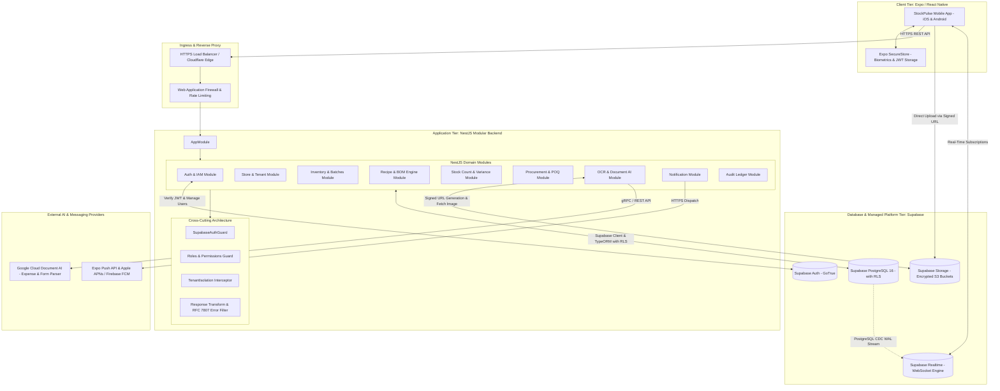
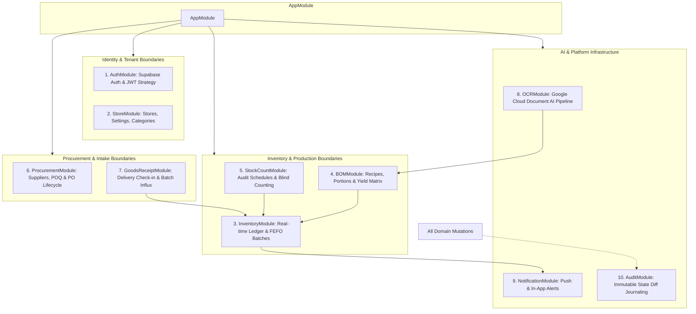
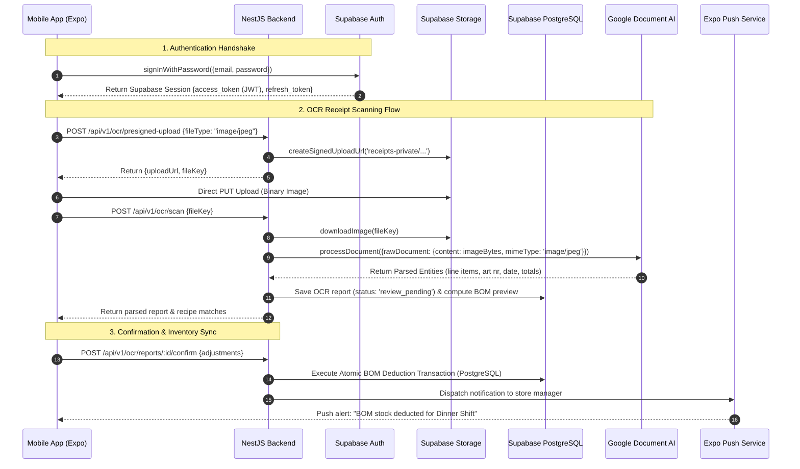
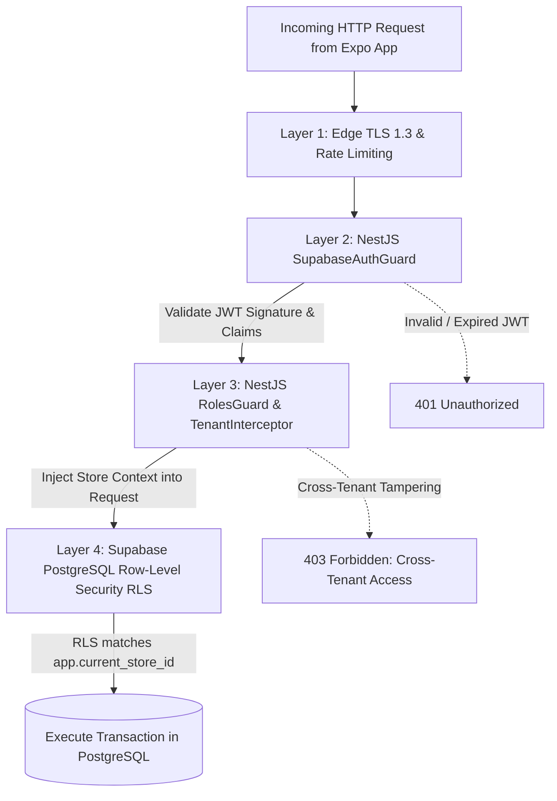

# StockPulse — Phase 1 Backend Architecture Specification
### (NestJS + Supabase PostgreSQL & Auth & Storage + Google Cloud Document AI)

> **Version:** 1.1.0 (Phase 1 Baseline)  
> **Target Environment:** NestJS (Node.js/TypeScript) + Supabase (PostgreSQL 16) + Google Cloud Platform (Document AI)  
> **Client Framework:** Expo / React Native (iOS & Android)  
> **Companion Documents:**  
> - [DOMAIN_MODEL.md](file:///d:/Project%20Local/fnb-mobile/docs/architecture/DOMAIN_MODEL.md)  
> - [SERVICE_CATALOG.md](file:///d:/Project%20Local/fnb-mobile/docs/architecture/SERVICE_CATALOG.md)  
> - [API_CATALOG.md](file:///d:/Project%20Local/fnb-mobile/docs/architecture/API_CATALOG.md)  
> - [DATABASE_DOMAINS.md](file:///d:/Project%20Local/fnb-mobile/docs/architecture/DATABASE_DOMAINS.md)  

---

## 1. Executive Summary & Stack Selection

Phase 1 establishes a **modular, developer-ergonomic, and enterprise-grade backend** for StockPulse. By unifying **NestJS** on the application layer with **Supabase** (managed PostgreSQL, GoTrue Auth, Realtime WebSockets, and Object Storage) and **Google Cloud Document AI** (specialized receipt/invoice parser), StockPulse achieves high development velocity, rock-solid multi-tenant isolation, and high-accuracy multi-modal OCR.

### Phase 1 Core Stack
| Component | Technology | Primary Role in StockPulse |
|---|---|---|
| **Mobile Client** | **Expo React Native** | Cross-platform Android & iOS app with SecureStore biometric auth & offline buffering. |
| **Backend Framework** | **NestJS (TypeScript)** | Enterprise modular framework with Dependency Injection, Guards, Interceptors, and TypeORM/Prisma. |
| **Primary Database** | **Supabase PostgreSQL 16** | Relational database with native Row-Level Security (RLS), ACID transactions, and indexing. |
| **Authentication** | **Supabase Auth (GoTrue)** | Secure JWT issuing, refresh token rotation, user metadata, and passwordless/biometric support. |
| **Object Storage** | **Supabase Storage** | S3-compatible encrypted bucket for receipt images, invoices, and exported reports with signed URLs. |
| **Realtime Gateway** | **Supabase Realtime** | WebSocket engine (PostgreSQL CDC) for live inventory level syncing and multi-user stocktaking. |
| **AI / OCR Engine** | **Google Cloud Document AI** | Specialized Expense / Invoice Processor for line-item extraction, dates, taxes, and totals. |
| **Notification Engine** | **Expo Push Service & FCM/APNs** | Multi-channel push notification delivery for expiry warnings and critical count variances. |

---

## 2. System Architecture Diagram (Mermaid)



---

## 3. Service Boundaries & NestJS Module Structure

NestJS enforces domain-driven modularity. Each domain context is encapsulated inside its own feature module with private business services and public controllers:



### NestJS Module Responsibilities

| Module | Core Services & Providers | Controllers / Routes | Database Entities Owned |
|---|---|---|---|
| **`AuthModule`** | `SupabaseAuthService`, `JwtStrategy`, `BiometricsService` | `AuthController`, `TeamController` | `users`, `roles`, `permissions`, `user_store_assignments` |
| **`StoreModule`** | `StoreService`, `StoreSettingsService`, `CategoryService` | `StoreController`, `SettingsController` | `organizations`, `stores`, `store_settings`, `categories` |
| **`InventoryModule`**| `InventoryService`, `BatchService`, `LedgerService` | `InventoryController`, `BatchController` | `inventory_items`, `inventory_batches`, `inventory_transactions` |
| **`BOMModule`** | `RecipeService`, `BomCalculatorService` | `RecipeController` | `recipes`, `recipe_ingredients`, `recipe_cost_history` |
| **`StockCountModule`**| `CountScheduleService`, `StockCountSessionService` | `StockCountController` | `count_schedules`, `stock_count_sessions`, `stock_count_items`, `variance_adjustments` |
| **`ProcurementModule`**| `SupplierService`, `PoqCalculatorService`, `PurchaseOrderService` | `SupplierController`, `ProcurementController` | `suppliers`, `purchase_orders`, `purchase_order_lines` |
| **`GoodsReceiptModule`**| `GoodsReceiptService`, `BatchInfluxService` | `GoodsReceiptController` | `goods_receipts`, `goods_receipt_items` |
| **`OCRModule`** | `GoogleDocumentAiService`, `RecipeMatcherService`, `OcrDeductionService` | `OcrController` | `ocr_documents`, `ocr_document_items`, `ocr_bom_deductions` |
| **`NotificationModule`**| `ExpoPushService`, `InAppNotificationService` | `NotificationController` | `notifications`, `device_tokens` |
| **`AuditModule`** | `AuditLedgerService`, `CryptoHashService` | `AuditController` | `audit_logs` |

---

## 4. API Modules & Controller Hierarchy

All REST endpoints are grouped under `/api/v1` and protected by default:

```
/api/v1
 ├── /auth
 │    ├── POST /login                   (Supabase email/password authentication)
 │    ├── POST /refresh                 (Refresh token rotation via Supabase GoTrue)
 │    ├── POST /biometrics/register     (Register Expo SecureStore public key)
 │    ├── POST /biometrics/verify       (Passwordless biometric challenge unlock)
 │    └── POST /logout                  (Invalidate session)
 │
 ├── /stores
 │    ├── GET  /current                 (Active store details & currency/tax rates)
 │    ├── PATCH /settings               (Update count schedule, BBD alert window)
 │    └── GET  /team                    (List store staff members & roles)
 │
 ├── /inventory
 │    ├── GET    /                      (Paginated inventory items with stock status)
 │    ├── GET    /:itemId               (Detailed SKU view with active FEFO batches)
 │    ├── POST   /:itemId/adjust        (Manual emergency stock adjustment)
 │    ├── GET    /batches/expiring      (Batches nearing BBD sorted by urgency)
 │    └── DELETE /batches/:batchId      (Discard or consume expired batch)
 │
 ├── /recipes
 │    ├── GET  /                        (List recipes, active status, portions sold)
 │    └── GET  /:recipeId               (Recipe ingredient matrix & portion costs)
 │
 ├── /stock-counts
 │    ├── GET  /schedules               (Audit schedules: Daily, Weekly, Monthly)
 │    ├── POST /sessions                (Start blind counting session)
 │    ├── PUT  /sessions/:id/items/:sku (Record counted quantity)
 │    └── POST /sessions/:id/submit     (Finalize count & calculate variance)
 │
 ├── /procurement
 │    ├── GET  /poq-recommendations     (Algorithmic POQ replenishment list)
 │    ├── GET  /purchase-orders         (List purchase orders by status)
 │    ├── POST /purchase-orders         (Create or auto-generate PO draft)
 │    └── POST /purchase-orders/:id/send (Dispatch PO to supplier)
 │
 ├── /goods-receipt
 │    ├── POST /                        (Check-in delivery, verify PO, create batches)
 │    └── GET  /:receiptId              (View goods receipt summary & batches created)
 │
 ├── /ocr
 │    ├── POST /presigned-upload        (Generate signed Supabase Storage upload URL)
 │    ├── POST /scan                    (Trigger GCP Document AI parsing)
 │    ├── GET  /reports/:reportId       (Review extracted receipt & matched recipes)
 │    └── POST /reports/:reportId/confirm (Supervisor confirmation & atomic BOM deduction)
 │
 ├── /notifications
 │    ├── GET   /                       (In-app notification list)
 │    ├── PATCH /:id/read               (Mark notification as read)
 │    └── POST  /device-token           (Register APNs / FCM Expo push token)
 │
 └── /audit
      └── GET  /ledger                  (Auditor search query with date & actor filters)
```

---

## 5. Integration Points



### Integration Details
1. **Supabase Auth & GoTrue**:
   - NestJS uses `@supabase/supabase-js` and a custom `SupabaseAuthGuard` configured with Passport to validate JWT signatures issued by Supabase Auth (`aud: authenticated`).
2. **Supabase Storage**:
   - Private bucket: `stockpulse-receipts-private`.
   - Direct client upload via `supabase.storage.from('receipts-private').createSignedUploadUrl(path)`.
   - Security: Restrict read access to backend service role key and store managers via Storage RLS.
3. **Google Cloud Document AI**:
   - Processor Type: **`EXPENSE_PROCESSOR`** (or **`FORM_PARSER_PROCESSOR`**) in `eu` / `us` multi-region.
   - Authentication: Google Cloud Service Account Key (`google-credentials.json`) injected via NestJS ConfigModule.
   - Processing logic: Extracts normalized line items, portion counts, line item totals, currency, and date/shift headers with confidence ratings.
4. **Expo Push Service**:
   - Standard Expo Push API (`https://exp.host/--/api/v2/push/send`) invoked by `NotificationService` to deliver critical BBD expiry and stock count discrepancy notifications.

---

## 6. Security & Multi-Tenant Isolation Model

StockPulse implements **Defense-in-Depth** across 4 security layers:



### Security Architecture Breakdown

1. **Supabase Auth JWT Verification**:
   - The NestJS `SupabaseAuthGuard` extracts the `Authorization: Bearer <token>` header, verifies the signature against the Supabase JWT Secret, and attaches the `user` object to the execution context.
2. **Role-Based Access Control (RBAC) Guard**:
   - Custom `@RequireRoles('admin', 'manager', 'supervisor')` and `@RequirePermissions('inventory:adjust_manual')` decorators guard controller methods.
3. **Tenant Isolation Interceptor**:
   - Ensures `req.user.storeId` matches the requested store resource. SuperAdmins are exempt from single-store constraints.
4. **PostgreSQL Row-Level Security (RLS)**:
   - When NestJS opens a transactional database connection for a user request, it sets session parameters:
     ```sql
     SET LOCAL app.current_store_id = '<store_id>';
     SET LOCAL app.current_user_id = '<user_id>';
     SET LOCAL app.current_user_role = '<role>';
     ```
   - PostgreSQL automatically filters all `SELECT`, `INSERT`, `UPDATE`, and `DELETE` operations so that no query can access or mutate rows belonging to another store.

---

## 7. Database Domains (Supabase PostgreSQL Schema)

```sql
-- ============================================================================
-- StockPulse Phase 1 Database Schema (Supabase PostgreSQL 16)
-- ============================================================================

CREATE EXTENSION IF NOT EXISTS "uuid-ossp";
CREATE EXTENSION IF NOT EXISTS "pgcrypto";
CREATE EXTENSION IF NOT EXISTS "pg_trgm";

-- 1. Organizations & Stores
CREATE TABLE organizations (
    id UUID PRIMARY KEY DEFAULT gen_random_uuid(),
    name VARCHAR(255) NOT NULL,
    plan_tier VARCHAR(50) NOT NULL DEFAULT 'enterprise',
    created_at TIMESTAMPTZ NOT NULL DEFAULT NOW(),
    updated_at TIMESTAMPTZ NOT NULL DEFAULT NOW(),
    version INTEGER NOT NULL DEFAULT 1,
    deleted_at TIMESTAMPTZ,
    deleted_by UUID
);

CREATE TABLE stores (
    id UUID PRIMARY KEY DEFAULT gen_random_uuid(),
    organization_id UUID NOT NULL REFERENCES organizations(id) ON DELETE CASCADE,
    code VARCHAR(50) NOT NULL,
    name VARCHAR(255) NOT NULL,
    address TEXT,
    currency VARCHAR(3) NOT NULL DEFAULT 'EUR',
    currency_symbol VARCHAR(10) NOT NULL DEFAULT '€',
    tax_rate NUMERIC(5,2) NOT NULL DEFAULT 19.00,
    timezone VARCHAR(100) NOT NULL DEFAULT 'Europe/Berlin',
    is_active BOOLEAN NOT NULL DEFAULT TRUE,
    created_at TIMESTAMPTZ NOT NULL DEFAULT NOW(),
    updated_at TIMESTAMPTZ NOT NULL DEFAULT NOW(),
    version INTEGER NOT NULL DEFAULT 1,
    deleted_at TIMESTAMPTZ,
    deleted_by UUID
);
CREATE UNIQUE INDEX uq_store_code ON stores(code) WHERE deleted_at IS NULL;

-- 2. Store Settings
CREATE TABLE store_settings (
    id UUID PRIMARY KEY DEFAULT gen_random_uuid(),
    store_id UUID UNIQUE NOT NULL REFERENCES stores(id) ON DELETE CASCADE,
    count_schedule VARCHAR(100) DEFAULT 'Daily 22:00',
    default_units VARCHAR(50) DEFAULT 'Metric (kg, L)',
    bbd_alert_days INTEGER NOT NULL DEFAULT 7,
    safety_stock_multiplier NUMERIC(3,2) NOT NULL DEFAULT 1.20,
    created_at TIMESTAMPTZ NOT NULL DEFAULT NOW(),
    updated_at TIMESTAMPTZ NOT NULL DEFAULT NOW()
);

-- 3. Users (Integrated with Supabase auth.users)
CREATE TABLE users (
    id UUID PRIMARY KEY REFERENCES auth.users(id) ON DELETE CASCADE,
    organization_id UUID NOT NULL REFERENCES organizations(id) ON DELETE CASCADE,
    default_store_id UUID NOT NULL REFERENCES stores(id) ON DELETE RESTRICT,
    email VARCHAR(255) NOT NULL UNIQUE,
    name VARCHAR(255) NOT NULL,
    role VARCHAR(50) NOT NULL CHECK (role IN ('superadmin', 'manager', 'supervisor', 'staff', 'auditor')),
    avatar_text VARCHAR(10) NOT NULL DEFAULT 'U',
    phone VARCHAR(50),
    biometrics_enabled BOOLEAN NOT NULL DEFAULT TRUE,
    biometrics_public_key TEXT,
    is_active BOOLEAN NOT NULL DEFAULT TRUE,
    last_active_at TIMESTAMPTZ,
    created_at TIMESTAMPTZ NOT NULL DEFAULT NOW(),
    updated_at TIMESTAMPTZ NOT NULL DEFAULT NOW(),
    version INTEGER NOT NULL DEFAULT 1,
    deleted_at TIMESTAMPTZ,
    deleted_by UUID
);

-- 4. Inventory Items & Batches
CREATE TABLE categories (
    id UUID PRIMARY KEY DEFAULT gen_random_uuid(),
    store_id UUID NOT NULL REFERENCES stores(id) ON DELETE CASCADE,
    name VARCHAR(255) NOT NULL,
    description TEXT,
    color VARCHAR(20) DEFAULT '#3b82f6',
    display_order INTEGER NOT NULL DEFAULT 0,
    created_at TIMESTAMPTZ NOT NULL DEFAULT NOW(),
    deleted_at TIMESTAMPTZ
);

CREATE TABLE suppliers (
    id UUID PRIMARY KEY DEFAULT gen_random_uuid(),
    store_id UUID NOT NULL REFERENCES stores(id) ON DELETE CASCADE,
    supplier_code VARCHAR(50) NOT NULL,
    name VARCHAR(255) NOT NULL,
    contact_name VARCHAR(255),
    phone VARCHAR(50),
    email VARCHAR(255),
    lead_time_days INTEGER NOT NULL DEFAULT 1,
    created_at TIMESTAMPTZ NOT NULL DEFAULT NOW(),
    deleted_at TIMESTAMPTZ
);

CREATE TABLE inventory_items (
    id UUID PRIMARY KEY DEFAULT gen_random_uuid(),
    store_id UUID NOT NULL REFERENCES stores(id) ON DELETE CASCADE,
    category_id UUID REFERENCES categories(id) ON DELETE SET NULL,
    supplier_id UUID REFERENCES suppliers(id) ON DELETE SET NULL,
    sku VARCHAR(100) NOT NULL,
    name VARCHAR(255) NOT NULL,
    unit VARCHAR(20) NOT NULL CHECK (unit IN ('kg', 'g', 'L', 'ml', 'pcs', 'can', 'bottle')),
    physical_stock NUMERIC(12,3) NOT NULL DEFAULT 0.000,
    theoretical_stock NUMERIC(12,3) NOT NULL DEFAULT 0.000,
    target_stock NUMERIC(12,3) NOT NULL DEFAULT 0.000,
    safety_stock NUMERIC(12,3) NOT NULL DEFAULT 0.000,
    cost_per_unit NUMERIC(10,2) NOT NULL DEFAULT 0.00,
    status VARCHAR(20) NOT NULL DEFAULT 'healthy' CHECK (status IN ('healthy', 'low', 'critical', 'overstock')),
    version INTEGER NOT NULL DEFAULT 1,
    created_at TIMESTAMPTZ NOT NULL DEFAULT NOW(),
    updated_at TIMESTAMPTZ NOT NULL DEFAULT NOW(),
    deleted_at TIMESTAMPTZ,
    deleted_by UUID
);
CREATE UNIQUE INDEX uq_inventory_sku ON inventory_items(store_id, sku) WHERE deleted_at IS NULL;
CREATE INDEX idx_inv_name_trgm ON inventory_items USING GIN (name gin_trgm_ops);

CREATE TABLE inventory_batches (
    id UUID PRIMARY KEY DEFAULT gen_random_uuid(),
    store_id UUID NOT NULL REFERENCES stores(id) ON DELETE CASCADE,
    item_id UUID NOT NULL REFERENCES inventory_items(id) ON DELETE CASCADE,
    batch_number VARCHAR(100) NOT NULL,
    quantity NUMERIC(12,3) NOT NULL CHECK (quantity >= 0),
    initial_quantity NUMERIC(12,3) NOT NULL,
    cost_per_unit NUMERIC(10,2) NOT NULL,
    expiry_date DATE NOT NULL,
    status VARCHAR(20) NOT NULL DEFAULT 'active' CHECK (status IN ('active', 'consumed', 'wasted', 'expired')),
    received_at TIMESTAMPTZ NOT NULL DEFAULT NOW(),
    created_at TIMESTAMPTZ NOT NULL DEFAULT NOW()
);
CREATE INDEX idx_batches_fefo ON inventory_batches(store_id, item_id, expiry_date ASC) WHERE status = 'active';

CREATE TABLE inventory_transactions (
    id UUID PRIMARY KEY DEFAULT gen_random_uuid(),
    store_id UUID NOT NULL REFERENCES stores(id) ON DELETE CASCADE,
    item_id UUID NOT NULL REFERENCES inventory_items(id) ON DELETE CASCADE,
    batch_id UUID REFERENCES inventory_batches(id) ON DELETE SET NULL,
    transaction_number VARCHAR(100) NOT NULL,
    transaction_type VARCHAR(50) NOT NULL,
    delta NUMERIC(12,3) NOT NULL,
    previous_stock NUMERIC(12,3) NOT NULL,
    new_stock NUMERIC(12,3) NOT NULL,
    cost_impact NUMERIC(10,2) NOT NULL DEFAULT 0.00,
    actor_id UUID REFERENCES users(id) ON DELETE SET NULL,
    actor_name VARCHAR(255),
    reference_type VARCHAR(50),
    reference_id VARCHAR(100),
    note TEXT,
    created_at TIMESTAMPTZ NOT NULL DEFAULT NOW()
);

-- 5. Recipes & BOM
CREATE TABLE recipes (
    id UUID PRIMARY KEY DEFAULT gen_random_uuid(),
    store_id UUID NOT NULL REFERENCES stores(id) ON DELETE CASCADE,
    recipe_code VARCHAR(50) NOT NULL,
    name VARCHAR(255) NOT NULL,
    category VARCHAR(100) NOT NULL DEFAULT 'Main Course',
    portions_sold_today INTEGER NOT NULL DEFAULT 0,
    is_active BOOLEAN NOT NULL DEFAULT TRUE,
    created_at TIMESTAMPTZ NOT NULL DEFAULT NOW(),
    updated_at TIMESTAMPTZ NOT NULL DEFAULT NOW(),
    deleted_at TIMESTAMPTZ
);

CREATE TABLE recipe_ingredients (
    id UUID PRIMARY KEY DEFAULT gen_random_uuid(),
    recipe_id UUID NOT NULL REFERENCES recipes(id) ON DELETE CASCADE,
    item_id UUID NOT NULL REFERENCES inventory_items(id) ON DELETE RESTRICT,
    quantity_required NUMERIC(10,4) NOT NULL CHECK (quantity_required > 0),
    unit VARCHAR(20) NOT NULL,
    created_at TIMESTAMPTZ NOT NULL DEFAULT NOW(),
    CONSTRAINT uq_recipe_ingredient UNIQUE (recipe_id, item_id)
);

-- 6. Stock Counts & Variance
CREATE TABLE count_schedules (
    id UUID PRIMARY KEY DEFAULT gen_random_uuid(),
    store_id UUID NOT NULL REFERENCES stores(id) ON DELETE CASCADE,
    schedule_code VARCHAR(50) NOT NULL,
    label VARCHAR(255) NOT NULL,
    frequency VARCHAR(50) NOT NULL DEFAULT 'daily',
    due_time VARCHAR(20) NOT NULL DEFAULT '22:00',
    created_at TIMESTAMPTZ NOT NULL DEFAULT NOW(),
    deleted_at TIMESTAMPTZ
);

CREATE TABLE stock_count_sessions (
    id UUID PRIMARY KEY DEFAULT gen_random_uuid(),
    store_id UUID NOT NULL REFERENCES stores(id) ON DELETE CASCADE,
    schedule_id UUID REFERENCES count_schedules(id) ON DELETE SET NULL,
    session_number VARCHAR(50) NOT NULL UNIQUE,
    conducted_by UUID NOT NULL REFERENCES users(id),
    status VARCHAR(30) NOT NULL DEFAULT 'in_progress' CHECK (status IN ('draft', 'in_progress', 'completed', 'approved', 'rejected')),
    count_type VARCHAR(20) NOT NULL DEFAULT 'blind',
    total_items_counted INTEGER NOT NULL DEFAULT 0,
    total_variance_value NUMERIC(10,2) NOT NULL DEFAULT 0.00,
    completed_at TIMESTAMPTZ,
    approved_by UUID REFERENCES users(id),
    created_at TIMESTAMPTZ NOT NULL DEFAULT NOW()
);

CREATE TABLE stock_count_items (
    id UUID PRIMARY KEY DEFAULT gen_random_uuid(),
    session_id UUID NOT NULL REFERENCES stock_count_sessions(id) ON DELETE CASCADE,
    item_id UUID NOT NULL REFERENCES inventory_items(id) ON DELETE RESTRICT,
    expected_qty NUMERIC(12,3) NOT NULL,
    counted_qty NUMERIC(12,3) NOT NULL,
    variance_qty NUMERIC(12,3) GENERATED ALWAYS AS (counted_qty - expected_qty) STORED,
    unit_cost NUMERIC(10,2) NOT NULL,
    variance_value NUMERIC(10,2) GENERATED ALWAYS AS ((counted_qty - expected_qty) * unit_cost) STORED,
    notes TEXT,
    counted_by UUID NOT NULL REFERENCES users(id),
    counted_at TIMESTAMPTZ NOT NULL DEFAULT NOW(),
    CONSTRAINT uq_session_item UNIQUE (session_id, item_id)
);

-- 7. Purchase Orders & Goods Receipts
CREATE TABLE purchase_orders (
    id UUID PRIMARY KEY DEFAULT gen_random_uuid(),
    store_id UUID NOT NULL REFERENCES stores(id) ON DELETE CASCADE,
    supplier_id UUID NOT NULL REFERENCES suppliers(id) ON DELETE RESTRICT,
    order_number VARCHAR(50) NOT NULL UNIQUE,
    order_date DATE NOT NULL,
    status VARCHAR(30) NOT NULL DEFAULT 'draft',
    subtotal NUMERIC(10,2) NOT NULL DEFAULT 0.00,
    tax_amount NUMERIC(10,2) NOT NULL DEFAULT 0.00,
    total_amount NUMERIC(10,2) NOT NULL DEFAULT 0.00,
    created_by UUID REFERENCES users(id),
    created_at TIMESTAMPTZ NOT NULL DEFAULT NOW(),
    deleted_at TIMESTAMPTZ
);

CREATE TABLE purchase_order_lines (
    id UUID PRIMARY KEY DEFAULT gen_random_uuid(),
    po_id UUID NOT NULL REFERENCES purchase_orders(id) ON DELETE CASCADE,
    item_id UUID NOT NULL REFERENCES inventory_items(id) ON DELETE RESTRICT,
    quantity_ordered NUMERIC(12,3) NOT NULL,
    quantity_received NUMERIC(12,3) NOT NULL DEFAULT 0.000,
    unit VARCHAR(20) NOT NULL,
    unit_price NUMERIC(10,2) NOT NULL,
    total_price NUMERIC(10,2) NOT NULL DEFAULT 0.00
);

CREATE TABLE goods_receipts (
    id UUID PRIMARY KEY DEFAULT gen_random_uuid(),
    store_id UUID NOT NULL REFERENCES stores(id) ON DELETE CASCADE,
    po_id UUID REFERENCES purchase_orders(id) ON DELETE SET NULL,
    supplier_id UUID NOT NULL REFERENCES suppliers(id) ON DELETE RESTRICT,
    receipt_number VARCHAR(50) NOT NULL UNIQUE,
    invoice_number VARCHAR(100) NOT NULL,
    receipt_date DATE NOT NULL,
    total_amount NUMERIC(10,2) NOT NULL DEFAULT 0.00,
    status VARCHAR(30) NOT NULL DEFAULT 'verified',
    received_by UUID NOT NULL REFERENCES users(id),
    created_at TIMESTAMPTZ NOT NULL DEFAULT NOW()
);

CREATE TABLE goods_receipt_items (
    id UUID PRIMARY KEY DEFAULT gen_random_uuid(),
    goods_receipt_id UUID NOT NULL REFERENCES goods_receipts(id) ON DELETE CASCADE,
    po_line_id UUID REFERENCES purchase_order_lines(id) ON DELETE SET NULL,
    item_id UUID NOT NULL REFERENCES inventory_items(id) ON DELETE RESTRICT,
    quantity_received NUMERIC(12,3) NOT NULL,
    unit VARCHAR(20) NOT NULL,
    price_per_unit NUMERIC(10,2) NOT NULL,
    batch_number VARCHAR(100) NOT NULL,
    expiry_date DATE NOT NULL,
    created_batch_id UUID REFERENCES inventory_batches(id),
    is_accepted BOOLEAN NOT NULL DEFAULT TRUE
);

-- 8. OCR Documents (Google Cloud Document AI)
CREATE TABLE ocr_documents (
    id UUID PRIMARY KEY DEFAULT gen_random_uuid(),
    store_id UUID NOT NULL REFERENCES stores(id) ON DELETE CASCADE,
    document_number VARCHAR(50) NOT NULL UNIQUE,
    document_type VARCHAR(50) NOT NULL DEFAULT 'pos_z_report',
    raw_image_storage_path TEXT NOT NULL,
    mime_type VARCHAR(100) NOT NULL DEFAULT 'image/jpeg',
    file_size_bytes INTEGER NOT NULL,
    status VARCHAR(30) NOT NULL DEFAULT 'uploaded',
    confidence_score NUMERIC(4,3) NOT NULL DEFAULT 0.000,
    total_extracted_portions INTEGER NOT NULL DEFAULT 0,
    extracted_date DATE,
    extracted_shift VARCHAR(50),
    confirmed_by UUID REFERENCES users(id),
    confirmed_at TIMESTAMPTZ,
    created_at TIMESTAMPTZ NOT NULL DEFAULT NOW(),
    created_by UUID REFERENCES users(id)
);

CREATE TABLE ocr_document_items (
    id UUID PRIMARY KEY DEFAULT gen_random_uuid(),
    ocr_document_id UUID NOT NULL REFERENCES ocr_documents(id) ON DELETE CASCADE,
    line_number INTEGER NOT NULL,
    art_nr VARCHAR(100),
    raw_text VARCHAR(255) NOT NULL,
    matched_recipe_id UUID REFERENCES recipes(id) ON DELETE SET NULL,
    matched_item_id UUID REFERENCES inventory_items(id) ON DELETE SET NULL,
    quantity INTEGER NOT NULL CHECK (quantity >= 0),
    confidence NUMERIC(4,3) NOT NULL,
    unit_price NUMERIC(10,2),
    is_confirmed BOOLEAN NOT NULL DEFAULT FALSE
);

CREATE TABLE ocr_bom_deductions (
    id UUID PRIMARY KEY DEFAULT gen_random_uuid(),
    ocr_document_id UUID NOT NULL REFERENCES ocr_documents(id) ON DELETE CASCADE,
    item_id UUID NOT NULL REFERENCES inventory_items(id) ON DELETE RESTRICT,
    delta_quantity NUMERIC(12,3) NOT NULL,
    unit VARCHAR(20) NOT NULL,
    theoretical_before NUMERIC(12,3) NOT NULL,
    theoretical_after NUMERIC(12,3) NOT NULL,
    cost_eur NUMERIC(10,2) NOT NULL,
    applied_at TIMESTAMPTZ NOT NULL DEFAULT NOW()
);

-- 9. Notifications & Audit Logs
CREATE TABLE notifications (
    id UUID PRIMARY KEY DEFAULT gen_random_uuid(),
    store_id UUID NOT NULL REFERENCES stores(id) ON DELETE CASCADE,
    user_id UUID REFERENCES users(id) ON DELETE CASCADE,
    notification_number VARCHAR(50) NOT NULL UNIQUE,
    type VARCHAR(50) NOT NULL,
    title VARCHAR(255) NOT NULL,
    message TEXT NOT NULL,
    urgency VARCHAR(20) NOT NULL DEFAULT 'normal',
    route VARCHAR(255),
    is_read BOOLEAN NOT NULL DEFAULT FALSE,
    read_at TIMESTAMPTZ,
    created_at TIMESTAMPTZ NOT NULL DEFAULT NOW()
);

CREATE TABLE audit_logs (
    id UUID PRIMARY KEY DEFAULT gen_random_uuid(),
    organization_id UUID NOT NULL REFERENCES organizations(id) ON DELETE CASCADE,
    store_id UUID NOT NULL REFERENCES stores(id) ON DELETE CASCADE,
    event_number VARCHAR(50) NOT NULL,
    actor_id UUID REFERENCES users(id) ON DELETE SET NULL,
    actor_role VARCHAR(50),
    ip_address INET,
    user_agent TEXT,
    event_action VARCHAR(100) NOT NULL,
    entity_type VARCHAR(100) NOT NULL,
    entity_id VARCHAR(100) NOT NULL,
    state_before JSONB,
    state_after JSONB,
    state_diff JSONB,
    reason_code VARCHAR(100),
    prev_hash VARCHAR(64) NOT NULL,
    current_hash VARCHAR(64) NOT NULL,
    created_at TIMESTAMPTZ NOT NULL DEFAULT NOW()
);

-- 10. Enable Supabase Row-Level Security (RLS)
ALTER TABLE inventory_items ENABLE ROW LEVEL SECURITY;
ALTER TABLE inventory_batches ENABLE ROW LEVEL SECURITY;
ALTER TABLE inventory_transactions ENABLE ROW LEVEL SECURITY;
ALTER TABLE recipes ENABLE ROW LEVEL SECURITY;
ALTER TABLE stock_count_sessions ENABLE ROW LEVEL SECURITY;
ALTER TABLE purchase_orders ENABLE ROW LEVEL SECURITY;
ALTER TABLE ocr_documents ENABLE ROW LEVEL SECURITY;
ALTER TABLE notifications ENABLE ROW LEVEL SECURITY;

CREATE POLICY store_isolation_inventory ON inventory_items
    FOR ALL
    USING (
        store_id = NULLIF(current_setting('app.current_store_id', true), '')::UUID
        OR NULLIF(current_setting('app.current_user_role', true), '') = 'superadmin'
    );
```

---

## 8. Summary of Phase 1 Deliverables

| Architecture Dimension | Specification Details |
|---|---|
| **Mobile Client** | Expo React Native (iOS & Android) with Supabase SDK & SecureStore biometrics |
| **Backend Framework** | NestJS with TypeScript, Modular Domain structure, Dependency Injection & Guards |
| **Database & Tenancy** | Supabase PostgreSQL 16 with Row-Level Security (RLS) & Trigram search |
| **Authentication** | Supabase Auth (GoTrue) JWTs validated by NestJS Passport Strategy |
| **Object Storage** | Supabase Storage private bucket with time-limited signed upload/read URLs |
| **Realtime Sync** | Supabase Realtime WebSocket subscriptions on PostgreSQL CDC tables |
| **OCR Document Parsing**| Google Cloud Document AI (`EXPENSE_PROCESSOR` / `FORM_PARSER`) with fuzzy recipe matching |
| **Notifications** | Expo Push Notification API + Firebase Cloud Messaging & Apple APNs |
| **Audit Ledger** | Append-only PostgreSQL table with cryptographic HMAC-SHA256 hash chaining |
