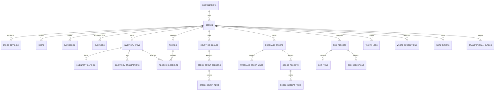

# StockPulse — PostgreSQL Database Domains, DDL & RLS Security

> **Version:** 1.0.0  
> **Database Engine:** Amazon Aurora PostgreSQL Serverless v2 (PostgreSQL 16+)  
> **Tenant Strategy:** Shared Schema with Multi-Tenant Row-Level Security (RLS)  
> **Companion Document:** [BACKEND_ARCHITECTURE.md](file:///d:/Project%20Local/fnb-mobile/docs/architecture/BACKEND_ARCHITECTURE.md)

---

## 1. Domain Data Model (Entity Relationship Diagram)



---

## 2. Production PostgreSQL DDL Schema

```sql
-- ============================================================================
-- StockPulse Production Database Schema (PostgreSQL 16+)
-- ============================================================================

CREATE EXTENSION IF NOT EXISTS "uuid-ossp";
CREATE EXTENSION IF NOT EXISTS "pgcrypto";

-- ----------------------------------------------------------------------------
-- 1. Organizations & Multi-Store Hierarchy
-- ----------------------------------------------------------------------------
CREATE TABLE organizations (
    id UUID PRIMARY KEY DEFAULT gen_random_uuid(),
    name VARCHAR(255) NOT NULL,
    tax_identifier VARCHAR(100),
    plan_tier VARCHAR(50) NOT NULL DEFAULT 'enterprise',
    created_at TIMESTAMPTZ NOT NULL DEFAULT NOW(),
    updated_at TIMESTAMPTZ NOT NULL DEFAULT NOW()
);

CREATE TABLE stores (
    id UUID PRIMARY KEY DEFAULT gen_random_uuid(),
    organization_id UUID NOT NULL REFERENCES organizations(id) ON DELETE CASCADE,
    name VARCHAR(255) NOT NULL,
    code VARCHAR(50) NOT NULL UNIQUE,
    address TEXT,
    currency VARCHAR(3) NOT NULL DEFAULT 'EUR',
    currency_symbol VARCHAR(10) NOT NULL DEFAULT '€',
    tax_rate NUMERIC(5,2) NOT NULL DEFAULT 19.00,
    timezone VARCHAR(100) NOT NULL DEFAULT 'Europe/Berlin',
    created_at TIMESTAMPTZ NOT NULL DEFAULT NOW(),
    updated_at TIMESTAMPTZ NOT NULL DEFAULT NOW()
);

CREATE TABLE store_settings (
    id UUID PRIMARY KEY DEFAULT gen_random_uuid(),
    store_id UUID UNIQUE NOT NULL REFERENCES stores(id) ON DELETE CASCADE,
    count_schedule VARCHAR(100) DEFAULT 'Daily 22:00',
    default_units VARCHAR(50) DEFAULT 'Metric (kg, L)',
    bbd_alert_days INTEGER NOT NULL DEFAULT 7,
    safety_stock_multiplier NUMERIC(3,2) NOT NULL DEFAULT 1.20,
    created_at TIMESTAMPTZ NOT NULL DEFAULT NOW(),
    updated_at TIMESTAMPTZ NOT NULL DEFAULT NOW()
);

-- ----------------------------------------------------------------------------
-- 2. Users, RBAC & Biometrics
-- ----------------------------------------------------------------------------
CREATE TABLE users (
    id UUID PRIMARY KEY DEFAULT gen_random_uuid(),
    organization_id UUID NOT NULL REFERENCES organizations(id) ON DELETE CASCADE,
    default_store_id UUID NOT NULL REFERENCES stores(id) ON DELETE CASCADE,
    email VARCHAR(255) NOT NULL UNIQUE,
    password_hash VARCHAR(255) NOT NULL,
    name VARCHAR(255) NOT NULL,
    role VARCHAR(50) NOT NULL CHECK (role IN ('superadmin', 'manager', 'supervisor', 'staff', 'auditor')),
    avatar_text VARCHAR(10) NOT NULL DEFAULT 'U',
    phone VARCHAR(50),
    biometrics_enabled BOOLEAN NOT NULL DEFAULT TRUE,
    biometrics_public_key TEXT,
    is_active BOOLEAN NOT NULL DEFAULT TRUE,
    last_active_at TIMESTAMPTZ,
    created_at TIMESTAMPTZ NOT NULL DEFAULT NOW(),
    updated_at TIMESTAMPTZ NOT NULL DEFAULT NOW()
);

CREATE TABLE user_store_assignments (
    id UUID PRIMARY KEY DEFAULT gen_random_uuid(),
    user_id UUID NOT NULL REFERENCES users(id) ON DELETE CASCADE,
    store_id UUID NOT NULL REFERENCES stores(id) ON DELETE CASCADE,
    assigned_role VARCHAR(50) NOT NULL CHECK (assigned_role IN ('manager', 'supervisor', 'staff', 'auditor')),
    created_at TIMESTAMPTZ NOT NULL DEFAULT NOW(),
    CONSTRAINT uq_user_store UNIQUE (user_id, store_id)
);

-- ----------------------------------------------------------------------------
-- 3. Categories & Suppliers
-- ----------------------------------------------------------------------------
CREATE TABLE categories (
    id UUID PRIMARY KEY DEFAULT gen_random_uuid(),
    store_id UUID NOT NULL REFERENCES stores(id) ON DELETE CASCADE,
    name VARCHAR(255) NOT NULL,
    description TEXT,
    color VARCHAR(20) DEFAULT '#3b82f6',
    display_order INTEGER NOT NULL DEFAULT 0,
    created_at TIMESTAMPTZ NOT NULL DEFAULT NOW()
);

CREATE TABLE suppliers (
    id UUID PRIMARY KEY DEFAULT gen_random_uuid(),
    store_id UUID NOT NULL REFERENCES stores(id) ON DELETE CASCADE,
    name VARCHAR(255) NOT NULL,
    contact_name VARCHAR(255),
    phone VARCHAR(50),
    email VARCHAR(255),
    lead_time_days INTEGER NOT NULL DEFAULT 1,
    last_delivery_date DATE,
    created_at TIMESTAMPTZ NOT NULL DEFAULT NOW()
);

-- ----------------------------------------------------------------------------
-- 4. Inventory Items, Batches & Append-Only Ledger
-- ----------------------------------------------------------------------------
CREATE TABLE inventory_items (
    id UUID PRIMARY KEY DEFAULT gen_random_uuid(),
    store_id UUID NOT NULL REFERENCES stores(id) ON DELETE CASCADE,
    category_id UUID REFERENCES categories(id) ON DELETE SET NULL,
    supplier_id UUID REFERENCES suppliers(id) ON DELETE SET NULL,
    name VARCHAR(255) NOT NULL,
    sku VARCHAR(100) NOT NULL,
    unit VARCHAR(20) NOT NULL CHECK (unit IN ('kg', 'g', 'L', 'ml', 'pcs', 'can', 'bottle')),
    physical_stock NUMERIC(12,3) NOT NULL DEFAULT 0.000,
    theoretical_stock NUMERIC(12,3) NOT NULL DEFAULT 0.000,
    target_stock NUMERIC(12,3) NOT NULL DEFAULT 0.000,
    safety_stock NUMERIC(12,3) NOT NULL DEFAULT 0.000,
    cost_per_unit NUMERIC(10,2) NOT NULL DEFAULT 0.00,
    status VARCHAR(20) NOT NULL DEFAULT 'healthy' CHECK (status IN ('healthy', 'low', 'critical', 'overstock')),
    version INTEGER NOT NULL DEFAULT 1,
    created_at TIMESTAMPTZ NOT NULL DEFAULT NOW(),
    updated_at TIMESTAMPTZ NOT NULL DEFAULT NOW(),
    CONSTRAINT uq_store_sku UNIQUE (store_id, sku)
);

CREATE TABLE inventory_batches (
    id UUID PRIMARY KEY DEFAULT gen_random_uuid(),
    store_id UUID NOT NULL REFERENCES stores(id) ON DELETE CASCADE,
    item_id UUID NOT NULL REFERENCES inventory_items(id) ON DELETE CASCADE,
    batch_number VARCHAR(100) NOT NULL,
    quantity NUMERIC(12,3) NOT NULL CHECK (quantity >= 0),
    initial_quantity NUMERIC(12,3) NOT NULL,
    cost_per_unit NUMERIC(10,2) NOT NULL,
    expiry_date DATE NOT NULL,
    status VARCHAR(20) NOT NULL DEFAULT 'active' CHECK (status IN ('active', 'consumed', 'wasted', 'expired')),
    received_at TIMESTAMPTZ NOT NULL DEFAULT NOW(),
    created_at TIMESTAMPTZ NOT NULL DEFAULT NOW()
);

-- Transaction Ledger Partitioned by Month
CREATE TABLE inventory_transactions (
    id UUID DEFAULT gen_random_uuid(),
    store_id UUID NOT NULL REFERENCES stores(id) ON DELETE CASCADE,
    item_id UUID NOT NULL REFERENCES inventory_items(id) ON DELETE CASCADE,
    batch_id UUID REFERENCES inventory_batches(id) ON DELETE SET NULL,
    transaction_type VARCHAR(50) NOT NULL CHECK (transaction_type IN (
        'PURCHASE_RECEIPT', 'POS_DEDUCTION', 'COUNT_ADJUSTMENT', 'WASTE_DISCARD', 'MANUAL_OVERRIDE'
    )),
    delta NUMERIC(12,3) NOT NULL,
    previous_stock NUMERIC(12,3) NOT NULL,
    new_stock NUMERIC(12,3) NOT NULL,
    cost_impact NUMERIC(10,2) NOT NULL DEFAULT 0.00,
    actor_id UUID REFERENCES users(id) ON DELETE SET NULL,
    actor_name VARCHAR(255),
    reference_id VARCHAR(100),
    note TEXT,
    created_at TIMESTAMPTZ NOT NULL DEFAULT NOW(),
    PRIMARY KEY (id, created_at)
) PARTITION BY RANGE (created_at);

-- Monthly partition examples
CREATE TABLE inventory_transactions_2026_08 PARTITION OF inventory_transactions
    FOR VALUES FROM ('2026-08-01 00:00:00+00') TO ('2026-09-01 00:00:00+00');
CREATE TABLE inventory_transactions_2026_09 PARTITION OF inventory_transactions
    FOR VALUES FROM ('2026-09-01 00:00:00+00') TO ('2026-10-01 00:00:00+00');

-- ----------------------------------------------------------------------------
-- 5. Recipes & Bill of Materials (BOM)
-- ----------------------------------------------------------------------------
CREATE TABLE recipes (
    id UUID PRIMARY KEY DEFAULT gen_random_uuid(),
    store_id UUID NOT NULL REFERENCES stores(id) ON DELETE CASCADE,
    name VARCHAR(255) NOT NULL,
    category VARCHAR(100) NOT NULL DEFAULT 'Main Course',
    portions_sold_today INTEGER NOT NULL DEFAULT 0,
    is_active BOOLEAN NOT NULL DEFAULT TRUE,
    created_at TIMESTAMPTZ NOT NULL DEFAULT NOW(),
    updated_at TIMESTAMPTZ NOT NULL DEFAULT NOW()
);

CREATE TABLE recipe_ingredients (
    id UUID PRIMARY KEY DEFAULT gen_random_uuid(),
    recipe_id UUID NOT NULL REFERENCES recipes(id) ON DELETE CASCADE,
    item_id UUID NOT NULL REFERENCES inventory_items(id) ON DELETE CASCADE,
    quantity_required NUMERIC(10,4) NOT NULL,
    unit VARCHAR(20) NOT NULL,
    created_at TIMESTAMPTZ NOT NULL DEFAULT NOW(),
    CONSTRAINT uq_recipe_ingredient UNIQUE (recipe_id, item_id)
);

-- ----------------------------------------------------------------------------
-- 6. Stock Count Sessions & Variance
-- ----------------------------------------------------------------------------
CREATE TABLE count_schedules (
    id VARCHAR(50) NOT NULL,
    store_id UUID NOT NULL REFERENCES stores(id) ON DELETE CASCADE,
    label VARCHAR(255) NOT NULL,
    sub_title TEXT,
    frequency VARCHAR(50) NOT NULL DEFAULT 'daily',
    due_date TIMESTAMPTZ,
    status VARCHAR(30) NOT NULL DEFAULT 'pending',
    created_at TIMESTAMPTZ NOT NULL DEFAULT NOW(),
    PRIMARY KEY (store_id, id)
);

CREATE TABLE stock_count_sessions (
    id UUID PRIMARY KEY DEFAULT gen_random_uuid(),
    store_id UUID NOT NULL REFERENCES stores(id) ON DELETE CASCADE,
    schedule_id VARCHAR(50),
    conducted_by UUID NOT NULL REFERENCES users(id),
    status VARCHAR(30) NOT NULL DEFAULT 'in_progress' CHECK (status IN ('in_progress', 'completed', 'approved', 'rejected')),
    total_counted INTEGER NOT NULL DEFAULT 0,
    total_variance_value NUMERIC(10,2) NOT NULL DEFAULT 0.00,
    completed_at TIMESTAMPTZ,
    approved_by UUID REFERENCES users(id),
    created_at TIMESTAMPTZ NOT NULL DEFAULT NOW()
);

CREATE TABLE stock_count_items (
    id UUID PRIMARY KEY DEFAULT gen_random_uuid(),
    session_id UUID NOT NULL REFERENCES stock_count_sessions(id) ON DELETE CASCADE,
    item_id UUID NOT NULL REFERENCES inventory_items(id) ON DELETE CASCADE,
    expected_qty NUMERIC(12,3) NOT NULL,
    counted_qty NUMERIC(12,3) NOT NULL,
    unit_cost NUMERIC(10,2) NOT NULL,
    counted_at TIMESTAMPTZ NOT NULL DEFAULT NOW()
);

-- ----------------------------------------------------------------------------
-- 7. Purchase Orders & Goods Receipts
-- ----------------------------------------------------------------------------
CREATE TABLE purchase_orders (
    id UUID PRIMARY KEY DEFAULT gen_random_uuid(),
    store_id UUID NOT NULL REFERENCES stores(id) ON DELETE CASCADE,
    supplier_id UUID NOT NULL REFERENCES suppliers(id),
    order_number VARCHAR(50) NOT NULL UNIQUE,
    order_date DATE NOT NULL,
    status VARCHAR(30) NOT NULL DEFAULT 'draft' CHECK (status IN ('draft', 'sent', 'confirmed', 'received', 'cancelled')),
    subtotal NUMERIC(10,2) NOT NULL DEFAULT 0.00,
    tax NUMERIC(10,2) NOT NULL DEFAULT 0.00,
    total NUMERIC(10,2) NOT NULL DEFAULT 0.00,
    created_by UUID REFERENCES users(id),
    created_at TIMESTAMPTZ NOT NULL DEFAULT NOW(),
    updated_at TIMESTAMPTZ NOT NULL DEFAULT NOW()
);

CREATE TABLE purchase_order_lines (
    id UUID PRIMARY KEY DEFAULT gen_random_uuid(),
    po_id UUID NOT NULL REFERENCES purchase_orders(id) ON DELETE CASCADE,
    item_id UUID NOT NULL REFERENCES inventory_items(id),
    item_name VARCHAR(255) NOT NULL,
    quantity NUMERIC(12,3) NOT NULL,
    unit VARCHAR(20) NOT NULL,
    price_per_unit NUMERIC(10,2) NOT NULL,
    total_price NUMERIC(10,2) NOT NULL DEFAULT 0.00
);

CREATE TABLE goods_receipts (
    id UUID PRIMARY KEY DEFAULT gen_random_uuid(),
    store_id UUID NOT NULL REFERENCES stores(id) ON DELETE CASCADE,
    po_id UUID REFERENCES purchase_orders(id) ON DELETE SET NULL,
    supplier_id UUID NOT NULL REFERENCES suppliers(id),
    invoice_number VARCHAR(100) NOT NULL,
    receipt_date DATE NOT NULL,
    total NUMERIC(10,2) NOT NULL DEFAULT 0.00,
    status VARCHAR(30) NOT NULL DEFAULT 'received',
    received_by UUID REFERENCES users(id),
    created_at TIMESTAMPTZ NOT NULL DEFAULT NOW()
);

CREATE TABLE goods_receipt_items (
    id UUID PRIMARY KEY DEFAULT gen_random_uuid(),
    goods_receipt_id UUID NOT NULL REFERENCES goods_receipts(id) ON DELETE CASCADE,
    item_id UUID NOT NULL REFERENCES inventory_items(id),
    quantity NUMERIC(12,3) NOT NULL,
    unit VARCHAR(20) NOT NULL,
    price_per_unit NUMERIC(10,2) NOT NULL,
    batch_number VARCHAR(100) NOT NULL,
    expiry_date DATE NOT NULL
);

-- ----------------------------------------------------------------------------
-- 8. OCR Reports & Deductions
-- ----------------------------------------------------------------------------
CREATE TABLE ocr_reports (
    id UUID PRIMARY KEY DEFAULT gen_random_uuid(),
    store_id UUID NOT NULL REFERENCES stores(id) ON DELETE CASCADE,
    report_number VARCHAR(100) NOT NULL,
    shift VARCHAR(50) NOT NULL DEFAULT 'Dinner',
    date_label VARCHAR(50) NOT NULL,
    raw_image_s3_key TEXT NOT NULL,
    status VARCHAR(30) NOT NULL DEFAULT 'review' CHECK (status IN ('processing', 'review', 'confirmed', 'rejected')),
    total_portions INTEGER NOT NULL DEFAULT 0,
    menu_item_count INTEGER NOT NULL DEFAULT 0,
    created_by UUID REFERENCES users(id),
    confirmed_by UUID REFERENCES users(id),
    confirmed_at TIMESTAMPTZ,
    created_at TIMESTAMPTZ NOT NULL DEFAULT NOW()
);

CREATE TABLE ocr_items (
    id UUID PRIMARY KEY DEFAULT gen_random_uuid(),
    report_id UUID NOT NULL REFERENCES ocr_reports(id) ON DELETE CASCADE,
    art_nr VARCHAR(100),
    item_name VARCHAR(255) NOT NULL,
    recipe_id UUID REFERENCES recipes(id) ON DELETE SET NULL,
    quantity INTEGER NOT NULL,
    confidence NUMERIC(4,3) NOT NULL,
    unit_price NUMERIC(10,2)
);

CREATE TABLE ocr_deductions (
    id UUID PRIMARY KEY DEFAULT gen_random_uuid(),
    report_id UUID NOT NULL REFERENCES ocr_reports(id) ON DELETE CASCADE,
    item_id UUID NOT NULL REFERENCES inventory_items(id),
    delta NUMERIC(12,3) NOT NULL,
    unit VARCHAR(20) NOT NULL,
    cost_eur NUMERIC(10,2) NOT NULL,
    theoretical_before NUMERIC(12,3) NOT NULL,
    theoretical_after NUMERIC(12,3) NOT NULL,
    created_at TIMESTAMPTZ NOT NULL DEFAULT NOW()
);

-- ----------------------------------------------------------------------------
-- 9. Waste Intelligence & Notifications
-- ----------------------------------------------------------------------------
CREATE TABLE waste_logs (
    id UUID PRIMARY KEY DEFAULT gen_random_uuid(),
    store_id UUID NOT NULL REFERENCES stores(id) ON DELETE CASCADE,
    item_id UUID REFERENCES inventory_items(id) ON DELETE SET NULL,
    batch_id UUID REFERENCES inventory_batches(id) ON DELETE SET NULL,
    quantity NUMERIC(12,3) NOT NULL,
    unit VARCHAR(20) NOT NULL DEFAULT 'kg',
    cost_per_unit NUMERIC(10,2) NOT NULL DEFAULT 0.00,
    total_loss NUMERIC(10,2) NOT NULL DEFAULT 0.00,
    reason VARCHAR(100) NOT NULL,
    user_id UUID REFERENCES users(id) ON DELETE SET NULL,
    created_at TIMESTAMPTZ NOT NULL DEFAULT NOW()
);

CREATE TABLE waste_suggestions (
    id UUID PRIMARY KEY DEFAULT gen_random_uuid(),
    store_id UUID NOT NULL REFERENCES stores(id) ON DELETE CASCADE,
    item_name VARCHAR(255) NOT NULL,
    qty NUMERIC(12,3) NOT NULL,
    unit VARCHAR(20) NOT NULL,
    days_remaining INTEGER NOT NULL,
    promo_name VARCHAR(255) NOT NULL,
    uses_qty NUMERIC(12,3) NOT NULL,
    uses_num INTEGER NOT NULL,
    utilization_pct INTEGER NOT NULL,
    saved_value NUMERIC(10,2) NOT NULL,
    recipe_id UUID REFERENCES recipes(id) ON DELETE SET NULL,
    description TEXT,
    status VARCHAR(30) NOT NULL DEFAULT 'pending',
    created_at TIMESTAMPTZ NOT NULL DEFAULT NOW()
);

CREATE TABLE notifications (
    id UUID PRIMARY KEY DEFAULT gen_random_uuid(),
    store_id UUID NOT NULL REFERENCES stores(id) ON DELETE CASCADE,
    user_id UUID REFERENCES users(id) ON DELETE CASCADE,
    type VARCHAR(50) NOT NULL,
    title VARCHAR(255) NOT NULL,
    message TEXT NOT NULL,
    urgency VARCHAR(20) NOT NULL DEFAULT 'normal' CHECK (urgency IN ('normal', 'critical')),
    route VARCHAR(255),
    is_read BOOLEAN NOT NULL DEFAULT FALSE,
    created_at TIMESTAMPTZ NOT NULL DEFAULT NOW()
);

-- ----------------------------------------------------------------------------
-- 10. Transactional Outbox Pattern Table
-- ----------------------------------------------------------------------------
CREATE TABLE transactional_outbox (
    id UUID PRIMARY KEY DEFAULT gen_random_uuid(),
    store_id UUID NOT NULL,
    event_type VARCHAR(100) NOT NULL,
    aggregate_type VARCHAR(100) NOT NULL,
    aggregate_id VARCHAR(100) NOT NULL,
    payload JSONB NOT NULL,
    status VARCHAR(20) NOT NULL DEFAULT 'pending' CHECK (status IN ('pending', 'published', 'failed')),
    retry_count INTEGER NOT NULL DEFAULT 0,
    created_at TIMESTAMPTZ NOT NULL DEFAULT NOW(),
    published_at TIMESTAMPTZ
);
```

---

## 3. Row-Level Security (RLS) Implementation

To ensure complete multi-tenant data isolation, RLS is enabled on all store-partitioned tables:

```sql
-- Enable RLS on core tables
ALTER TABLE inventory_items ENABLE ROW LEVEL SECURITY;
ALTER TABLE inventory_batches ENABLE ROW LEVEL SECURITY;
ALTER TABLE inventory_transactions ENABLE ROW LEVEL SECURITY;
ALTER TABLE recipes ENABLE ROW LEVEL SECURITY;
ALTER TABLE stock_count_sessions ENABLE ROW LEVEL SECURITY;
ALTER TABLE purchase_orders ENABLE ROW LEVEL SECURITY;
ALTER TABLE ocr_reports ENABLE ROW LEVEL SECURITY;
ALTER TABLE waste_logs ENABLE ROW LEVEL SECURITY;
ALTER TABLE notifications ENABLE ROW LEVEL SECURITY;

-- Helper function to read current store ID from transaction context
CREATE OR REPLACE FUNCTION current_store_id() RETURNS UUID AS $$
BEGIN
    RETURN NULLIF(current_setting('app.current_store_id', true), '')::UUID;
END;
$$ LANGUAGE plpgsql STABLE;

-- RLS Policy: Standard Store Isolation
CREATE POLICY tenant_store_isolation_inventory ON inventory_items
    FOR ALL
    USING (
        store_id = current_store_id()
        OR current_setting('app.current_user_role', true) = 'superadmin'
    );

CREATE POLICY tenant_store_isolation_batches ON inventory_batches
    FOR ALL
    USING (
        store_id = current_store_id()
        OR current_setting('app.current_user_role', true) = 'superadmin'
    );

CREATE POLICY tenant_store_isolation_orders ON purchase_orders
    FOR ALL
    USING (
        store_id = current_store_id()
        OR current_setting('app.current_user_role', true) = 'superadmin'
    );
```

---

## 4. Analytical Views & Materialized Views

```sql
-- Automated POQ (Purchase Order Quantity) Recommendations
CREATE OR REPLACE VIEW v_poq_recommendations AS
SELECT 
    i.id AS item_id,
    i.store_id,
    i.supplier_id,
    s.name AS supplier_name,
    i.name AS item_name,
    i.sku,
    i.unit,
    i.physical_stock,
    i.target_stock,
    i.safety_stock,
    i.cost_per_unit,
    GREATEST(0, ROUND((i.target_stock - i.physical_stock)::numeric, 2)) AS recommended_order_qty,
    ROUND((GREATEST(0, (i.target_stock - i.physical_stock)) * i.cost_per_unit)::numeric, 2) AS estimated_po_cost
FROM inventory_items i
LEFT JOIN suppliers s ON i.supplier_id = s.id
WHERE i.physical_stock < i.target_stock;

-- Expiring Batches Summary View
CREATE OR REPLACE VIEW v_expiring_batches_summary AS
SELECT 
    b.id AS batch_id,
    b.store_id,
    b.item_id,
    i.name AS item_name,
    i.sku,
    b.batch_number,
    b.quantity,
    i.unit,
    b.expiry_date,
    (b.expiry_date - CURRENT_DATE) AS days_until_expiry,
    CASE 
        WHEN (b.expiry_date - CURRENT_DATE) <= 1 THEN 'critical'
        WHEN (b.expiry_date - CURRENT_DATE) <= 3 THEN 'warning'
        ELSE 'notice'
    END AS urgency_level
FROM inventory_batches b
JOIN inventory_items i ON b.item_id = i.id
WHERE b.status = 'active' 
  AND b.expiry_date <= (CURRENT_DATE + INTERVAL '7 days')
ORDER BY b.expiry_date ASC;
```

---

## 5. Performance Indexing Matrix

| Table Name | Index Name | Index Type | Columns | Purpose |
|---|---|---|---|---|
| `inventory_items` | `idx_inv_items_store_status` | B-Tree | `(store_id, status)` | Fast dashboard stock health queries. |
| `inventory_items` | `idx_inv_items_sku_trgm` | GIN / Trigram | `name gin_trgm_ops` | Sub-millisecond mobile fuzzy search. |
| `inventory_batches` | `idx_batches_fe_fo` | B-Tree | `(store_id, item_id, expiry_date ASC)` | High-speed FEFO ingredient allocation. |
| `inventory_batches` | `idx_batches_expiring_active`| Partial B-Tree| `(store_id, expiry_date) WHERE status = 'active'` | Daily automated BBD alert sweeps. |
| `transactional_outbox`| `idx_outbox_pending` | Partial B-Tree| `(created_at ASC) WHERE status = 'pending'` | Ultra-low latency event publisher polling. |
| `stock_count_items`| `idx_count_items_session` | B-Tree | `(session_id, item_id)` | Session variance rollup calculations. |
