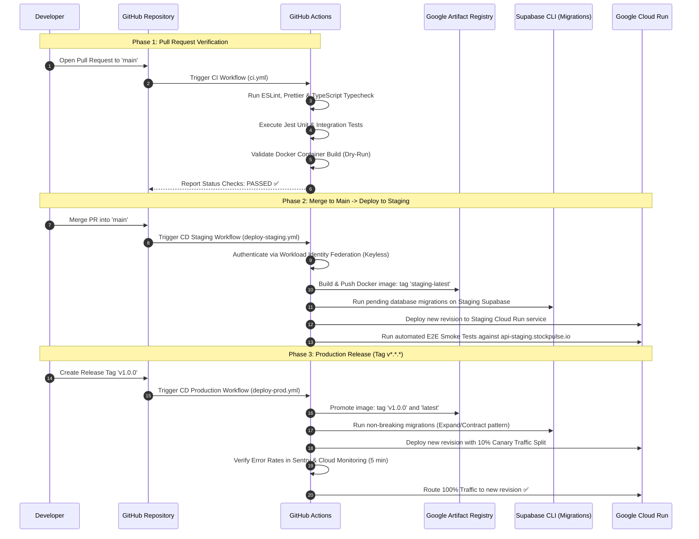
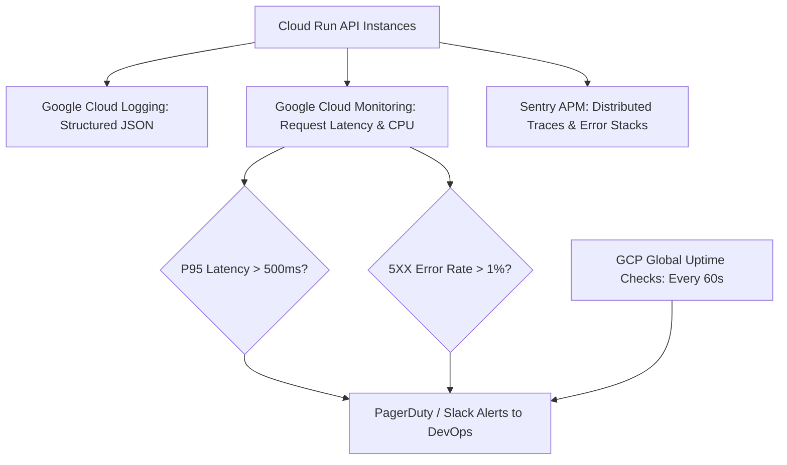
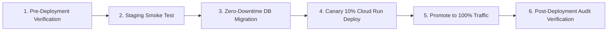

# StockPulse — Production Deployment Architecture & CI/CD Specification
### (NestJS + Supabase + Google Cloud Run + GCP Document AI)

> **Version:** 1.0.0  
> **Container Compute:** Google Cloud Run (Serverless Multi-AZ Containers)  
> **Database & Storage:** Supabase Cloud (PostgreSQL 16 + GoTrue Auth + S3 Storage)  
> **CI/CD Engine:** GitHub Actions + Google Artifact Registry + Workload Identity Federation  
> **Companion Documents:**  
> - [BACKEND_ARCHITECTURE.md](file:///d:/Project%20Local/fnb-mobile/docs/architecture/BACKEND_ARCHITECTURE.md)  
> - [NESTJS_MODULE_STRUCTURE.md](file:///d:/Project%20Local/fnb-mobile/docs/architecture/NESTJS_MODULE_STRUCTURE.md)  
> - [SUPABASE_SCHEMA.md](file:///d:/Project%20Local/fnb-mobile/docs/architecture/SUPABASE_SCHEMA.md)  

---

## 1. Deployment Architecture Topology

```mermaid
flowchart TD
    subgraph Developer_Tier [1. Source Control & CI/CD Pipeline]
        Git[Git Commit / PR] --> GHA[GitHub Actions Runner]
        GHA -->|1. Test & Build| DockerBuild[Docker Multi-Stage Build: Node 22 LTS]
        DockerBuild -->|2. Push Image| GAR[Google Artifact Registry: europe-west3-docker.pkg.dev]
    end

    subgraph Security_Identity [2. Keyless Security & Secrets]
        WIF[Workload Identity Federation: GitHub to GCP]
        GSM[Google Secret Manager: Supabase Keys, JWT Secret, Sentry DSN]
        GHA <--> WIF
        GSM -.->|Injected as Env Vars at Runtime| CloudRun_Prod & CloudRun_Staging
    end

    subgraph GCP_Staging_Project [3. Staging Environment: stockpulse-staging]
        CloudRun_Staging[Cloud Run: api-staging.stockpulse.io (Min: 0, Max: 5)]
        DocAI_Staging[Google Document AI: Staging Processor]
        Supa_Staging[(Supabase Project: stockpulse-staging)]
        
        CloudRun_Staging <--> Supa_Staging
        CloudRun_Staging <--> DocAI_Staging
    end

    subgraph GCP_Prod_Project [4. Production Environment: stockpulse-prod]
        Edge[Cloudflare Edge / Cloud Armor WAF]
        CloudRun_Prod[Cloud Run: api.stockpulse.io (Min: 2, Max: 50)]
        DocAI_Prod[Google Document AI: Production Processor]
        Supa_Prod[(Supabase Project: stockpulse-prod - Multi-AZ)]
        
        Edge --> CloudRun_Prod
        CloudRun_Prod <--> Supa_Prod
        CloudRun_Prod <--> DocAI_Prod
    end

    subgraph Monitoring_Observability [5. Monitoring & Error Tracking]
        CloudOps[Google Cloud Monitoring & Cloud Logging]
        Sentry[Sentry APM & Error Tracking]
        Uptime[GCP Uptime Checks & PagerDuty Alerts]
        
        CloudRun_Prod --> CloudOps & Sentry
        Uptime --> CloudRun_Prod
    end

    %% Deploy Flows
    GAR -->|Deploy to Staging on main merge| CloudRun_Staging
    GAR -->|Deploy to Prod on Release Tag v*.*.*| CloudRun_Prod
```

---

## 2. Environment Strategy & Isolation

| Dimension | Local Development | Staging Environment | Production Environment |
|---|---|---|---|
| **Purpose** | Rapid local feature iteration | Pre-release regression & integration testing | Live multi-store restaurant operations |
| **GCP Project** | None (Local gcloud emulator) | `stockpulse-staging` (`europe-west3`) | `stockpulse-prod` (`europe-west3`) |
| **Backend URL** | `http://localhost:3000` | `https://api-staging.stockpulse.io` | `https://api.stockpulse.io` |
| **Container Compute** | Docker Compose / `npm run start:dev` | Cloud Run (Min: 0, Max: 5 instances) | Cloud Run (Min: 2, Max: 50 instances) |
| **Database & Auth** | Supabase Local CLI (`supabase start`) | Supabase Cloud (`stockpulse-staging`) | Supabase Cloud (`stockpulse-prod` - Pro Plan) |
| **Storage Bucket** | Local Supabase Storage | `stockpulse-staging-receipts` | `stockpulse-prod-receipts` |
| **Document AI** | Mock Provider / Staging Processor | GCP Document AI (Staging Processor) | GCP Document AI (Dedicated Production Processor)|
| **Push Notifications**| Expo Go Sandbox | Expo Push (Staging Channel) | Expo Push (Production APNs / FCM v1) |

---

## 3. Automated CI/CD Workflow (GitHub Actions)



---

## 4. Keyless Secrets Management Architecture

StockPulse utilizes **Google Secret Manager** combined with **Workload Identity Federation**, eliminating long-lived service account keys from GitHub:

```mermaid
flowchart LR
    GHA[GitHub Actions Job] -->|OIDC Token exchange| WIF[GCP Workload Identity Pool]
    WIF -->|Short-Lived IAM Token| SecretManager[Google Secret Manager]
    
    subgraph Managed_Secrets [Secrets Managed in GSM]
        S1[SUPABASE_URL]
        S2[SUPABASE_SERVICE_ROLE_KEY]
        S3[SUPABASE_JWT_SECRET]
        S4[GCP_DOCAI_PROCESSOR_ID]
        S5[SENTRY_DSN]
    end
    
    SecretManager --> Managed_Secrets
    Managed_Secrets -->|Mounted as Env Variables| CloudRun[Cloud Run Container Instances]
```



---

## 5. Monitoring, Observability & Alarms



### Critical Operational SLIs & Alert Thresholds:
| Metric | Threshold | Evaluation Window | Response Action |
|---|---|---|---|
| **API Availability (Uptime)** | $< 99.9\%$ | 5 Minutes | Immediate PagerDuty incident trigger |
| **P95 Request Latency** | $> 500\text{ms}$ | 5 Minutes | Cloud Run instance scaling inspection |
| **5XX Server Error Rate** | $> 1.0\%$ of requests | 3 Minutes | Automatic traffic rollback trigger |
| **OCR Processing Error Rate** | $> 5.0\%$ of scans | 10 Minutes | Google Document AI quota & credit check |
| **Supabase Connection Pool** | $> 80\%$ utilization | 5 Minutes | Inspect long-running locks & scale pool |

---

## 6. Rollback Strategy & Zero-Downtime Migration Policy

### 6.1 Instant Cloud Run Traffic Rollback ($< 10\text{ seconds}$)
If a critical runtime issue or elevated 5XX error rate is detected in production, traffic is immediately redirected back to the last known stable revision with zero rebuild time:

```bash
# Instant one-command rollback to previous Cloud Run revision
gcloud run services update-traffic stockpulse-api \
  --to-revisions=PREVIOUS_STABLE_REVISION=100 \
  --region=europe-west3 \
  --project=stockpulse-prod
```

### 6.2 Zero-Downtime Database Migration Policy (Expand / Contract Pattern)
To ensure database migrations never break running Cloud Run revisions during deployments:
1. **Phase 1 (Expand)**: Add new columns as nullable, create new tables, add additive indexes.
2. **Phase 2 (Deploy)**: Deploy new NestJS application revision to Cloud Run.
3. **Phase 3 (Contract)**: In a subsequent release, apply `NOT NULL` constraints, drop obsolete columns, or remove deprecated tables.

---

## 7. Production Operational Deployment Checklist



### Step-by-Step Checklist:

#### 1. Pre-Deployment Checklist
- [ ] All unit, integration, and E2E test suites passing ($100\%$ green in CI).
- [ ] Database migrations reviewed for zero-downtime compatibility (no destructive `DROP` operations on active columns).
- [ ] All required secrets added to Google Secret Manager in `stockpulse-prod`.
- [ ] GCP Document AI quotas verified in `europe-west3`.

#### 2. Deployment Execution
- [ ] Trigger deployment via GitHub Release Tag (`vX.Y.Z`).
- [ ] Confirm automated database migrations apply cleanly to Supabase Production.
- [ ] Verify Cloud Run revision deploys with minimum 2 warm instances.
- [ ] Verify 10% canary traffic route produces zero 5XX errors in Sentry.

#### 3. Post-Deployment Verification
- [ ] Health check endpoint (`GET /api/v1/health`) returns `200 OK` across all regions.
- [ ] Test live Supabase Auth login from mobile client.
- [ ] Test OCR document scan with sample POS receipt.
- [ ] Confirm audit log record is created for deployment event.
- [ ] Monitor Sentry error stream and Cloud Run CPU metrics for 15 minutes.

---

## 8. Documentation Baseline

The complete deployment architecture has been saved and indexed in the documentation portal:
- 📖 **[DEPLOYMENT_ARCHITECTURE.md](file:///d:/Project%20Local/fnb-mobile/docs/architecture/DEPLOYMENT_ARCHITECTURE.md)** — Cloud Run hosting, environment isolation, CI/CD pipelines, keyless secrets, and instant rollback runbooks.
- 📖 **[BACKEND_ARCHITECTURE.md](file:///d:/Project%20Local/fnb-mobile/docs/architecture/BACKEND_ARCHITECTURE.md)** — Master Phase 1 architecture specification.
- 📖 **[docs/README.md](file:///d:/Project%20Local/fnb-mobile/docs/README.md)** — Architecture index portal.
