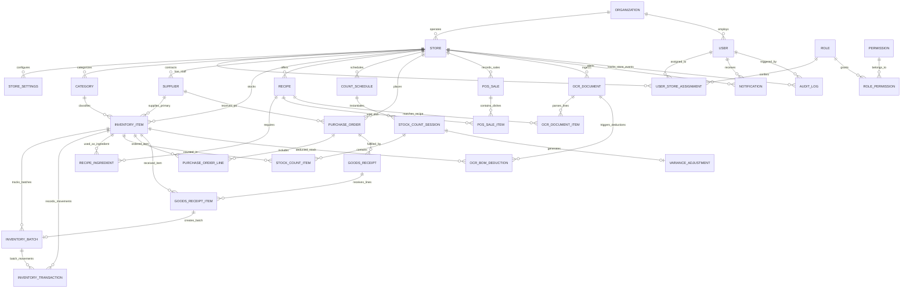

# StockPulse — Complete Domain Model Specification

> **Version:** 1.0.0  
> **Status:** Production Reference Specification  
> **Companion Documents:**  
> - [BACKEND_ARCHITECTURE.md](file:///d:/Project%20Local/fnb-mobile/docs/architecture/BACKEND_ARCHITECTURE.md)  
> - [DATABASE_DOMAINS.md](file:///d:/Project%20Local/fnb-mobile/docs/architecture/DATABASE_DOMAINS.md)  
> - [SERVICE_CATALOG.md](file:///d:/Project%20Local/fnb-mobile/docs/architecture/SERVICE_CATALOG.md)  

---

## 1. Domain Overview & Entity Map

The **StockPulse** domain model provides comprehensive data modeling for Food & Beverage multi-store inventory, recipe Bill-of-Materials (BOM), automated Purchase Order Quantity (POQ) procurement, AI OCR extraction, blind stocktaking, and tamper-proof financial audit ledgers.

### 16 Core Domains
1. **User**: Authentication credentials, biometrics, active session status.
2. **Role**: Granular RBAC definitions (`superadmin`, `manager`, `supervisor`, `staff`, `auditor`).
3. **Permission**: Atomic operation capabilities (e.g., `inventory:adjust_manual`, `procurement:approve_po`).
4. **Store**: Tenant boundaries, tax, currency, and operational schedules.
5. **Inventory**: Real-time stock balances, categories, thresholds, and valuation.
6. **InventoryItem**: Master SKU catalog, unit conversions, and storage criteria.
7. **StockCount**: Scheduled audits, multi-user blind count sessions, and item-by-item logs.
8. **Variance**: Variance delta quantification, shrinkage value, and ledger reconciliation.
9. **Supplier**: Vendor directories, lead times, payment terms, and delivery performance.
10. **PurchaseOrder**: Replenishment orders, line items, approvals, and order lifecycles.
11. **GoodsReceipt**: Physical delivery check-in, PO discrepancy verification, and batch creation.
12. **BOM (Bill of Materials)**: Recipe composition, ingredient portioning, and theoretical yields.
13. **POSSale**: Point-of-Sale shift aggregation, sold dishes, and revenue figures.
14. **OCRDocument**: Multi-modal AI receipt/invoice ingestion, fuzzy recipe mapping, and deduction previews.
15. **Notification**: Multi-channel push alerts, urgency classification, and in-app inboxes.
16. **AuditLog**: Cryptographically chained, append-only immutable event logs with state diffs.

---

## 2. Complete Entity-Relationship Diagram (Mermaid)



---

## 3. Structural Design Standards

### 3.1 Primary Keys
- **Technical Primary Key**: All entities use **UUIDv7** (time-ordered 128-bit UUIDs) as primary keys (`id UUID`). UUIDv7 guarantees high-speed B-Tree index locality, prevents index fragmentation on high-write append tables, and enables client-side ID pre-generation for offline mobile sync.

### 3.2 Business Identifiers (Human-Readable Prefixes)
Every primary business domain includes a unique, human-readable identifier formatted with a standard prefix, year-month token, and sequence counter:

| Domain Entity | Prefix Format | Example | Description |
|---|---|---|---|
| **Store** | `STR-{CODE}` | `STR-BER-01` | Unique location code |
| **Inventory Item** | `SKU-{CAT}-{NUM}` | `SKU-CHK-001` | Stock Keeping Unit |
| **Inventory Batch** | `BAT-{DATE}-{NUM}` | `BAT-20260818-001` | FEFO Batch Code |
| **Transaction** | `TXN-{YYYYMM}-{SEQ}` | `TXN-202608-000452` | Immutable movement reference |
| **Stock Count** | `SC-{YYYYMMDD}-{FREQ}`| `SC-20260818-D01` | Scheduled audit session code |
| **Variance** | `VAR-{YYYYMM}-{SEQ}` | `VAR-202608-000089` | Shrinkage reconciliation code |
| **Supplier** | `SUP-{SEQ}` | `SUP-001` | Vendor identifier |
| **Purchase Order** | `PO-{YYYYMM}-{SEQ}` | `PO-202608-0012` | Procurement order number |
| **Goods Receipt** | `GR-{YYYYMM}-{SEQ}` | `GR-202608-0008` | Physical delivery check-in |
| **Recipe** | `REC-{SEQ}` | `REC-001` | Master menu dish code |
| **POS Sale** | `POS-{YYYYMMDD}-{SHIFT}`| `POS-20260818-DIN` | Register shift sales batch |
| **OCR Document** | `OCR-{YYYYMM}-{SEQ}` | `OCR-202608-0094` | AI scanned document batch |
| **Notification** | `NTF-{YYYYMM}-{SEQ}` | `NTF-202608-000120` | Push message identifier |
| **Audit Log** | `AUD-{YYYYMM}-{SEQ}` | `AUD-202608-000001` | Forensic ledger entry ID |

---

### 3.3 Standard Audit Fields
All mutable domain entities implement the standard audit structure:
```sql
created_at    TIMESTAMPTZ NOT NULL DEFAULT NOW(),
created_by    UUID NOT NULL REFERENCES users(id),
updated_at    TIMESTAMPTZ NOT NULL DEFAULT NOW(),
updated_by    UUID REFERENCES users(id),
version       INTEGER NOT NULL DEFAULT 1  -- Optimistic Concurrency Locking
```

---

### 3.4 Soft-Delete Strategy

#### Classification of Deletability
1. **Soft-Deletable Master Entities**:
   - `User`, `Store`, `Category`, `Supplier`, `InventoryItem`, `Recipe`, `CountSchedule`, `PurchaseOrder` (in `draft` state only).
   - Columns: `deleted_at TIMESTAMPTZ NULL`, `deleted_by UUID NULL REFERENCES users(id)`.
   - **Partial Unique Indexes**: Unique constraints must use `WHERE deleted_at IS NULL` to allow recreating entities with identical SKUs or codes after deletion.

2. **Strictly Immutable / Append-Only Entities (CANNOT BE DELETED)**:
   - `InventoryTransaction`, `InventoryBatch`, `GoodsReceipt`, `StockCountSession` (once finalized), `VarianceAdjustment`, `POSSale`, `OCRBOMDeduction`, `AuditLog`.
   - Lifecycle state changes are modeled via status transitions (`status = 'discarded'` or `status = 'cancelled'`), never via `DELETE` or `deleted_at`.

---

## 4. TypeScript Domain Interfaces

```typescript
// ============================================================================
// StockPulse Domain Interfaces (TypeScript 5.x)
// ============================================================================

export type UUID = string;
export type ISODateString = string; // e.g. "2026-08-18T10:00:00.000Z"
export type DateOnlyString = string; // e.g. "2026-08-18"

export type UnitOfMeasure = 'kg' | 'g' | 'L' | 'ml' | 'pcs' | 'can' | 'bottle';
export type StockStatus = 'healthy' | 'low' | 'critical' | 'overstock';
export type UserRoleType = 'superadmin' | 'manager' | 'supervisor' | 'staff' | 'auditor';

// ----------------------------------------------------------------------------
// 1. Base Domain Entity Interfaces
// ----------------------------------------------------------------------------
export interface IBaseEntity {
  id: UUID;
  createdAt: ISODateString;
  createdBy?: UUID;
  updatedAt: ISODateString;
  updatedBy?: UUID;
  version: number;
}

export interface ISoftDeletable {
  deletedAt?: ISODateString | null;
  deletedBy?: UUID | null;
}

// ----------------------------------------------------------------------------
// 2. IAM & Multi-Store Domain
// ----------------------------------------------------------------------------
export interface IOrganization extends IBaseEntity, ISoftDeletable {
  name: string;
  taxIdentifier?: string;
  planTier: 'standard' | 'enterprise';
}

export interface IStore extends IBaseEntity, ISoftDeletable {
  organizationId: UUID;
  code: string; // e.g. "STR-BER-01"
  name: string;
  address?: string;
  currency: string; // e.g. "EUR"
  currencySymbol: string; // e.g. "€"
  taxRate: number; // e.g. 19.0
  timezone: string; // e.g. "Europe/Berlin"
  isActive: boolean;
}

export interface IStoreSettings extends IBaseEntity {
  storeId: UUID;
  countSchedule: string; // "Daily 22:00"
  defaultUnits: string; // "Metric (kg, L)"
  bbdAlertDays: number; // 7
  safetyStockMultiplier: number; // 1.2
}

export interface IUser extends IBaseEntity, ISoftDeletable {
  organizationId: UUID;
  defaultStoreId: UUID;
  email: string;
  name: string;
  role: UserRoleType;
  phone?: string;
  avatarText: string;
  biometricsEnabled: boolean;
  biometricsPublicKey?: string;
  isActive: boolean;
  lastActiveAt?: ISODateString;
}

export interface IRole {
  id: UUID;
  code: UserRoleType;
  name: string;
  description: string;
  isSystem: boolean;
}

export interface IPermission {
  id: UUID;
  code: string; // e.g. "inventory:adjust_manual"
  module: string; // e.g. "inventory"
  name: string;
  description: string;
}

// ----------------------------------------------------------------------------
// 3. Inventory & Batch Domain
// ----------------------------------------------------------------------------
export interface ICategory extends IBaseEntity, ISoftDeletable {
  storeId: UUID;
  name: string;
  description?: string;
  color: string;
  displayOrder: number;
}

export interface IInventoryItem extends IBaseEntity, ISoftDeletable {
  storeId: UUID;
  categoryId?: UUID;
  supplierId?: UUID;
  sku: string; // e.g. "SKU-CHK-001"
  name: string;
  unit: UnitOfMeasure;
  physicalStock: number;
  theoreticalStock: number;
  targetStock: number;
  safetyStock: number;
  costPerUnit: number;
  status: StockStatus;
}

export interface IInventoryBatch {
  id: UUID;
  storeId: UUID;
  itemId: UUID;
  batchNumber: string; // e.g. "BAT-20260818-001"
  quantity: number;
  initialQuantity: number;
  costPerUnit: number;
  expiryDate: DateOnlyString;
  status: 'active' | 'consumed' | 'wasted' | 'expired';
  receivedAt: ISODateString;
  createdAt: ISODateString;
}

export type InventoryTransactionType =
  | 'PURCHASE_RECEIPT'
  | 'POS_DEDUCTION'
  | 'COUNT_VARIANCE'
  | 'WASTE_DISCARD'
  | 'MANUAL_ADJUSTMENT';

export interface IInventoryTransaction {
  id: UUID;
  storeId: UUID;
  itemId: UUID;
  batchId?: UUID;
  transactionNumber: string; // e.g. "TXN-202608-000452"
  transactionType: InventoryTransactionType;
  delta: number;
  previousStock: number;
  newStock: number;
  costImpact: number;
  actorId?: UUID;
  actorName?: string;
  referenceType?: 'purchase_order' | 'ocr_report' | 'stock_count' | 'waste_log';
  referenceId?: string;
  note?: string;
  createdAt: ISODateString;
}

// ----------------------------------------------------------------------------
// 4. Recipes & Bill of Materials (BOM) Domain
// ----------------------------------------------------------------------------
export interface IRecipe extends IBaseEntity, ISoftDeletable {
  storeId: UUID;
  recipeCode: string; // e.g. "REC-001"
  name: string;
  category: string;
  portionsSoldToday: number;
  standardCost: number;
  targetMarginPct: number;
  isActive: boolean;
}

export interface IRecipeIngredient {
  id: UUID;
  recipeId: UUID;
  itemId: UUID;
  quantityRequired: number;
  unit: UnitOfMeasure;
  yieldPercentage: number;
  costContribution: number;
}

// ----------------------------------------------------------------------------
// 5. Stock Count & Variance Domain
// ----------------------------------------------------------------------------
export interface ICountSchedule extends IBaseEntity, ISoftDeletable {
  storeId: UUID;
  scheduleCode: string; // e.g. "SCH-DAILY-2200"
  label: string;
  frequency: 'daily' | 'weekly' | 'monthly';
  dueTime: string;
  targetCategoryIds?: UUID[];
}

export interface IStockCountSession extends IBaseEntity {
  storeId: UUID;
  scheduleId?: UUID;
  sessionNumber: string; // e.g. "SC-20260818-D01"
  conductedBy: UUID;
  status: 'draft' | 'in_progress' | 'completed' | 'approved' | 'rejected';
  countType: 'blind' | 'standard';
  totalItemsCounted: number;
  totalVarianceValue: number;
  completedAt?: ISODateString;
  approvedBy?: UUID;
}

export interface IStockCountItem {
  id: UUID;
  sessionId: UUID;
  itemId: UUID;
  expectedQty: number;
  countedQty: number;
  varianceQty: number;
  unitCost: number;
  varianceValue: number;
  notes?: string;
  countedBy: UUID;
  countedAt: ISODateString;
}

export interface IVarianceAdjustment {
  id: UUID;
  storeId: UUID;
  sessionId: UUID;
  adjustmentNumber: string; // e.g. "VAR-202608-000089"
  totalNetShrinkage: number;
  approvedBy: UUID;
  approvedAt: ISODateString;
  ledgerSyncedAt: ISODateString;
}

// ----------------------------------------------------------------------------
// 6. Procurement & Goods Receipt Domain
// ----------------------------------------------------------------------------
export interface ISupplier extends IBaseEntity, ISoftDeletable {
  storeId: UUID;
  supplierCode: string; // e.g. "SUP-001"
  name: string;
  contactName?: string;
  phone?: string;
  email?: string;
  leadTimeDays: number;
  paymentTerms?: string;
  lastDeliveryDate?: DateOnlyString;
}

export interface IPurchaseOrder extends IBaseEntity, ISoftDeletable {
  storeId: UUID;
  supplierId: UUID;
  orderNumber: string; // e.g. "PO-202608-0012"
  orderDate: DateOnlyString;
  expectedDeliveryDate?: DateOnlyString;
  status: 'draft' | 'sent' | 'confirmed' | 'partially_received' | 'received' | 'cancelled';
  subtotal: number;
  taxAmount: number;
  totalAmount: number;
  approvedBy?: UUID;
  approvedAt?: ISODateString;
}

export interface IPurchaseOrderLine {
  id: UUID;
  poId: UUID;
  itemId: UUID;
  quantityOrdered: number;
  quantityReceived: number;
  unit: UnitOfMeasure;
  unitPrice: number;
  totalPrice: number;
}

export interface IGoodsReceipt extends IBaseEntity {
  storeId: UUID;
  poId?: UUID;
  supplierId: UUID;
  receiptNumber: string; // e.g. "GR-202608-0008"
  invoiceNumber: string;
  receiptDate: DateOnlyString;
  totalAmount: number;
  status: 'draft' | 'verified' | 'discrepancy';
  receivedBy: UUID;
}

export interface IGoodsReceiptItem {
  id: UUID;
  goodsReceiptId: UUID;
  poLineId?: UUID;
  itemId: UUID;
  quantityReceived: number;
  unit: UnitOfMeasure;
  pricePerUnit: number;
  batchNumber: string;
  expiryDate: DateOnlyString;
  createdBatchId?: UUID;
  isAccepted: boolean;
}

// ----------------------------------------------------------------------------
// 7. POS Sales & OCR Ingestion Domain
// ----------------------------------------------------------------------------
export interface IPOSSale extends IBaseEntity {
  storeId: UUID;
  saleNumber: string; // e.g. "POS-20260818-DIN"
  shift: 'Lunch' | 'Dinner' | 'Night';
  registerId?: string;
  saleDate: DateOnlyString;
  totalGross: number;
  totalPortions: number;
  deductionStatus: 'pending' | 'deducted' | 'failed';
  deductedAt?: ISODateString;
}

export interface IPOSSaleItem {
  id: UUID;
  posSaleId: UUID;
  recipeId?: UUID;
  artNr?: string;
  dishName: string;
  quantitySold: number;
  unitPrice: number;
  totalPrice: number;
}

export interface IOCRDocument extends IBaseEntity {
  storeId: UUID;
  documentNumber: string; // e.g. "OCR-202608-0094"
  documentType: 'pos_z_report' | 'supplier_invoice';
  rawImageS3Key: string;
  mimeType: string;
  fileSizeBytes: number;
  status: 'uploaded' | 'processing' | 'review_pending' | 'confirmed' | 'rejected';
  confidenceScore: number; // 0.00 - 1.00
  totalExtractedPortions: number;
  extractedDate?: DateOnlyString;
  extractedShift?: string;
  confirmedBy?: UUID;
  confirmedAt?: ISODateString;
}

export interface IOCRDocumentItem {
  id: UUID;
  ocrDocumentId: UUID;
  lineNumber: number;
  artNr?: string;
  rawText: string;
  matchedRecipeId?: UUID;
  matchedItemId?: UUID;
  quantity: number;
  confidence: number;
  unitPrice?: number;
  isConfirmed: boolean;
}

export interface IOCRBOMDeduction {
  id: UUID;
  ocrDocumentId: UUID;
  itemId: UUID;
  deltaQuantity: number;
  unit: UnitOfMeasure;
  theoreticalBefore: number;
  theoreticalAfter: number;
  costEur: number;
  appliedAt: ISODateString;
}

// ----------------------------------------------------------------------------
// 8. Notification & Audit Log Domain
// ----------------------------------------------------------------------------
export interface INotification {
  id: UUID;
  storeId: UUID;
  userId?: UUID; // If null, broadcasts to all authorized store staff
  notificationNumber: string; // e.g. "NTF-202608-000120"
  type: 'expiring_batch' | 'safety_stock_breach' | 'critical_variance' | 'po_approval' | 'count_reminder';
  title: string;
  message: string;
  urgency: 'normal' | 'critical';
  route?: string; // Deep link route e.g. "/expiration"
  isRead: boolean;
  readAt?: ISODateString;
  createdAt: ISODateString;
}

export interface IAuditLog {
  id: UUID;
  organizationId: UUID;
  storeId: UUID;
  eventNumber: string; // e.g. "AUD-202608-000001"
  actorId?: UUID;
  actorRole?: UserRoleType;
  ipAddress?: string;
  userAgent?: string;
  eventAction: string; // e.g. "INVENTORY.MANUAL_ADJUSTMENT"
  entityType: string; // e.g. "inventory_item"
  entityId: string;
  stateBefore?: Record<string, any>;
  stateAfter?: Record<string, any>;
  stateDiff?: Record<string, any>;
  reasonCode?: string;
  prevHash: string;
  currentHash: string; // HMAC-SHA256
  createdAt: ISODateString;
}
```

---

## 5. Complete PostgreSQL Database DDL Table Definitions

```sql
-- ============================================================================
-- StockPulse Complete Production Domain DDL (PostgreSQL 16+)
-- ============================================================================

CREATE EXTENSION IF NOT EXISTS "uuid-ossp";
CREATE EXTENSION IF NOT EXISTS "pgcrypto";
CREATE EXTENSION IF NOT EXISTS "pg_trgm";

-- ----------------------------------------------------------------------------
-- 1. Organizations & Multi-Store Hierarchy
-- ----------------------------------------------------------------------------
CREATE TABLE organizations (
    id UUID PRIMARY KEY DEFAULT gen_random_uuid(),
    name VARCHAR(255) NOT NULL,
    tax_identifier VARCHAR(100),
    plan_tier VARCHAR(50) NOT NULL DEFAULT 'enterprise',
    created_at TIMESTAMPTZ NOT NULL DEFAULT NOW(),
    created_by UUID,
    updated_at TIMESTAMPTZ NOT NULL DEFAULT NOW(),
    updated_by UUID,
    version INTEGER NOT NULL DEFAULT 1,
    deleted_at TIMESTAMPTZ,
    deleted_by UUID
);

CREATE TABLE stores (
    id UUID PRIMARY KEY DEFAULT gen_random_uuid(),
    organization_id UUID NOT NULL REFERENCES organizations(id) ON DELETE CASCADE,
    code VARCHAR(50) NOT NULL,
    name VARCHAR(255) NOT NULL,
    address TEXT,
    currency VARCHAR(3) NOT NULL DEFAULT 'EUR',
    currency_symbol VARCHAR(10) NOT NULL DEFAULT '€',
    tax_rate NUMERIC(5,2) NOT NULL DEFAULT 19.00,
    timezone VARCHAR(100) NOT NULL DEFAULT 'Europe/Berlin',
    is_active BOOLEAN NOT NULL DEFAULT TRUE,
    created_at TIMESTAMPTZ NOT NULL DEFAULT NOW(),
    created_by UUID,
    updated_at TIMESTAMPTZ NOT NULL DEFAULT NOW(),
    updated_by UUID,
    version INTEGER NOT NULL DEFAULT 1,
    deleted_at TIMESTAMPTZ,
    deleted_by UUID
);
CREATE UNIQUE INDEX uq_store_code_active ON stores(code) WHERE deleted_at IS NULL;

CREATE TABLE store_settings (
    id UUID PRIMARY KEY DEFAULT gen_random_uuid(),
    store_id UUID UNIQUE NOT NULL REFERENCES stores(id) ON DELETE CASCADE,
    count_schedule VARCHAR(100) DEFAULT 'Daily 22:00',
    default_units VARCHAR(50) DEFAULT 'Metric (kg, L)',
    bbd_alert_days INTEGER NOT NULL DEFAULT 7,
    safety_stock_multiplier NUMERIC(3,2) NOT NULL DEFAULT 1.20,
    created_at TIMESTAMPTZ NOT NULL DEFAULT NOW(),
    updated_at TIMESTAMPTZ NOT NULL DEFAULT NOW(),
    version INTEGER NOT NULL DEFAULT 1
);

-- ----------------------------------------------------------------------------
-- 2. Users, RBAC & Permissions
-- ----------------------------------------------------------------------------
CREATE TABLE roles (
    id UUID PRIMARY KEY DEFAULT gen_random_uuid(),
    code VARCHAR(50) UNIQUE NOT NULL,
    name VARCHAR(100) NOT NULL,
    description TEXT,
    is_system BOOLEAN NOT NULL DEFAULT TRUE,
    created_at TIMESTAMPTZ NOT NULL DEFAULT NOW()
);

CREATE TABLE permissions (
    id UUID PRIMARY KEY DEFAULT gen_random_uuid(),
    code VARCHAR(100) UNIQUE NOT NULL,
    module VARCHAR(50) NOT NULL,
    name VARCHAR(100) NOT NULL,
    description TEXT,
    created_at TIMESTAMPTZ NOT NULL DEFAULT NOW()
);

CREATE TABLE role_permissions (
    role_id UUID NOT NULL REFERENCES roles(id) ON DELETE CASCADE,
    permission_id UUID NOT NULL REFERENCES permissions(id) ON DELETE CASCADE,
    PRIMARY KEY (role_id, permission_id)
);

CREATE TABLE users (
    id UUID PRIMARY KEY DEFAULT gen_random_uuid(),
    organization_id UUID NOT NULL REFERENCES organizations(id) ON DELETE CASCADE,
    default_store_id UUID NOT NULL REFERENCES stores(id) ON DELETE RESTRICT,
    email VARCHAR(255) NOT NULL,
    password_hash VARCHAR(255) NOT NULL,
    name VARCHAR(255) NOT NULL,
    role VARCHAR(50) NOT NULL REFERENCES roles(code),
    avatar_text VARCHAR(10) NOT NULL DEFAULT 'U',
    phone VARCHAR(50),
    biometrics_enabled BOOLEAN NOT NULL DEFAULT TRUE,
    biometrics_public_key TEXT,
    is_active BOOLEAN NOT NULL DEFAULT TRUE,
    last_active_at TIMESTAMPTZ,
    created_at TIMESTAMPTZ NOT NULL DEFAULT NOW(),
    created_by UUID,
    updated_at TIMESTAMPTZ NOT NULL DEFAULT NOW(),
    updated_by UUID,
    version INTEGER NOT NULL DEFAULT 1,
    deleted_at TIMESTAMPTZ,
    deleted_by UUID
);
CREATE UNIQUE INDEX uq_user_email_active ON users(email) WHERE deleted_at IS NULL;

CREATE TABLE user_store_assignments (
    id UUID PRIMARY KEY DEFAULT gen_random_uuid(),
    user_id UUID NOT NULL REFERENCES users(id) ON DELETE CASCADE,
    store_id UUID NOT NULL REFERENCES stores(id) ON DELETE CASCADE,
    role_code VARCHAR(50) NOT NULL REFERENCES roles(code),
    created_at TIMESTAMPTZ NOT NULL DEFAULT NOW(),
    CONSTRAINT uq_user_store_assignment UNIQUE (user_id, store_id)
);

-- ----------------------------------------------------------------------------
-- 3. Categories, Suppliers & Inventory Items
-- ----------------------------------------------------------------------------
CREATE TABLE categories (
    id UUID PRIMARY KEY DEFAULT gen_random_uuid(),
    store_id UUID NOT NULL REFERENCES stores(id) ON DELETE CASCADE,
    name VARCHAR(255) NOT NULL,
    description TEXT,
    color VARCHAR(20) DEFAULT '#3b82f6',
    display_order INTEGER NOT NULL DEFAULT 0,
    created_at TIMESTAMPTZ NOT NULL DEFAULT NOW(),
    created_by UUID REFERENCES users(id),
    updated_at TIMESTAMPTZ NOT NULL DEFAULT NOW(),
    updated_by UUID REFERENCES users(id),
    version INTEGER NOT NULL DEFAULT 1,
    deleted_at TIMESTAMPTZ,
    deleted_by UUID
);
CREATE UNIQUE INDEX uq_category_store_name ON categories(store_id, name) WHERE deleted_at IS NULL;

CREATE TABLE suppliers (
    id UUID PRIMARY KEY DEFAULT gen_random_uuid(),
    store_id UUID NOT NULL REFERENCES stores(id) ON DELETE CASCADE,
    supplier_code VARCHAR(50) NOT NULL,
    name VARCHAR(255) NOT NULL,
    contact_name VARCHAR(255),
    phone VARCHAR(50),
    email VARCHAR(255),
    lead_time_days INTEGER NOT NULL DEFAULT 1,
    payment_terms VARCHAR(100),
    last_delivery_date DATE,
    created_at TIMESTAMPTZ NOT NULL DEFAULT NOW(),
    created_by UUID REFERENCES users(id),
    updated_at TIMESTAMPTZ NOT NULL DEFAULT NOW(),
    updated_by UUID REFERENCES users(id),
    version INTEGER NOT NULL DEFAULT 1,
    deleted_at TIMESTAMPTZ,
    deleted_by UUID
);
CREATE UNIQUE INDEX uq_supplier_code ON suppliers(store_id, supplier_code) WHERE deleted_at IS NULL;

CREATE TABLE inventory_items (
    id UUID PRIMARY KEY DEFAULT gen_random_uuid(),
    store_id UUID NOT NULL REFERENCES stores(id) ON DELETE CASCADE,
    category_id UUID REFERENCES categories(id) ON DELETE SET NULL,
    supplier_id UUID REFERENCES suppliers(id) ON DELETE SET NULL,
    sku VARCHAR(100) NOT NULL,
    name VARCHAR(255) NOT NULL,
    unit VARCHAR(20) NOT NULL CHECK (unit IN ('kg', 'g', 'L', 'ml', 'pcs', 'can', 'bottle')),
    physical_stock NUMERIC(12,3) NOT NULL DEFAULT 0.000,
    theoretical_stock NUMERIC(12,3) NOT NULL DEFAULT 0.000,
    target_stock NUMERIC(12,3) NOT NULL DEFAULT 0.000,
    safety_stock NUMERIC(12,3) NOT NULL DEFAULT 0.000,
    cost_per_unit NUMERIC(10,2) NOT NULL DEFAULT 0.00,
    status VARCHAR(20) NOT NULL DEFAULT 'healthy' CHECK (status IN ('healthy', 'low', 'critical', 'overstock')),
    created_at TIMESTAMPTZ NOT NULL DEFAULT NOW(),
    created_by UUID REFERENCES users(id),
    updated_at TIMESTAMPTZ NOT NULL DEFAULT NOW(),
    updated_by UUID REFERENCES users(id),
    version INTEGER NOT NULL DEFAULT 1,
    deleted_at TIMESTAMPTZ,
    deleted_by UUID
);
CREATE UNIQUE INDEX uq_inventory_sku_active ON inventory_items(store_id, sku) WHERE deleted_at IS NULL;
CREATE INDEX idx_inv_items_name_trgm ON inventory_items USING GIN (name gin_trgm_ops);

-- ----------------------------------------------------------------------------
-- 4. Batches & Append-Only Transaction Ledger
-- ----------------------------------------------------------------------------
CREATE TABLE inventory_batches (
    id UUID PRIMARY KEY DEFAULT gen_random_uuid(),
    store_id UUID NOT NULL REFERENCES stores(id) ON DELETE CASCADE,
    item_id UUID NOT NULL REFERENCES inventory_items(id) ON DELETE CASCADE,
    batch_number VARCHAR(100) NOT NULL,
    quantity NUMERIC(12,3) NOT NULL CHECK (quantity >= 0),
    initial_quantity NUMERIC(12,3) NOT NULL,
    cost_per_unit NUMERIC(10,2) NOT NULL,
    expiry_date DATE NOT NULL,
    status VARCHAR(20) NOT NULL DEFAULT 'active' CHECK (status IN ('active', 'consumed', 'wasted', 'expired')),
    received_at TIMESTAMPTZ NOT NULL DEFAULT NOW(),
    created_at TIMESTAMPTZ NOT NULL DEFAULT NOW()
);
CREATE INDEX idx_batches_fefo ON inventory_batches(store_id, item_id, expiry_date ASC) WHERE status = 'active';

CREATE TABLE inventory_transactions (
    id UUID DEFAULT gen_random_uuid(),
    store_id UUID NOT NULL REFERENCES stores(id) ON DELETE CASCADE,
    item_id UUID NOT NULL REFERENCES inventory_items(id) ON DELETE CASCADE,
    batch_id UUID REFERENCES inventory_batches(id) ON DELETE SET NULL,
    transaction_number VARCHAR(100) NOT NULL,
    transaction_type VARCHAR(50) NOT NULL CHECK (transaction_type IN (
        'PURCHASE_RECEIPT', 'POS_DEDUCTION', 'COUNT_VARIANCE', 'WASTE_DISCARD', 'MANUAL_ADJUSTMENT'
    )),
    delta NUMERIC(12,3) NOT NULL,
    previous_stock NUMERIC(12,3) NOT NULL,
    new_stock NUMERIC(12,3) NOT NULL,
    cost_impact NUMERIC(10,2) NOT NULL DEFAULT 0.00,
    actor_id UUID REFERENCES users(id) ON DELETE SET NULL,
    actor_name VARCHAR(255),
    reference_type VARCHAR(50),
    reference_id VARCHAR(100),
    note TEXT,
    created_at TIMESTAMPTZ NOT NULL DEFAULT NOW(),
    PRIMARY KEY (id, created_at)
) PARTITION BY RANGE (created_at);

-- Partition range examples
CREATE TABLE inventory_transactions_2026_08 PARTITION OF inventory_transactions
    FOR VALUES FROM ('2026-08-01 00:00:00+00') TO ('2026-09-01 00:00:00+00');
CREATE TABLE inventory_transactions_2026_09 PARTITION OF inventory_transactions
    FOR VALUES FROM ('2026-09-01 00:00:00+00') TO ('2026-10-01 00:00:00+00');

-- ----------------------------------------------------------------------------
-- 5. Recipes & Bill of Materials (BOM)
-- ----------------------------------------------------------------------------
CREATE TABLE recipes (
    id UUID PRIMARY KEY DEFAULT gen_random_uuid(),
    store_id UUID NOT NULL REFERENCES stores(id) ON DELETE CASCADE,
    recipe_code VARCHAR(50) NOT NULL,
    name VARCHAR(255) NOT NULL,
    category VARCHAR(100) NOT NULL DEFAULT 'Main Course',
    portions_sold_today INTEGER NOT NULL DEFAULT 0,
    standard_cost NUMERIC(10,2) NOT NULL DEFAULT 0.00,
    target_margin_pct NUMERIC(5,2) NOT NULL DEFAULT 70.00,
    is_active BOOLEAN NOT NULL DEFAULT TRUE,
    created_at TIMESTAMPTZ NOT NULL DEFAULT NOW(),
    created_by UUID REFERENCES users(id),
    updated_at TIMESTAMPTZ NOT NULL DEFAULT NOW(),
    updated_by UUID REFERENCES users(id),
    version INTEGER NOT NULL DEFAULT 1,
    deleted_at TIMESTAMPTZ,
    deleted_by UUID
);
CREATE UNIQUE INDEX uq_recipe_code_active ON recipes(store_id, recipe_code) WHERE deleted_at IS NULL;

CREATE TABLE recipe_ingredients (
    id UUID PRIMARY KEY DEFAULT gen_random_uuid(),
    recipe_id UUID NOT NULL REFERENCES recipes(id) ON DELETE CASCADE,
    item_id UUID NOT NULL REFERENCES inventory_items(id) ON DELETE RESTRICT,
    quantity_required NUMERIC(10,4) NOT NULL CHECK (quantity_required > 0),
    unit VARCHAR(20) NOT NULL,
    yield_percentage NUMERIC(5,2) NOT NULL DEFAULT 100.00,
    cost_contribution NUMERIC(10,2) NOT NULL DEFAULT 0.00,
    created_at TIMESTAMPTZ NOT NULL DEFAULT NOW(),
    CONSTRAINT uq_recipe_ingredient UNIQUE (recipe_id, item_id)
);

-- ----------------------------------------------------------------------------
-- 6. Stock Count Sessions & Variance Adjustments
-- ----------------------------------------------------------------------------
CREATE TABLE count_schedules (
    id UUID PRIMARY KEY DEFAULT gen_random_uuid(),
    store_id UUID NOT NULL REFERENCES stores(id) ON DELETE CASCADE,
    schedule_code VARCHAR(50) NOT NULL,
    label VARCHAR(255) NOT NULL,
    frequency VARCHAR(50) NOT NULL DEFAULT 'daily' CHECK (frequency IN ('daily', 'weekly', 'monthly')),
    due_time VARCHAR(20) NOT NULL DEFAULT '22:00',
    created_at TIMESTAMPTZ NOT NULL DEFAULT NOW(),
    created_by UUID REFERENCES users(id),
    updated_at TIMESTAMPTZ NOT NULL DEFAULT NOW(),
    updated_by UUID REFERENCES users(id),
    version INTEGER NOT NULL DEFAULT 1,
    deleted_at TIMESTAMPTZ,
    deleted_by UUID
);

CREATE TABLE stock_count_sessions (
    id UUID PRIMARY KEY DEFAULT gen_random_uuid(),
    store_id UUID NOT NULL REFERENCES stores(id) ON DELETE CASCADE,
    schedule_id UUID REFERENCES count_schedules(id) ON DELETE SET NULL,
    session_number VARCHAR(50) NOT NULL UNIQUE,
    conducted_by UUID NOT NULL REFERENCES users(id),
    status VARCHAR(30) NOT NULL DEFAULT 'in_progress' CHECK (status IN ('draft', 'in_progress', 'completed', 'approved', 'rejected')),
    count_type VARCHAR(20) NOT NULL DEFAULT 'blind' CHECK (count_type IN ('blind', 'standard')),
    total_items_counted INTEGER NOT NULL DEFAULT 0,
    total_variance_value NUMERIC(10,2) NOT NULL DEFAULT 0.00,
    completed_at TIMESTAMPTZ,
    approved_by UUID REFERENCES users(id),
    created_at TIMESTAMPTZ NOT NULL DEFAULT NOW(),
    created_by UUID REFERENCES users(id),
    updated_at TIMESTAMPTZ NOT NULL DEFAULT NOW(),
    updated_by UUID REFERENCES users(id),
    version INTEGER NOT NULL DEFAULT 1
);

CREATE TABLE stock_count_items (
    id UUID PRIMARY KEY DEFAULT gen_random_uuid(),
    session_id UUID NOT NULL REFERENCES stock_count_sessions(id) ON DELETE CASCADE,
    item_id UUID NOT NULL REFERENCES inventory_items(id) ON DELETE RESTRICT,
    expected_qty NUMERIC(12,3) NOT NULL,
    counted_qty NUMERIC(12,3) NOT NULL,
    variance_qty NUMERIC(12,3) GENERATED ALWAYS AS (counted_qty - expected_qty) STORED,
    unit_cost NUMERIC(10,2) NOT NULL,
    variance_value NUMERIC(10,2) GENERATED ALWAYS AS ((counted_qty - expected_qty) * unit_cost) STORED,
    notes TEXT,
    counted_by UUID NOT NULL REFERENCES users(id),
    counted_at TIMESTAMPTZ NOT NULL DEFAULT NOW(),
    CONSTRAINT uq_session_item UNIQUE (session_id, item_id)
);

CREATE TABLE variance_adjustments (
    id UUID PRIMARY KEY DEFAULT gen_random_uuid(),
    store_id UUID NOT NULL REFERENCES stores(id) ON DELETE CASCADE,
    session_id UUID UNIQUE NOT NULL REFERENCES stock_count_sessions(id) ON DELETE CASCADE,
    adjustment_number VARCHAR(50) NOT NULL UNIQUE,
    total_net_shrinkage NUMERIC(10,2) NOT NULL,
    approved_by UUID NOT NULL REFERENCES users(id),
    approved_at TIMESTAMPTZ NOT NULL DEFAULT NOW(),
    ledger_synced_at TIMESTAMPTZ NOT NULL DEFAULT NOW()
);

-- ----------------------------------------------------------------------------
-- 7. Purchase Orders & Goods Receipts
-- ----------------------------------------------------------------------------
CREATE TABLE purchase_orders (
    id UUID PRIMARY KEY DEFAULT gen_random_uuid(),
    store_id UUID NOT NULL REFERENCES stores(id) ON DELETE CASCADE,
    supplier_id UUID NOT NULL REFERENCES suppliers(id) ON DELETE RESTRICT,
    order_number VARCHAR(50) NOT NULL UNIQUE,
    order_date DATE NOT NULL,
    expected_delivery_date DATE,
    status VARCHAR(30) NOT NULL DEFAULT 'draft' CHECK (status IN ('draft', 'sent', 'confirmed', 'partially_received', 'received', 'cancelled')),
    subtotal NUMERIC(10,2) NOT NULL DEFAULT 0.00,
    tax_amount NUMERIC(10,2) NOT NULL DEFAULT 0.00,
    total_amount NUMERIC(10,2) NOT NULL DEFAULT 0.00,
    approved_by UUID REFERENCES users(id),
    approved_at TIMESTAMPTZ,
    created_at TIMESTAMPTZ NOT NULL DEFAULT NOW(),
    created_by UUID REFERENCES users(id),
    updated_at TIMESTAMPTZ NOT NULL DEFAULT NOW(),
    updated_by UUID REFERENCES users(id),
    version INTEGER NOT NULL DEFAULT 1,
    deleted_at TIMESTAMPTZ,
    deleted_by UUID
);

CREATE TABLE purchase_order_lines (
    id UUID PRIMARY KEY DEFAULT gen_random_uuid(),
    po_id UUID NOT NULL REFERENCES purchase_orders(id) ON DELETE CASCADE,
    item_id UUID NOT NULL REFERENCES inventory_items(id) ON DELETE RESTRICT,
    quantity_ordered NUMERIC(12,3) NOT NULL CHECK (quantity_ordered > 0),
    quantity_received NUMERIC(12,3) NOT NULL DEFAULT 0.000,
    unit VARCHAR(20) NOT NULL,
    unit_price NUMERIC(10,2) NOT NULL,
    total_price NUMERIC(10,2) NOT NULL DEFAULT 0.00,
    CONSTRAINT uq_po_item UNIQUE (po_id, item_id)
);

CREATE TABLE goods_receipts (
    id UUID PRIMARY KEY DEFAULT gen_random_uuid(),
    store_id UUID NOT NULL REFERENCES stores(id) ON DELETE CASCADE,
    po_id UUID REFERENCES purchase_orders(id) ON DELETE SET NULL,
    supplier_id UUID NOT NULL REFERENCES suppliers(id) ON DELETE RESTRICT,
    receipt_number VARCHAR(50) NOT NULL UNIQUE,
    invoice_number VARCHAR(100) NOT NULL,
    receipt_date DATE NOT NULL,
    total_amount NUMERIC(10,2) NOT NULL DEFAULT 0.00,
    status VARCHAR(30) NOT NULL DEFAULT 'verified' CHECK (status IN ('draft', 'verified', 'discrepancy')),
    received_by UUID NOT NULL REFERENCES users(id),
    created_at TIMESTAMPTZ NOT NULL DEFAULT NOW(),
    created_by UUID REFERENCES users(id),
    updated_at TIMESTAMPTZ NOT NULL DEFAULT NOW(),
    updated_by UUID REFERENCES users(id),
    version INTEGER NOT NULL DEFAULT 1
);

CREATE TABLE goods_receipt_items (
    id UUID PRIMARY KEY DEFAULT gen_random_uuid(),
    goods_receipt_id UUID NOT NULL REFERENCES goods_receipts(id) ON DELETE CASCADE,
    po_line_id UUID REFERENCES purchase_order_lines(id) ON DELETE SET NULL,
    item_id UUID NOT NULL REFERENCES inventory_items(id) ON DELETE RESTRICT,
    quantity_received NUMERIC(12,3) NOT NULL CHECK (quantity_received >= 0),
    unit VARCHAR(20) NOT NULL,
    price_per_unit NUMERIC(10,2) NOT NULL,
    batch_number VARCHAR(100) NOT NULL,
    expiry_date DATE NOT NULL,
    created_batch_id UUID REFERENCES inventory_batches(id),
    is_accepted BOOLEAN NOT NULL DEFAULT TRUE
);

-- ----------------------------------------------------------------------------
-- 8. POS Sales & OCR Multi-Modal Documents
-- ----------------------------------------------------------------------------
CREATE TABLE pos_sales (
    id UUID PRIMARY KEY DEFAULT gen_random_uuid(),
    store_id UUID NOT NULL REFERENCES stores(id) ON DELETE CASCADE,
    sale_number VARCHAR(50) NOT NULL UNIQUE,
    shift VARCHAR(50) NOT NULL DEFAULT 'Dinner',
    register_id VARCHAR(50),
    sale_date DATE NOT NULL,
    total_gross NUMERIC(10,2) NOT NULL DEFAULT 0.00,
    total_portions INTEGER NOT NULL DEFAULT 0,
    deduction_status VARCHAR(30) NOT NULL DEFAULT 'pending' CHECK (deduction_status IN ('pending', 'deducted', 'failed')),
    deducted_at TIMESTAMPTZ,
    created_at TIMESTAMPTZ NOT NULL DEFAULT NOW(),
    created_by UUID REFERENCES users(id),
    updated_at TIMESTAMPTZ NOT NULL DEFAULT NOW(),
    updated_by UUID REFERENCES users(id),
    version INTEGER NOT NULL DEFAULT 1
);

CREATE TABLE pos_sale_items (
    id UUID PRIMARY KEY DEFAULT gen_random_uuid(),
    pos_sale_id UUID NOT NULL REFERENCES pos_sales(id) ON DELETE CASCADE,
    recipe_id UUID REFERENCES recipes(id) ON DELETE SET NULL,
    art_nr VARCHAR(100),
    dish_name VARCHAR(255) NOT NULL,
    quantity_sold INTEGER NOT NULL CHECK (quantity_sold > 0),
    unit_price NUMERIC(10,2) NOT NULL,
    total_price NUMERIC(10,2) NOT NULL
);

CREATE TABLE ocr_documents (
    id UUID PRIMARY KEY DEFAULT gen_random_uuid(),
    store_id UUID NOT NULL REFERENCES stores(id) ON DELETE CASCADE,
    document_number VARCHAR(50) NOT NULL UNIQUE,
    document_type VARCHAR(50) NOT NULL DEFAULT 'pos_z_report' CHECK (document_type IN ('pos_z_report', 'supplier_invoice')),
    raw_image_s3_key TEXT NOT NULL,
    mime_type VARCHAR(100) NOT NULL DEFAULT 'image/jpeg',
    file_size_bytes INTEGER NOT NULL,
    status VARCHAR(30) NOT NULL DEFAULT 'uploaded' CHECK (status IN ('uploaded', 'processing', 'review_pending', 'confirmed', 'rejected')),
    confidence_score NUMERIC(4,3) NOT NULL DEFAULT 0.000,
    total_extracted_portions INTEGER NOT NULL DEFAULT 0,
    extracted_date DATE,
    extracted_shift VARCHAR(50),
    confirmed_by UUID REFERENCES users(id),
    confirmed_at TIMESTAMPTZ,
    created_at TIMESTAMPTZ NOT NULL DEFAULT NOW(),
    created_by UUID REFERENCES users(id),
    updated_at TIMESTAMPTZ NOT NULL DEFAULT NOW(),
    updated_by UUID REFERENCES users(id),
    version INTEGER NOT NULL DEFAULT 1
);

CREATE TABLE ocr_document_items (
    id UUID PRIMARY KEY DEFAULT gen_random_uuid(),
    ocr_document_id UUID NOT NULL REFERENCES ocr_documents(id) ON DELETE CASCADE,
    line_number INTEGER NOT NULL,
    art_nr VARCHAR(100),
    raw_text VARCHAR(255) NOT NULL,
    matched_recipe_id UUID REFERENCES recipes(id) ON DELETE SET NULL,
    matched_item_id UUID REFERENCES inventory_items(id) ON DELETE SET NULL,
    quantity INTEGER NOT NULL CHECK (quantity >= 0),
    confidence NUMERIC(4,3) NOT NULL,
    unit_price NUMERIC(10,2),
    is_confirmed BOOLEAN NOT NULL DEFAULT FALSE
);

CREATE TABLE ocr_bom_deductions (
    id UUID PRIMARY KEY DEFAULT gen_random_uuid(),
    ocr_document_id UUID NOT NULL REFERENCES ocr_documents(id) ON DELETE CASCADE,
    item_id UUID NOT NULL REFERENCES inventory_items(id) ON DELETE RESTRICT,
    delta_quantity NUMERIC(12,3) NOT NULL,
    unit VARCHAR(20) NOT NULL,
    theoretical_before NUMERIC(12,3) NOT NULL,
    theoretical_after NUMERIC(12,3) NOT NULL,
    cost_eur NUMERIC(10,2) NOT NULL,
    applied_at TIMESTAMPTZ NOT NULL DEFAULT NOW()
);

-- ----------------------------------------------------------------------------
-- 9. Notifications & Immutable Audit Logs
-- ----------------------------------------------------------------------------
CREATE TABLE notifications (
    id UUID PRIMARY KEY DEFAULT gen_random_uuid(),
    store_id UUID NOT NULL REFERENCES stores(id) ON DELETE CASCADE,
    user_id UUID REFERENCES users(id) ON DELETE CASCADE,
    notification_number VARCHAR(50) NOT NULL UNIQUE,
    type VARCHAR(50) NOT NULL,
    title VARCHAR(255) NOT NULL,
    message TEXT NOT NULL,
    urgency VARCHAR(20) NOT NULL DEFAULT 'normal' CHECK (urgency IN ('normal', 'critical')),
    route VARCHAR(255),
    is_read BOOLEAN NOT NULL DEFAULT FALSE,
    read_at TIMESTAMPTZ,
    created_at TIMESTAMPTZ NOT NULL DEFAULT NOW()
);
CREATE INDEX idx_notif_user_unread ON notifications(user_id, is_read) WHERE is_read = FALSE;

CREATE TABLE audit_logs (
    id UUID DEFAULT gen_random_uuid(),
    organization_id UUID NOT NULL REFERENCES organizations(id) ON DELETE CASCADE,
    store_id UUID NOT NULL REFERENCES stores(id) ON DELETE CASCADE,
    event_number VARCHAR(50) NOT NULL,
    actor_id UUID REFERENCES users(id) ON DELETE SET NULL,
    actor_role VARCHAR(50),
    ip_address INET,
    user_agent TEXT,
    event_action VARCHAR(100) NOT NULL,
    entity_type VARCHAR(100) NOT NULL,
    entity_id VARCHAR(100) NOT NULL,
    state_before JSONB,
    state_after JSONB,
    state_diff JSONB,
    reason_code VARCHAR(100),
    prev_hash VARCHAR(64) NOT NULL,
    current_hash VARCHAR(64) NOT NULL,
    created_at TIMESTAMPTZ NOT NULL DEFAULT NOW(),
    PRIMARY KEY (id, created_at)
) PARTITION BY RANGE (created_at);

-- Audit monthly partition examples
CREATE TABLE audit_logs_2026_08 PARTITION OF audit_logs
    FOR VALUES FROM ('2026-08-01 00:00:00+00') TO ('2026-09-01 00:00:00+00');
CREATE TABLE audit_logs_2026_09 PARTITION OF audit_logs
    FOR VALUES FROM ('2026-09-01 00:00:00+00') TO ('2026-10-01 00:00:00+00');
```

---

## 6. Summary of Entity Relationships & Foreign Key Matrix

| Domain Entity | Primary Key | Foreign Key References | Cascade Rules | Soft Delete |
|---|---|---|---|:---:|
| `organizations` | `id (UUIDv7)` | None | — | ✅ |
| `stores` | `id (UUIDv7)` | `organization_id` $\rightarrow$ `organizations.id` | `ON DELETE CASCADE` | ✅ |
| `users` | `id (UUIDv7)` | `organization_id`, `default_store_id`, `role` | `ON DELETE RESTRICT` | ✅ |
| `categories` | `id (UUIDv7)` | `store_id` $\rightarrow$ `stores.id` | `ON DELETE CASCADE` | ✅ |
| `suppliers` | `id (UUIDv7)` | `store_id` $\rightarrow$ `stores.id` | `ON DELETE CASCADE` | ✅ |
| `inventory_items` | `id (UUIDv7)` | `store_id`, `category_id`, `supplier_id` | `ON DELETE SET NULL` | ✅ |
| `inventory_batches`| `id (UUIDv7)` | `store_id`, `item_id` | `ON DELETE CASCADE` | ❌ (Immutable) |
| `inventory_transactions`| `id (UUIDv7)`| `store_id`, `item_id`, `batch_id`, `actor_id`| `ON DELETE CASCADE` | ❌ (Immutable) |
| `recipes` | `id (UUIDv7)` | `store_id` $\rightarrow$ `stores.id` | `ON DELETE CASCADE` | ✅ |
| `recipe_ingredients`| `id (UUIDv7)`| `recipe_id`, `item_id` | `CASCADE / RESTRICT` | ❌ |
| `count_schedules` | `id (UUIDv7)` | `store_id` $\rightarrow$ `stores.id` | `ON DELETE CASCADE` | ✅ |
| `stock_count_sessions`| `id (UUIDv7)`| `store_id`, `schedule_id`, `conducted_by` | `CASCADE / SET NULL` | ❌ (Status based)|
| `stock_count_items` | `id (UUIDv7)` | `session_id`, `item_id`, `counted_by` | `CASCADE / RESTRICT` | ❌ |
| `variance_adjustments`| `id (UUIDv7)`| `store_id`, `session_id`, `approved_by` | `ON DELETE CASCADE` | ❌ (Immutable) |
| `purchase_orders` | `id (UUIDv7)` | `store_id`, `supplier_id`, `approved_by` | `CASCADE / RESTRICT` | ✅ (`draft` only) |
| `purchase_order_lines`| `id (UUIDv7)`| `po_id`, `item_id` | `CASCADE / RESTRICT` | ❌ |
| `goods_receipts` | `id (UUIDv7)` | `store_id`, `po_id`, `supplier_id`, `received_by`| `CASCADE / SET NULL` | ❌ (Immutable) |
| `goods_receipt_items`| `id (UUIDv7)`| `goods_receipt_id`, `po_line_id`, `item_id` | `CASCADE / RESTRICT` | ❌ |
| `pos_sales` | `id (UUIDv7)` | `store_id` $\rightarrow$ `stores.id` | `ON DELETE CASCADE` | ❌ (Immutable) |
| `pos_sale_items` | `id (UUIDv7)` | `pos_sale_id`, `recipe_id` | `CASCADE / SET NULL` | ❌ |
| `ocr_documents` | `id (UUIDv7)` | `store_id`, `confirmed_by` | `CASCADE / SET NULL` | ❌ (Status based)|
| `ocr_document_items`| `id (UUIDv7)`| `ocr_document_id`, `matched_recipe_id` | `CASCADE / SET NULL` | ❌ |
| `ocr_bom_deductions`| `id (UUIDv7)`| `ocr_document_id`, `item_id` | `CASCADE / RESTRICT` | ❌ (Immutable) |
| `notifications` | `id (UUIDv7)` | `store_id`, `user_id` | `ON DELETE CASCADE` | ❌ |
| `audit_logs` | `id (UUIDv7)` | `organization_id`, `store_id`, `actor_id` | `CASCADE / SET NULL` | ❌ (WORM Ledger) |
