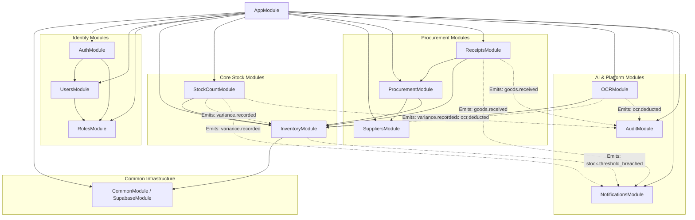
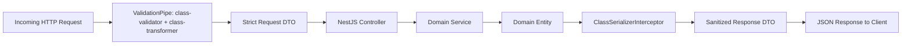
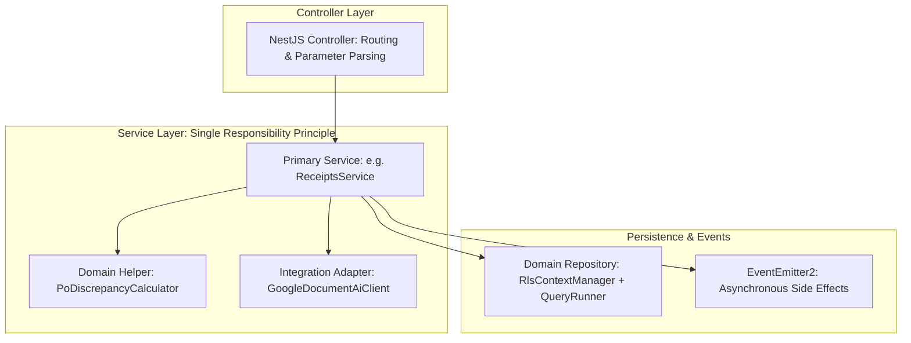
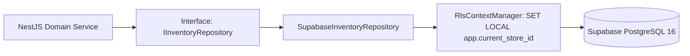

# StockPulse — NestJS Modular Backend Architecture

> **Version:** 1.0.0  
> **Framework:** NestJS 10.x / 11.x (TypeScript)  
> **Database & Auth:** Supabase PostgreSQL 16 & Supabase Auth  
> **AI / OCR:** Google Cloud Document AI  
> **Companion Documents:**  
> - [BACKEND_ARCHITECTURE.md](file:///d:/Project%20Local/fnb-mobile/docs/architecture/BACKEND_ARCHITECTURE.md)  
> - [DOMAIN_MODEL.md](file:///d:/Project%20Local/fnb-mobile/docs/architecture/DOMAIN_MODEL.md)  
> - [API_CATALOG.md](file:///d:/Project%20Local/fnb-mobile/docs/architecture/API_CATALOG.md)  

---

## 1. Project Directory Layout

```
src/
├── main.ts
├── app.module.ts
│
├── common/                     # Cross-cutting primitives, guards, filters, interceptors
│   ├── constants/              # System error codes, regex, token keys
│   ├── decorators/             # @CurrentUser, @CurrentStore, @Roles, @Permissions, @Public
│   ├── dto/                    # PaginationQueryDto, BaseResponseDto, CursorDto
│   ├── exceptions/             # RFC 7807 ProblemDetailsException, DomainExceptions
│   ├── filters/                # GlobalHttpExceptionFilter, SupabaseExceptionFilter
│   ├── guards/                 # SupabaseAuthGuard, RolesGuard, PermissionsGuard
│   ├── interceptors/           # TenantIsolationInterceptor, LoggingInterceptor, TransformInterceptor
│   ├── interfaces/             # IRequestContext, IAuthenticatedUser, IPaginatedResult
│   ├── pipes/                  # ParseUUIDv7Pipe, StrictValidationPipe
│   └── database/               # SupabaseModule, DatabaseConnectionService, RlsContextManager
│
├── auth/                       # Authentication & Biometric Challenge Handshake
│   ├── auth.module.ts
│   ├── auth.controller.ts
│   ├── auth.service.ts
│   ├── biometrics.service.ts
│   ├── strategies/             # SupabaseJwtStrategy, PassportStrategy
│   └── dto/                    # LoginDto, RefreshTokenDto, BiometricRegisterDto, BiometricVerifyDto
│
├── users/                      # User Profiles & Store Assignments
│   ├── users.module.ts
│   ├── users.controller.ts
│   ├── users.service.ts
│   ├── repositories/           # UsersRepository
│   ├── entities/               # User.entity.ts, UserStoreAssignment.entity.ts
│   └── dto/                    # CreateUserDto, UpdateUserProfileDto, UserResponseDto
│
├── roles/                      # RBAC Role Definitions & Permission Matrix
│   ├── roles.module.ts
│   ├── roles.controller.ts
│   ├── roles.service.ts
│   ├── repositories/           # RolesRepository, PermissionsRepository
│   └── dto/                    # AssignRoleDto, RolePermissionResponseDto
│
├── inventory/                  # Inventory Items, Categories, FEFO Batches & Movements
│   ├── inventory.module.ts
│   ├── controllers/            # InventoryController, BatchController, CategoryController, RecipeController
│   ├── services/               # InventoryService, BatchService, BomCalculatorService, LedgerService
│   ├── repositories/           # InventoryRepository, BatchRepository, RecipeRepository, LedgerRepository
│   ├── entities/               # Item.entity.ts, Batch.entity.ts, Transaction.entity.ts, Recipe.entity.ts
│   └── dto/                    # CreateItemDto, UpdateStockAdjustmentDto, ItemQueryDto, BatchResponseDto
│
├── stock-count/                # Scheduled Audits, Blind Counting & Variance Reconciliation
│   ├── stock-count.module.ts
│   ├── stock-count.controller.ts
│   ├── services/               # StockCountService, VarianceCalculatorService
│   ├── repositories/           # CountScheduleRepository, CountSessionRepository, CountItemRepository
│   ├── entities/               # CountSchedule.entity.ts, CountSession.entity.ts, CountItem.entity.ts
│   └── dto/                    # StartSessionDto, RecordCountItemDto, SubmitSessionDto, VarianceResponseDto
│
├── suppliers/                  # Supplier Directories & Master Contracts
│   ├── suppliers.module.ts
│   ├── suppliers.controller.ts
│   ├── suppliers.service.ts
│   ├── repositories/           # SuppliersRepository
│   ├── entities/               # Supplier.entity.ts
│   └── dto/                    # CreateSupplierDto, UpdateSupplierDto, SupplierResponseDto
│
├── procurement/                # POQ Replenishment Engine & Purchase Order Lifecycle
│   ├── procurement.module.ts
│   ├── procurement.controller.ts
│   ├── services/               # ProcurementService, PoqCalculatorService
│   ├── repositories/           # PurchaseOrderRepository, PurchaseOrderLineRepository
│   ├── entities/               # PurchaseOrder.entity.ts, PurchaseOrderLine.entity.ts
│   └── dto/                    # CreatePurchaseOrderDto, UpdatePoStatusDto, PoqRecommendationDto
│
├── receipts/                   # Goods Receipt Delivery Check-in & Batch Influx
│   ├── receipts.module.ts
│   ├── receipts.controller.ts
│   ├── receipts.service.ts
│   ├── repositories/           # GoodsReceiptRepository, GoodsReceiptItemRepository
│   ├── entities/               # GoodsReceipt.entity.ts, GoodsReceiptItem.entity.ts
│   └── dto/                    # CheckInDeliveryDto, GoodsReceiptResponseDto
│
├── ocr/                        # Google Cloud Document AI Pipeline & Recipe Matching
│   ├── ocr.module.ts
│   ├── ocr.controller.ts
│   ├── services/               # OcrService, GoogleDocumentAiClient, RecipeFuzzyMatcherService
│   ├── repositories/           # OcrDocumentRepository, OcrItemRepository, OcrDeductionRepository
│   ├── entities/               # OcrDocument.entity.ts, OcrDocumentItem.entity.ts
│   └── dto/                    # PresignedUploadDto, ScanDocumentDto, ConfirmOcrDeductionDto
│
├── notifications/              # Expo Push API & In-App Notification Inbox
│   ├── notifications.module.ts
│   ├── notifications.controller.ts
│   ├── services/               # NotificationService, ExpoPushClient
│   ├── repositories/           # NotificationRepository, DeviceTokenRepository
│   ├── entities/               # Notification.entity.ts, DeviceToken.entity.ts
│   └── dto/                    # RegisterDeviceTokenDto, NotificationResponseDto
│
└── audit/                      # Immutable Audit Log Journal & HMAC Hash Chaining
    ├── audit.module.ts
    ├── audit.controller.ts
    ├── services/               # AuditService, CryptoHashService
    ├── repositories/           # AuditLogRepository
    ├── entities/               # AuditLog.entity.ts
    ├── subscribers/            # AuditEventSubscriber (Listens to cross-module mutations)
    └── dto/                    # AuditQueryDto, AuditLogResponseDto
```

---

## 2. Module Dependency Graph & Flow Direction

Dependencies flow **strictly from Controller $\rightarrow$ Service $\rightarrow$ Repository/Database**, with cross-module domain interactions decoupled via **Event Emitters** and **Injected Services**:



---

## 3. DTO Strategy (Data Transfer Objects)

The DTO architecture ensures strict type safety, automatic validation, sanitization, and clean response serialization.



### Key DTO Rules:
1. **Validation**: All incoming request DTOs use `class-validator` decorators (`@IsString()`, `@IsUUID()`, `@IsNumber()`, `@Min()`, `@IsEnum()`, `@IsNotEmpty()`).
2. **Transformation**: Input strings are automatically cast to typed primitives using `class-transformer` (`@Type(() => Number)`, `@Transform(({ value }) => value?.trim())`).
3. **Composition**: Derived DTOs leverage `@nestjs/swagger` / `@nestjs/mapped-types` helpers (`PartialType`, `PickType`, `OmitType`, `IntersectionType`) to eliminate code duplication:
   ```typescript
   export class CreateInventoryItemDto {
     @IsString() @IsNotEmpty() sku: string;
     @IsString() @IsNotEmpty() name: string;
     @IsEnum(['kg', 'g', 'L', 'ml', 'pcs']) unit: UnitOfMeasure;
     @IsNumber() @Min(0) costPerUnit: number;
     @IsNumber() @Min(0) targetStock: number;
     @IsNumber() @Min(0) safetyStock: number;
   }

   export class UpdateInventoryItemDto extends PartialType(CreateInventoryItemDto) {}
   ```
4. **Response Serialization**: Entities are never returned directly to the client. Responses use dedicated `ResponseDto` classes with `@Exclude()` on internal fields (`passwordHash`, `deletedAt`, internal database IDs) and `@Expose()` on computed properties.

---

## 4. Service Strategy (Business Logic Layer)



### Key Service Guidelines:
1. **Single Responsibility**: Controllers are thin (only parsing HTTP headers/bodies and returning DTOs). All business rules, stock math, variance calculations, and validation live inside dedicated services.
2. **Transaction Boundaries**: Operations spanning multiple tables (e.g. confirming goods receipt $\rightarrow$ updating PO status $\rightarrow$ creating inventory batches $\rightarrow$ inserting ledger records) use atomic PostgreSQL transactions managed via Supabase / TypeORM `QueryRunner`.
3. **Event-Driven Side Effects**: Cross-domain side effects (push notifications, audit logging, analytics metric increments) are published via `@nestjs/event-emitter` (`EventEmitter2`) to keep services decoupled and testable.
4. **Integration Isolation**: External SDKs (Google Cloud Document AI, Expo Push API) are encapsulated inside dedicated adapter services implementing clean TypeScript interfaces.

---

## 5. Repository Strategy & Database Abstraction

StockPulse uses an **Interface-Based Repository Pattern** that guarantees multi-tenant database isolation via PostgreSQL Row-Level Security (RLS).



### Key Repository Principles:
1. **Tenant-Aware Queries**: Every repository interacts with `RlsContextManager` to inject the current user's `storeId` into the local PostgreSQL session context (`SET LOCAL app.current_store_id = '<storeId>'`).
2. **Soft-Delete Filtering**: Repositories automatically append `WHERE deleted_at IS NULL` to read queries unless an explicit `withDeleted: true` option is passed by an authorized auditor.
3. **Strongly Typed Returns**: Query results map directly to typed domain entities, avoiding untyped `any` leaks.

---

## 6. Cross-Cutting Common Module (`src/common/`)

| Directory | Core Components | Purpose |
|---|---|---|
| **`guards/`** | `SupabaseAuthGuard`<br>`RolesGuard`<br>`PermissionsGuard` | Validates Supabase JWTs and enforces RBAC/ABAC role hierarchies. |
| **`decorators/`** | `@CurrentUser()`<br>`@CurrentStore()`<br>`@RequireRoles(...)`<br>`@RequirePermissions(...)` | Injects validated user/tenant context into controller method parameters. |
| **`interceptors/`** | `TenantIsolationInterceptor`<br>`LoggingInterceptor`<br>`TransformInterceptor` | Validates `X-Store-Id` headers, logs request durations, and formats standard response envelopes. |
| **`filters/`** | `GlobalExceptionFilter` | Catches all unhandled exceptions and outputs standard **RFC 7807 Problem Details** JSON. |
| **`database/`** | `SupabaseModule`<br>`DatabaseConnectionService`<br>`RlsContextManager` | Manages Supabase client instances, connection pools, and PostgreSQL session context. |
