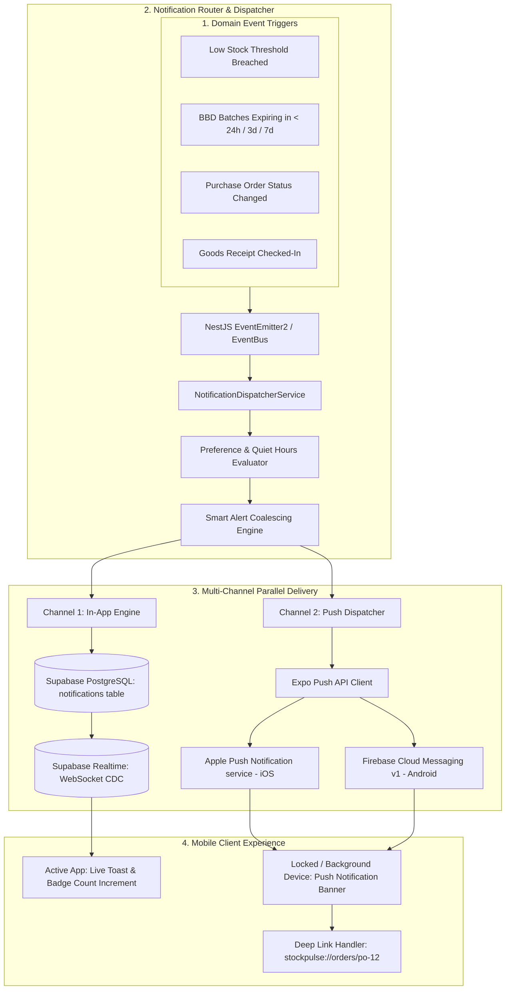

# StockPulse — Notification Architecture Specification
### (In-App + Mobile Push Notifications via Expo / APNs / FCM)

> **Version:** 1.0.0  
> **Channels:** In-App Inbox (Supabase Realtime / PostgreSQL) + Mobile Push (Expo Push API / APNs / FCM v1)  
> **Target Framework:** NestJS Backend + Expo React Native Client  
> **Companion Documents:**  
> - [NESTJS_MODULE_STRUCTURE.md](file:///d:/Project%20Local/fnb-mobile/docs/architecture/NESTJS_MODULE_STRUCTURE.md)  
> - [SUPABASE_SCHEMA.md](file:///d:/Project%20Local/fnb-mobile/docs/architecture/SUPABASE_SCHEMA.md)  
> - [DOMAIN_MODEL.md](file:///d:/Project%20Local/fnb-mobile/docs/architecture/DOMAIN_MODEL.md)  

---

## 1. High-Level Notification Topology & Delivery Model



---

## 2. Notification Model & Event Taxonomy

### 2.1 Core Event Taxonomy
| Event Code | Trigger Condition | Default Urgency | Target Roles | Deep Link Target Route |
|---|---|:---:|---|---|
| `LOW_STOCK_BREACH` | Physical stock $\le$ safety stock | `CRITICAL` / `NORMAL` | Manager, Supervisor, Staff | `stockpulse://orders/poq` |
| `EXPIRING_BATCH_WARNING` | Batch expiry $\le 24\text{h}$ (Critical) or $\le 7\text{d}$ (Notice) | `CRITICAL` / `NORMAL` | Manager, Supervisor, Staff | `stockpulse://expiration` |
| `PURCHASE_ORDER_UPDATES`| PO Approved, Dispatched, or Cancelled | `NORMAL` | Manager, Supervisor | `stockpulse://orders/:poId` |
| `GOODS_RECEIPT_UPDATES` | Delivery Checked-in, Short-Ship Discrepancy | `NORMAL` / `CRITICAL`| Manager, Supervisor | `stockpulse://goods-receipt/:receiptId` |

---

## 3. Preference & Anti-Spam Coalescing Model

```mermaid
flowchart LR
    Incoming[5 Expiring Batches Detected at 06:00] --> CoalesceCheck{Coalescing Window: 60s}
    CoalesceCheck -->|Single Alert per Item (Spam)| DirectSend[5 Separate Push Notifications ❌]
    CoalesceCheck -->|Coalesce into Digest| DigestGen[Single Consolidated Notification ✅]
    DigestGen --> Output["⚠️ 5 items expiring soon (Salmon, Milk, Chicken) in Bella Cucina"]
```

### Preference Rules:
1. **Channel Toggles**: Users can toggle In-App and Push independently per event category.
2. **Quiet Hours**: Non-critical notifications (e.g. standard PO confirmations) are suppressed between `22:00` and `07:00` in the store's local timezone.
3. **Critical Urgency Override**: Critical alerts (e.g. meat/seafood expiring in $< 24\text{h}$) bypass quiet hours to prevent food waste.
4. **Auto-Pruning of Dead Tokens**: If the Expo Push API returns `DeviceNotRegistered`, the backend automatically marks the corresponding device token as inactive.

---

## 4. Pure TypeScript Service Interfaces & Data Contracts

```typescript
// ============================================================================
// StockPulse Notification Architecture — Pure TypeScript Interfaces
// ============================================================================

export type UUID = string;
export type ISODateString = string;

/**
 * Standard notification event categories.
 */
export type NotificationEventType =
  | 'LOW_STOCK_BREACH'
  | 'EXPIRING_BATCH_WARNING'
  | 'PURCHASE_ORDER_UPDATES'
  | 'GOODS_RECEIPT_UPDATES'
  | 'STOCK_COUNT_VARIANCE_CRITICAL';

/**
 * Urgency tiers controlling quiet-hour bypass and sound/vibration priority.
 */
export type NotificationUrgency = 'NORMAL' | 'CRITICAL';

/**
 * Delivery channels supported by StockPulse.
 */
export type NotificationChannel = 'IN_APP' | 'PUSH_NOTIFICATION';

// ----------------------------------------------------------------------------
// 1. Notification Models & Event Payloads
// ----------------------------------------------------------------------------

/**
 * Core notification entity persisted in PostgreSQL.
 */
export interface INotification {
  readonly id: UUID;
  readonly storeId: UUID;
  readonly userId?: UUID; // If null, broadcasts to all authorized store staff
  readonly notificationNumber: string; // e.g. "NTF-202608-000120"
  readonly eventType: NotificationEventType;
  readonly title: string;
  readonly message: string;
  readonly urgency: NotificationUrgency;
  readonly route?: string; // Deep link e.g. "stockpulse://orders/po-12"
  readonly metadata?: Readonly<Record<string, unknown>>;
  readonly isRead: boolean;
  readonly readAt?: ISODateString;
  readonly createdAt: ISODateString;
  readonly expiresAt?: ISODateString;
}

/**
 * Domain event payload dispatched by business modules.
 */
export interface NotificationEventPayload {
  readonly eventType: NotificationEventType;
  readonly storeId: UUID;
  readonly targetUserId?: UUID; // Optional: specify target user
  readonly targetRoles?: ('admin' | 'manager' | 'supervisor' | 'staff' | 'auditor')[];
  readonly title: string;
  readonly message: string;
  readonly urgency: NotificationUrgency;
  readonly route?: string;
  readonly metadata?: Record<string, unknown>;
}

// ----------------------------------------------------------------------------
// 2. User & Store Preference Models
// ----------------------------------------------------------------------------

/**
 * User-specific notification preference configuration.
 */
export interface INotificationPreference {
  readonly id: UUID;
  readonly userId: UUID;
  readonly storeId: UUID;
  readonly inAppEnabled: boolean;
  readonly pushEnabled: boolean;
  
  /** Category-level toggles */
  readonly categories: {
    readonly lowStock: boolean;
    readonly expiringItems: boolean;
    readonly purchaseOrders: boolean;
    readonly goodsReceipts: boolean;
  };
  
  /** Quiet hours configuration */
  readonly quietHours: {
    readonly enabled: boolean;
    readonly startTime: string; // e.g. "22:00"
    readonly endTime: string;   // e.g. "07:00"
    readonly timezone: string;  // e.g. "Europe/Berlin"
  };
  
  readonly updatedAt: ISODateString;
}

/**
 * Registered mobile client device token.
 */
export interface IDeviceToken {
  readonly id: UUID;
  readonly userId: UUID;
  readonly storeId: UUID;
  readonly expoPushToken: string; // e.g. "ExponentPushToken[xxxxxxxxxxxxxx]"
  readonly platform: 'ios' | 'android';
  readonly appVersion: string;
  readonly isActive: boolean;
  readonly lastUsedAt: ISODateString;
}

// ----------------------------------------------------------------------------
// 3. Service Contracts & Adapter Interfaces
// ----------------------------------------------------------------------------

/**
 * Push dispatch request for a single device token.
 */
export interface PushMessageRequest {
  readonly to: string; // Expo Push Token
  readonly title: string;
  readonly body: string;
  readonly data?: Record<string, unknown>;
  readonly sound?: 'default' | null;
  readonly priority?: 'default' | 'normal' | 'high';
  readonly badge?: number;
  readonly channelId?: string; // Android notification channel
}

/**
 * Push dispatch response result.
 */
export interface PushDeliveryResult {
  readonly success: boolean;
  readonly ticketId?: string;
  readonly error?: 'DeviceNotRegistered' | 'MessageTooBig' | 'RateLimitExceeded' | 'Unknown';
}

/**
 * Push notification adapter contract.
 */
export interface IPushNotificationAdapter {
  /**
   * Send a single push notification to a device token.
   */
  sendPush(message: PushMessageRequest): Promise<PushDeliveryResult>;

  /**
   * Send a batch of push notifications in a single network round-trip.
   */
  sendBatchPush(messages: readonly PushMessageRequest[]): Promise<readonly PushDeliveryResult[]>;

  /**
   * Check validity of an Expo Push Token format.
   */
  isValidPushToken(token: string): boolean;
}

/**
 * In-app notification adapter contract.
 */
export interface IInAppNotificationAdapter {
  /**
   * Persist a notification in PostgreSQL for real-time delivery via Supabase.
   */
  persistNotification(notification: Omit<INotification, 'id' | 'createdAt' | 'isRead'>): Promise<INotification>;

  /**
   * Broadcast notification to multiple users within a store.
   */
  broadcastToStore(storeId: UUID, notification: Omit<INotification, 'id' | 'createdAt' | 'isRead'>): Promise<number>;
}

/**
 * Core notification dispatcher service interface.
 */
export interface INotificationDispatcher {
  /**
   * Main entry point for domain events: evaluates preferences and dispatches to channels.
   */
  dispatchEvent(event: NotificationEventPayload): Promise<void>;

  /**
   * Coalesce bursty events (e.g. 10 expiring items) into a single digest alert.
   */
  coalesceEvents(events: readonly NotificationEventPayload[]): NotificationEventPayload;

  /**
   * Evaluate whether a notification should be delivered based on quiet hours and preferences.
   */
  shouldDeliver(userId: UUID, channel: NotificationChannel, urgency: NotificationUrgency): Promise<boolean>;
}

/**
 * Application-level notification management service interface.
 */
export interface INotificationService {
  /**
   * Get paginated in-app notifications for the active user.
   */
  getInbox(userId: UUID, storeId: UUID, query: { limit?: number; unreadOnly?: boolean }): Promise<{
    notifications: readonly INotification[];
    unreadCount: number;
  }>;

  /**
   * Mark a specific notification as read.
   */
  markAsRead(notificationId: UUID, userId: UUID): Promise<void>;

  /**
   * Mark all notifications in a store as read for the user.
   */
  markAllAsRead(userId: UUID, storeId: UUID): Promise<void>;

  /**
   * Register or update an active mobile device push token.
   */
  registerDeviceToken(userId: UUID, storeId: UUID, token: string, platform: 'ios' | 'android', appVersion: string): Promise<IDeviceToken>;

  /**
   * Deactivate a device token (e.g. on user logout).
   */
  deactivateDeviceToken(expoPushToken: string): Promise<void>;
}
```

---

## 5. Documentation Baseline

The complete Notification Architecture specification has been persisted and indexed:
- 📖 **[NOTIFICATION_ARCHITECTURE.md](file:///d:/Project%20Local/fnb-mobile/docs/architecture/NOTIFICATION_ARCHITECTURE.md)** — Full topological delivery model, event taxonomy, anti-spam coalescing, and TypeScript interfaces.
- 📖 **[SUPABASE_SCHEMA.md](file:///d:/Project%20Local/fnb-mobile/docs/architecture/SUPABASE_SCHEMA.md)** — PostgreSQL tables for `notifications` and Supabase Realtime publications.
- 📖 **[docs/README.md](file:///d:/Project%20Local/fnb-mobile/docs/README.md)** — Architecture index portal.
