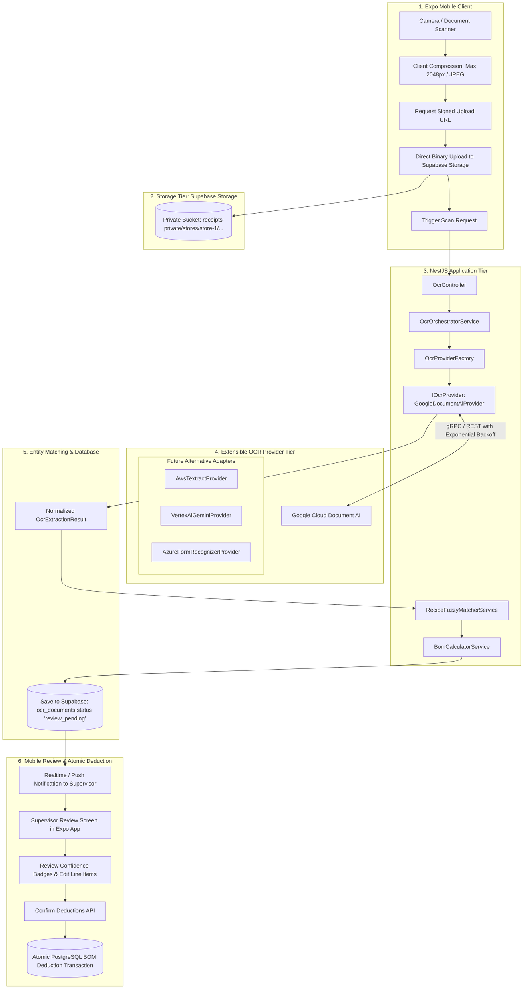
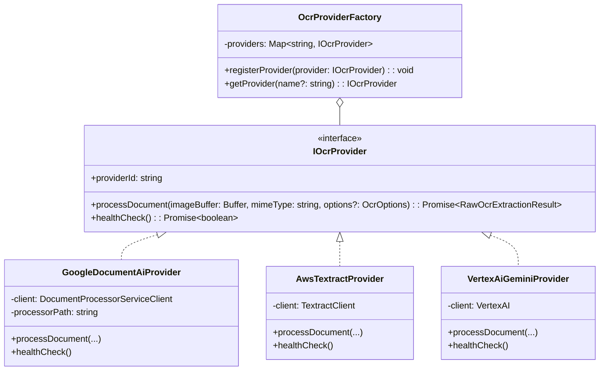
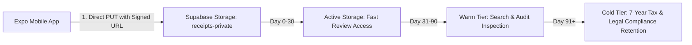
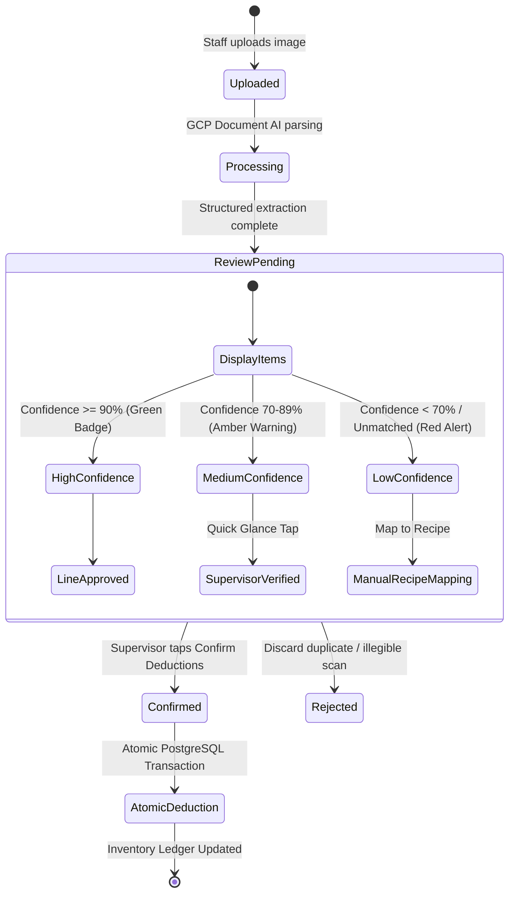
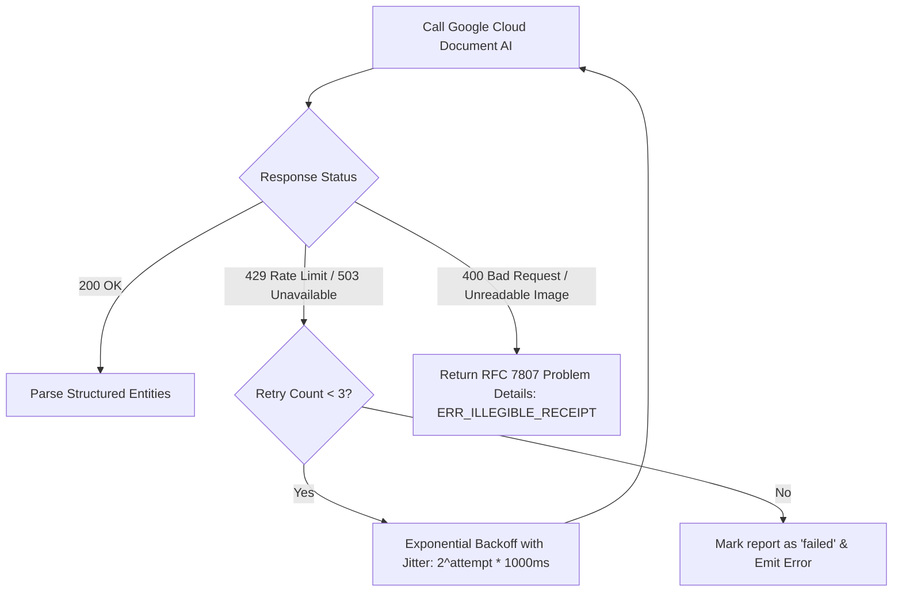

# StockPulse — OCR & Document AI Architecture Specification

> **Version:** 1.0.0  
> **Primary Provider:** Google Cloud Document AI (`EXPENSE_PROCESSOR` / `FORM_PARSER`)  
> **Storage Layer:** Supabase Storage (Private Encrypted Bucket)  
> **Backend Framework:** NestJS (Modular Provider Abstraction)  
> **Client Framework:** Expo React Native (Human-in-the-loop Review UI)  
> **Companion Documents:**  
> - [NESTJS_MODULE_STRUCTURE.md](file:///d:/Project%20Local/fnb-mobile/docs/architecture/NESTJS_MODULE_STRUCTURE.md)  
> - [SUPABASE_SCHEMA.md](file:///d:/Project%20Local/fnb-mobile/docs/architecture/SUPABASE_SCHEMA.md)  
> - [DOMAIN_MODEL.md](file:///d:/Project%20Local/fnb-mobile/docs/architecture/DOMAIN_MODEL.md)  

---

## 1. End-to-End Workflow & Architecture Diagram



---

## 2. Pluggable Provider Abstraction Pattern

To ensure StockPulse is never locked into a single cloud vendor, OCR processing is governed by the **Strategy & Factory Pattern**:



### Provider Contract Definition:
```typescript
export interface IOcrProvider {
  readonly providerId: 'google_document_ai' | 'aws_textract' | 'vertex_ai_gemini';
  
  processDocument(
    imageBuffer: Buffer,
    mimeType: string,
    options?: { storeLanguage?: string; timeoutMs?: number }
  ): Promise<RawOcrExtractionResult>;

  healthCheck(): Promise<boolean>;
}
```

---

## 3. Data Contracts & Canonical Extraction Models

### 3.1 Normalized Raw Extraction Result (`RawOcrExtractionResult`)
Standardized output format returned by any OCR provider implementation:
```typescript
export interface RawOcrExtractionResult {
  providerId: string;
  processingTimeMs: number;
  overallConfidence: number; // 0.00 to 1.00
  metadata: {
    documentNumber?: string; // e.g. "POS-8821" or "INV-99812"
    date?: string;           // ISO format: "2026-08-18"
    shift?: 'Lunch' | 'Dinner' | 'Night';
    merchantName?: string;   // e.g. "Bella Cucina Berlin"
    totalAmount?: number;
    taxAmount?: number;
  };
  lineItems: RawOcrLineItem[];
}

export interface RawOcrLineItem {
  lineNumber: number;
  rawText: string;
  artNr?: string;
  quantity: number;
  unitPrice?: number;
  totalPrice?: number;
  confidence: number; // 0.00 to 1.00
}
```

### 3.2 Recipe Matched Line Item (`MatchedOcrItemDto`)
Result after fuzzy matching against the store's active recipe catalog:
```typescript
export type MatchStatus = 'EXACT_CODE' | 'FUZZY_NAME' | 'MANUAL_OVERRIDE' | 'UNMATCHED';

export interface MatchedOcrItemDto {
  id: string;
  lineNumber: number;
  rawText: string;
  artNr?: string;
  matchedRecipeId?: string;
  matchedRecipeName?: string;
  matchStatus: MatchStatus;
  matchConfidence: number; // Combined OCR + Fuzzy similarity score
  quantitySold: number;
  unitPrice?: number;
  confidenceTier: 'high' | 'medium' | 'low'; // Green >= 0.90, Amber 0.70-0.89, Red < 0.70
}
```

### 3.3 BOM Theoretical Deduction Preview (`BomDeductionPreviewDto`)
Calculated raw ingredient consumption breakdown:
```typescript
export interface BomDeductionPreviewDto {
  reportId: string;
  totalPortions: number;
  totalEstimatedCostEur: number;
  ingredientDeductions: Array<{
    itemId: string;
    itemName: string;
    sku: string;
    unit: 'kg' | 'g' | 'L' | 'ml' | 'pcs';
    currentPhysicalStock: number;
    deductionQuantity: number;
    stockAfterDeduction: number;
    isStockDeficit: boolean; // True if physical stock < deductionQuantity
    unitCost: number;
    costImpactEur: number;
  }>;
}
```

---

## 4. REST API Endpoints

### 1. `POST /api/v1/ocr/presigned-upload`
- **Description**: Request a short-lived signed upload URL for direct mobile upload to Supabase Storage.
- **Auth**: `Bearer JWT` (`staff`, `supervisor`, `manager`, `admin`)
- **Request Body**:
  ```json
  {
    "mimeType": "image/jpeg",
    "fileSizeBytes": 2458900,
    "documentType": "pos_z_report"
  }
  ```
- **Response `200 OK`**:
  ```json
  {
    "uploadUrl": "https://<supabase-id>.supabase.co/storage/v1/object/upload/sign/receipts-private/stores/store-1/ocr/2026-08/rec_99.jpg?token=...",
    "storagePath": "stores/store-1/ocr/2026-08/rec_99.jpg",
    "expiresInSeconds": 300
  }
  ```

### 2. `POST /api/v1/ocr/scan`
- **Description**: Submit uploaded image path for Google Document AI extraction and BOM recipe resolution.
- **Auth**: `Bearer JWT` (`staff`, `supervisor`, `manager`, `admin`)
- **Request Body**:
  ```json
  {
    "storagePath": "stores/store-1/ocr/2026-08/rec_99.jpg",
    "documentType": "pos_z_report"
  }
  ```
- **Response `202 Accepted`**:
  ```json
  {
    "reportId": "01915dfa-b1c4-7221-9988-51b72e04e0a1",
    "status": "processing",
    "estimatedTimeSeconds": 3
  }
  ```

### 3. `GET /api/v1/ocr/reports/:reportId`
- **Description**: Fetch parsed report, confidence tiers, line items, and preview BOM ingredient deductions.
- **Auth**: `Bearer JWT` (All Roles)
- **Response `200 OK`**: Returns full report, matched items, and `BomDeductionPreviewDto`.

### 4. `PATCH /api/v1/ocr/reports/:reportId/items/:itemId`
- **Description**: Update an extracted item during mobile supervisor review (e.g. manually map an unmatched dish).
- **Auth**: `Bearer JWT` (`supervisor`, `manager`, `admin`)
- **Request Body**:
  ```json
  {
    "matchedRecipeId": "rec_chicken_salad_01",
    "quantitySold": 24
  }
  ```

### 5. `POST /api/v1/ocr/reports/:reportId/confirm`
- **Description**: Final supervisor confirmation executing atomic BOM stock deduction transactions in PostgreSQL.
- **Auth**: `Bearer JWT` (`supervisor`, `manager`, `admin`)
- **Headers**: `Idempotency-Key: <UUIDv4>`
- **Response `200 OK`**:
  ```json
  {
    "reportId": "01915dfa-b1c4-7221-9988-51b72e04e0a1",
    "status": "confirmed",
    "totalPortionsDeducted": 42,
    "transactionsLogged": 6,
    "confirmedAt": "2026-08-18T10:24:00Z"
  }
  ```

---

## 5. Storage Strategy & Lifecycle Policies



### Storage Security Configuration:
1. **Bucket Privacy**: `receipts-private` bucket is strictly **Private** (no public URLs).
2. **Access Control**: Client downloads are mediated exclusively via short-lived signed URLs (15 min TTL) generated by the NestJS backend.
3. **Storage RLS**: Supabase Storage RLS policies ensure users can only generate signed URLs for objects within their assigned `store_id` prefix.

---

## 6. Confidence Scoring & Human-in-the-Loop Review Workflow



### Confidence Threshold Policy:
| Confidence Range | UI Indicator | Review Requirement | Action |
|---|---|---|---|
| **$\ge 90\%$ (High)** | 🟢 Green Checkmark | Pre-selected as valid | Auto-approved unless edited |
| **$70\% - 89\%$ (Medium)** | 🟡 Amber Warning | Visual review recommended | Single tap to verify quantity / price |
| **$< 70\%$ / Unmatched (Low)**| 🔴 Red Alert | **Mandatory Action** | User must manually pick recipe from dropdown |

---

## 7. Resilience, Retry Strategy & Error Handling



### Error Scenarios & Handlers:
1. **Illegible / Blurry Image**: Document AI returns low entity confidence or empty text. Handled gracefully by prompting staff on mobile: *"Image quality too low to detect lines. Please retake photo with better lighting"*.
2. **Unsupported Format / Exceeded Size**: Rejected at the pre-signed URL step before GCP invocation.
3. **Partial Extraction Recovery**: If 8 out of 10 lines parse successfully, the report is saved with the 8 parsed items, and the supervisor can manually add the 2 missing lines in the UI.

---

## 8. Documentation Baseline

The complete OCR architecture specification has been saved and linked across the documentation portal:
- 📖 **[OCR_ARCHITECTURE.md](file:///d:/Project%20Local/fnb-mobile/docs/architecture/OCR_ARCHITECTURE.md)** — Full Google Cloud Document AI integration, provider abstraction, data contracts, and review workflow.
- 📖 **[SUPABASE_SCHEMA.md](file:///d:/Project%20Local/fnb-mobile/docs/architecture/SUPABASE_SCHEMA.md)** — PostgreSQL tables for `ocr_documents`, `ocr_document_items`, and `ocr_bom_deductions`.
- 📖 **[docs/README.md](file:///d:/Project%20Local/fnb-mobile/docs/README.md)** — Architecture index portal.
