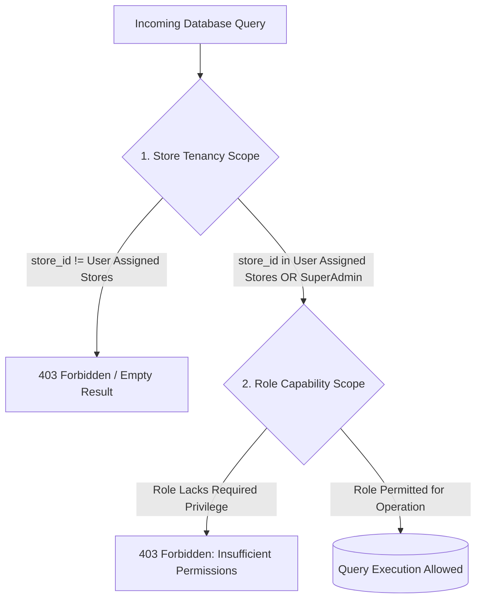
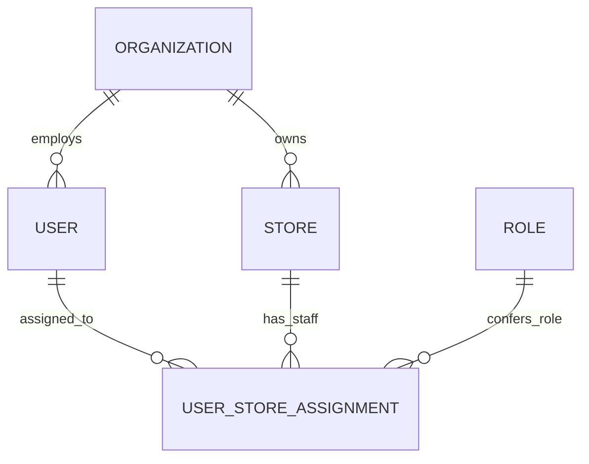
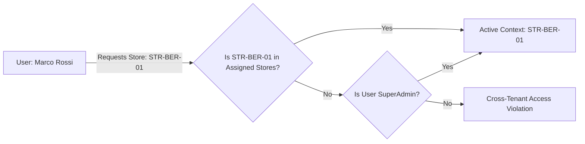
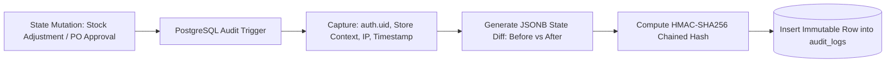

# StockPulse — Supabase Row-Level Security (RLS) Policy Architecture

> **Version:** 1.0.0  
> **Target Engine:** Supabase PostgreSQL 16+  
> **Security Model:** Multi-Tenant Store Isolation + Role-Based Access Control (RBAC)  
> **Companion Documents:**  
> - [SUPABASE_SCHEMA.md](file:///d:/Project%20Local/fnb-mobile/docs/architecture/SUPABASE_SCHEMA.md)  
> - [NESTJS_MODULE_STRUCTURE.md](file:///d:/Project%20Local/fnb-mobile/docs/architecture/NESTJS_MODULE_STRUCTURE.md)  
> - [DOMAIN_MODEL.md](file:///d:/Project%20Local/fnb-mobile/docs/architecture/DOMAIN_MODEL.md)  

---

## 1. RLS Strategy Overview

The StockPulse Row-Level Security architecture establishes a **defense-in-depth security perimeter** directly within the database engine. Every database query executed via the Supabase client or NestJS backend is automatically filtered based on two orthogonal dimensions:

### Core Strategy Pillars:
1. **Zero-Trust Default**: All public tables have RLS enabled with `DEFAULT DENY`. If no explicit policy matches a given user and operation, the query returns zero rows or errors.
2. **Context Resolution (Dual-Mode)**:
   - *Direct Supabase Client (Mobile App)*: Uses Supabase `auth.uid()` and queries security-definer helper functions to resolve active store assignments.
   - *NestJS Backend API*: Injects session parameters (`SET LOCAL app.current_store_id = ...`) inside transactions, verified against JWT claims.
3. **Subquery Performance Optimization**:
   - Avoids repetitive inline subqueries inside RLS policies. Uses lightweight `SECURITY DEFINER` helper functions marked `STABLE` to allow PostgreSQL to cache authorization results across rows in the same query plan.
4. **Child Entity Inheritance**:
   - Sub-item tables without an explicit `store_id` column (e.g. `recipe_ingredients`, `purchase_order_items`, `stock_count_items`) enforce security via relational foreign key existence checks against their parent table.

---

## 2. Multi-Store Isolation Model

### 2.1 User-to-Store Mapping Hierarchy
Users belong to an organization and can be assigned to one or more stores with specific roles:

### 2.2 Store Context Resolution Logic
When an authenticated request arrives:
1. **SuperAdmin (Franchise Admin)**: Granted global cross-store access across all stores in the organization.
2. **Multi-Store Staff / Supervisors**: Can switch active store context in the mobile app. The RLS engine verifies that the requested `store_id` exists in the user's `user_store_assignments` table.
3. **Single-Store Staff**: Scoped strictly to their `default_store_id`.

---

## 3. Role-Based Access Control (RBAC) Matrix

| Entity Domain | Operation | SuperAdmin | Store Manager | Supervisor | Staff | Auditor |
|---|---|:---:|:---:|:---:|:---:|:---:|
| **Stores & Settings** | `SELECT` | ✅ All | ✅ Assigned | ✅ Assigned | ✅ Assigned | ✅ Assigned |
| | `INSERT / UPDATE` | ✅ All | ✅ Assigned | ❌ | ❌ | ❌ |
| **Users & Team** | `SELECT` | ✅ All | ✅ Assigned | ✅ Assigned | ✅ Assigned | ✅ Assigned |
| | `MANAGE` | ✅ All | ✅ Assigned | ❌ | ❌ | ❌ |
| **Inventory Items** | `SELECT` | ✅ All | ✅ Assigned | ✅ Assigned | ✅ Assigned | ✅ Assigned |
| | `CREATE / EDIT` | ✅ All | ✅ Assigned | ✅ Assigned | ❌ | ❌ |
| | `MANUAL ADJUST` | ✅ All | ✅ Assigned | ✅ Assigned | ❌ | ❌ |
| **Inventory Batches**| `SELECT` | ✅ All | ✅ Assigned | ✅ Assigned | ✅ Assigned | ✅ Assigned |
| | `CREATE / CONSUME`| ✅ All | ✅ Assigned | ✅ Assigned | ✅ Assigned | ❌ |
| **Recipes & BOM** | `SELECT` | ✅ All | ✅ Assigned | ✅ Assigned | ✅ Assigned | ✅ Assigned |
| | `CREATE / EDIT` | ✅ All | ✅ Assigned | ❌ | ❌ | ❌ |
| **Stock Counts** | `SELECT` | ✅ All | ✅ Assigned | ✅ Assigned | ✅ Blind View | ✅ Assigned |
| | `COUNT / ENTER` | ✅ All | ✅ Assigned | ✅ Assigned | ✅ Assigned | ❌ |
| | `APPROVE VARIANCE`| ✅ All | ✅ Assigned | ❌ | ❌ | ❌ |
| **Purchase Orders** | `SELECT` | ✅ All | ✅ Assigned | ✅ Assigned | ❌ | ✅ Assigned |
| | `CREATE DRAFT` | ✅ All | ✅ Assigned | ✅ Assigned | ❌ | ❌ |
| | `APPROVE / SEND` | ✅ All | ✅ Assigned | ❌ | ❌ | ❌ |
| **Goods Receipts** | `SELECT` | ✅ All | ✅ Assigned | ✅ Assigned | ✅ Assigned | ✅ Assigned |
| | `CHECK-IN / CREATE`| ✅ All | ✅ Assigned | ✅ Assigned | ✅ Assigned | ❌ |
| **OCR Documents** | `SELECT` | ✅ All | ✅ Assigned | ✅ Assigned | ✅ Assigned | ❌ |
| | `SCAN / UPLOAD` | ✅ All | ✅ Assigned | ✅ Assigned | ✅ Assigned | ❌ |
| | `CONFIRM DEDUCT` | ✅ All | ✅ Assigned | ✅ Assigned | ❌ | ❌ |
| **Notifications** | `SELECT / READ` | ✅ All | ✅ Assigned | ✅ Assigned | ✅ Assigned | ✅ Assigned |
| **Audit Logs** | `SELECT` | ✅ All | ✅ Assigned | ❌ | ❌ | ✅ Assigned |
| | `INSERT / UPDATE` | ❌ Engine Only| ❌ Engine Only| ❌ Engine Only| ❌ Engine Only| ❌ Engine Only|

---

## 4. Policy Definitions by Domain

---

### 4.1 Stores & Store Settings
- **`SELECT` Policy**:
  - *Condition*: Permitted if `id` is the user's `default_store_id`, or exists in `user_store_assignments`, or the user has role `superadmin`.
- **`INSERT / UPDATE / DELETE` Policy**:
  - *Condition*: Restricted exclusively to `superadmin` and `manager` roles assigned to the target store.

---

### 4.2 Users & Team Members
- **`SELECT` Policy**:
  - *Condition*: Authenticated users can view team members who share at least one common store assignment or within the same organization.
- **`UPDATE` Policy**:
  - *Self-Profile*: Users can update their own personal details (name, avatar, biometrics preference).
  - *Store Role Management*: Only `superadmin` and store `manager` can update roles or store assignments.

---

### 4.3 Inventory Items & Batches
- **`SELECT` Policy**:
  - *Condition*: Read access granted to all authenticated roles (`superadmin`, `manager`, `supervisor`, `staff`, `auditor`) where `store_id` matches the user's active store.
- **`INSERT` Policy**:
  - *Condition*: Permitted for `superadmin`, `manager`, and `supervisor`.
- **`UPDATE` Policy**:
  - *Metadata & Target Stock*: Permitted for `superadmin` and `manager`.
  - *Manual Stock Adjustments*: Permitted for `superadmin`, `manager`, and `supervisor` (must log mandatory transaction record).
- **`DELETE` Policy (Soft Delete)**:
  - *Condition*: Restricted to `superadmin` and `manager`. Soft delete sets `deleted_at = NOW()`. Physical `DELETE` is blocked.

---

### 4.4 Recipes & Bill of Materials (BOM)
- **`SELECT` Policy**:
  - *Condition*: Read access for all roles within the assigned store.
- **`INSERT / UPDATE / DELETE` Policy**:
  - *Condition*: Restricted to `superadmin` and `manager`. Modifying recipe ingredient ratios automatically logs a recipe version event.

---

### 4.5 Stock Counts & Variances
- **`SELECT` Policy**:
  - *Standard View*: `superadmin`, `manager`, `supervisor`, and `auditor` can view expected quantities, counted quantities, and variance financial values.
  - *Blind View for Staff*: Staff can only see the items assigned to be counted; theoretical stock and variance cost fields are omitted.
- **`INSERT` (Start Count)**:
  - *Condition*: Permitted for `superadmin`, `manager`, `supervisor`, and `staff`.
- **`UPDATE` (Record Count Lines)**:
  - *Condition*: Counter can update line items while `status = 'in_progress'`. Once submitted, records become read-only.
- **`APPROVE` (Variance Ledger Sync)**:
  - *Condition*: Restricted strictly to `superadmin` and `manager`.

---

### 4.6 Purchase Orders & Procurement
- **`SELECT` Policy**:
  - *Condition*: Visible to `superadmin`, `manager`, `supervisor`, and `auditor` for assigned stores. Staff cannot view purchase orders or financial costs.
- **`INSERT` (Create PO Draft)**:
  - *Condition*: Permitted for `superadmin`, `manager`, and `supervisor`.
- **`UPDATE` (Approve & Dispatch)**:
  - *Condition*: Approving financial orders requires `manager` or `superadmin` privileges.
- **`DELETE` Policy**:
  - *Condition*: Only unapproved `draft` orders may be cancelled or soft-deleted. Sent/received orders are immutable.

---

### 4.7 Goods Receipts & Delivery Check-in
- **`SELECT` Policy**:
  - *Condition*: Read access for all roles within the assigned store.
- **`INSERT` (Check-in Delivery)**:
  - *Condition*: Permitted for `superadmin`, `manager`, `supervisor`, and `staff`. Inserting a goods receipt atomically creates new FEFO batches and inventory transaction records.
- **`UPDATE / DELETE` Policy**:
  - *Condition*: **FORBIDDEN (Immutable)**. Goods receipts represent legal commercial intake and cannot be altered or deleted once confirmed. Corrections require compensatory adjustment logs.

---

### 4.8 OCR Multi-Modal Documents
- **`SELECT` Policy**:
  - *Condition*: Visible to `superadmin`, `manager`, `supervisor`, and `staff` for the store where the receipt was scanned.
- **`INSERT` (Upload / Scan)**:
  - *Condition*: Permitted for `superadmin`, `manager`, `supervisor`, and `staff`.
- **`CONFIRM & DEDUCT` Policy**:
  - *Condition*: Final review and commit of theoretical BOM ingredient stock deductions requires `supervisor`, `manager`, or `superadmin`.

---

### 4.9 Notifications
- **`SELECT` Policy**:
  - *Condition*: Users can only read notifications directed to their specific `user_id` OR store-wide broadcasts matching their assigned `store_id`.
- **`UPDATE` (Mark as Read)**:
  - *Condition*: Users can only update `is_read` status on their own notifications.

---

### 4.10 Audit Logs (Immutable WORM Compliance)
- **`SELECT` Policy**:
  - *Condition*: Read-only access granted strictly to `auditor`, `manager`, and `superadmin` within their store. Staff and supervisors cannot query audit logs.
- **`INSERT` Policy**:
  - *Condition*: System engine only (via backend service role or database triggers).
- **`UPDATE / DELETE` Policy**:
  - *Condition*: **STRICTLY BLOCKED FOR ALL USERS (INCLUDING ADMINS)**. The audit log is an immutable append-only ledger.

---

## 5. Audit & Compliance Considerations

### Critical Security Guards:
1. **Automatic Actor Attribution**:
   - Database triggers automatically populate `created_by` and `updated_by` with `auth.uid()`, preventing clients from spoofing author credentials.
2. **Cryptographic Hash Chaining**:
   - Each audit entry calculates a cryptographic hash linking to the previous entry:
     $$\text{Current Hash} = \text{HMAC-SHA256}(\text{Prev Hash} + \text{Event ID} + \text{Payload} + \text{Timestamp})$$
   - Any tampering or row deletion invalidates the mathematical chain, failing auditor verification sweeps.
3. **Audit Log Read-Only Guarantee**:
   - `audit_logs` has zero `UPDATE` or `DELETE` RLS policies. PostgreSQL revokes table mutation privileges even from the database owner role on the production cluster.
4. **Failed Access Logging**:
   - Attempts to access cross-tenant store IDs trigger security exception logging in Supabase audit logs and CloudWatch metric alarms.
