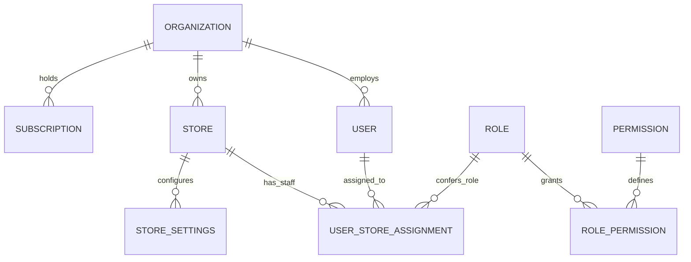
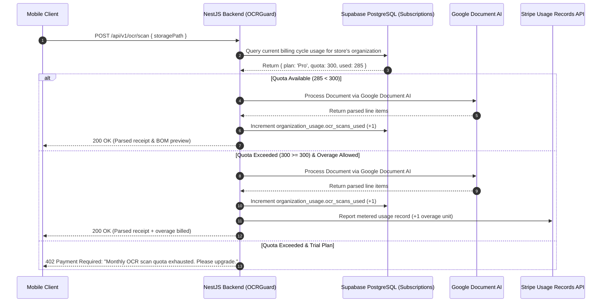
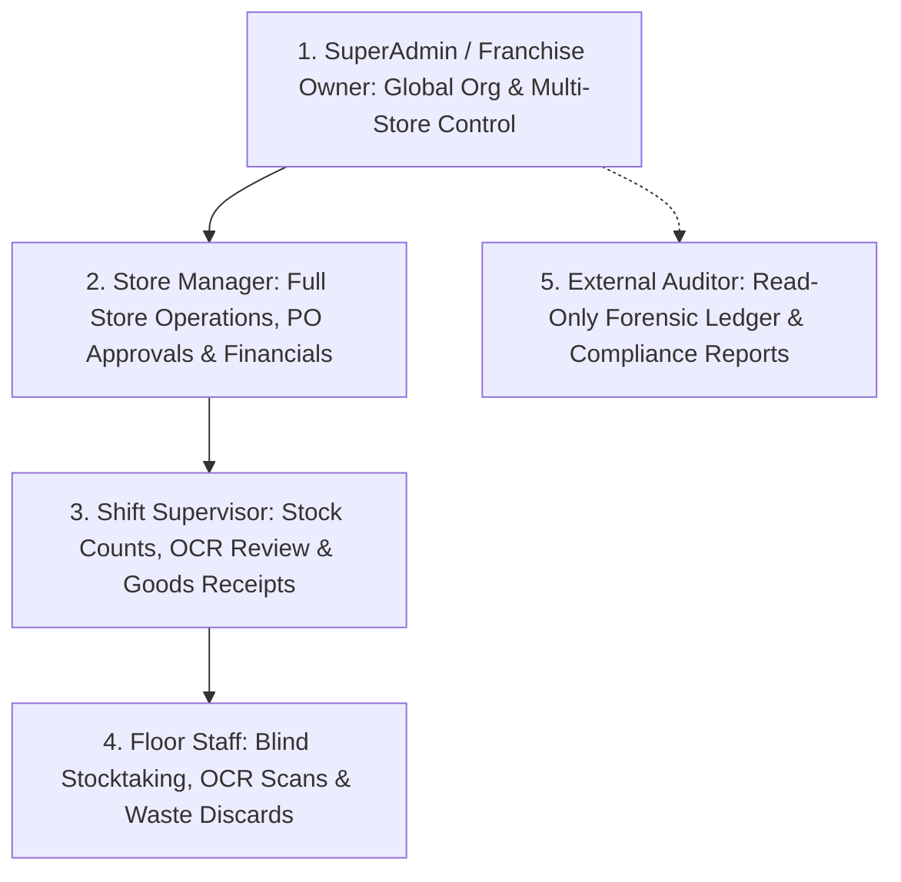
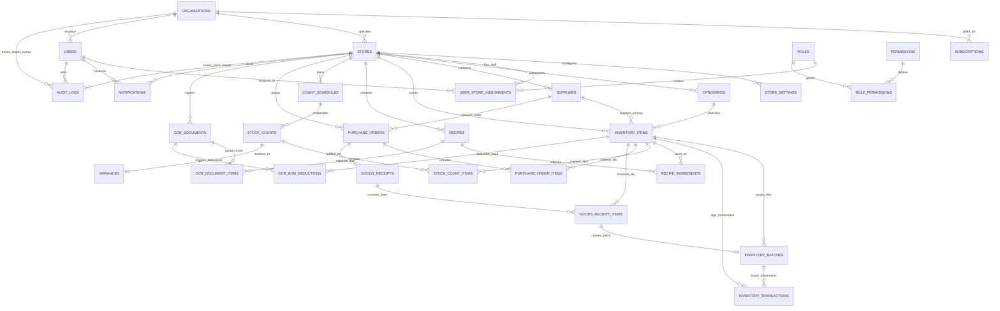
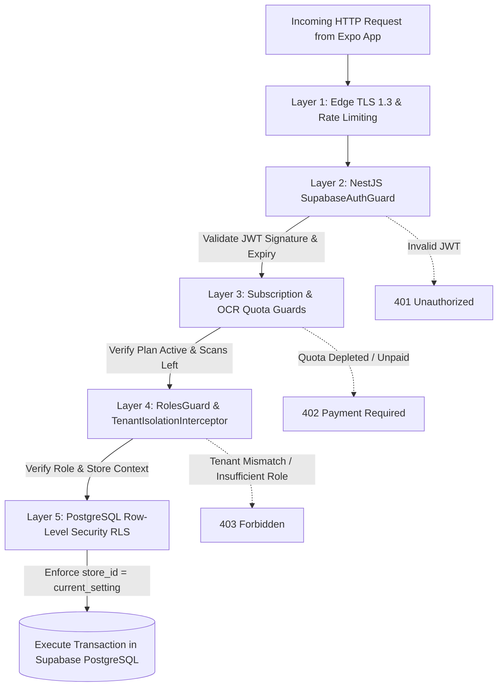
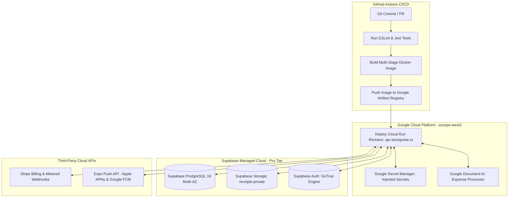

# StockPulse — Cloud-First Multi-Tenant SaaS Backend Architecture
## Official Backend Source of Truth

> **Document Version:** 1.0.0 (Canonical SaaS Specification)  
> **Target Environment:** Multi-Tenant Cloud SaaS  
> **Core Stack:** NestJS (Backend) + Supabase (PostgreSQL 16, GoTrue Auth, Storage, Realtime) + Google Cloud Document AI (OCR) + Expo React Native (Mobile Client)  
> **Business Model:** Multi-Store Subscription SaaS + Metered OCR Usage Credits (Stripe)  

---

## 1. Executive Summary & SaaS Operating Principles

**StockPulse** is a multi-tenant, subscription-based, mobile-first inventory intelligence SaaS platform purpose-built for the Food & Beverage (F&B) industry. It enables restaurant groups, multi-unit franchises, and independent culinary operations to automate inventory tracking, recipe Bill of Materials (BOM) theoretical consumption, AI-powered POS/invoice OCR parsing, and compliance-grade audit logging.

### SaaS Architecture Tenets:
1. **Shared-Database, Shared-Schema Multi-Tenancy**: Guaranteed tenant data isolation enforced by PostgreSQL **Row-Level Security (RLS)** using cryptographic user identity context (`auth.uid()`, `organization_id`, `store_id`).
2. **Subscription & Metered OCR Quota Enforcement**: Tier-based feature gating and metered OCR scan usage tracking with automated overage billing via Stripe webhooks.
3. **Mobile-First Real-Time Synchronization**: Native iOS and Android operation powered by Expo, leveraging Supabase Realtime (PostgreSQL CDC WebSockets) for zero-latency inventory counters and collaborative stock audits.
4. **Immutable Compliance & Traceability**: Append-only transactional inventory ledgers and HMAC-SHA256 cryptographically chained audit trails adhering to HACCP and statutory accounting standards.

---

## 2. Master System Architecture Diagram

```mermaid
flowchart TB
    subgraph Client_Tier [Client Tier: Mobile-First Mobile Apps]
        iOS[iOS App - Expo / SecureStore FaceID]
        Android[Android App - Expo / SecureStore Biometrics]
    end

    subgraph Ingress_Edge [Ingress & Edge Security]
        Cloudflare[Cloudflare Edge CDN & DNS]
        WAF[Cloudflare / Cloud Armor WAF - Rate Limiting & Bot Protection]
        Cloudflare --> WAF
    end

    subgraph Application_Tier [Application Tier: NestJS SaaS Core - Google Cloud Run]
        AppModule[AppModule]
        
        subgraph Core_Domain_Modules [Core NestJS Feature Modules]
            AuthMod[1. Auth & IAM Module]
            OrgMod[2. Organization & Store Module]
            BillingMod[3. Subscription & Billing Module]
            InvMod[4. Inventory & Batches Module]
            BOMMod[5. Recipe & BOM Engine Module]
            CountMod[6. Stock Count & Variance Module]
            ProcMod[7. Procurement & POQ Module]
            GoodsMod[8. Goods Receipt Module]
            OCRMod[9. OCR & Document AI Module]
            NotifMod[10. Notification Module]
            AuditMod[11. Audit Ledger Module]
        end

        subgraph NestJS_Cross_Cutting [Cross-Cutting Middleware & Security]
            SupabaseAuthGuard[SupabaseAuthGuard (JWT Verification)]
            SubscriptionGuard[SubscriptionPlanGuard (Feature Gating)]
            OcrQuotaGuard[OcrQuotaGuard (Metered Scan Credits)]
            RolesGuard[Roles & Permissions Guard (RBAC)]
            TenantInterceptor[TenantIsolationInterceptor]
            RlsManager[Database RlsContextManager]
        end

        AppModule --> Core_Domain_Modules
        Core_Domain_Modules --> NestJS_Cross_Cutting
    end

    subgraph Supabase_Cloud [Database & Managed Services: Supabase Enterprise]
        SupaAuth[(Supabase Auth - GoTrue Engine)]
        SupaDB[(Supabase PostgreSQL 16 - with Native RLS)]
        SupaStorage[(Supabase Storage - Private S3 Encrypted Buckets)]
        SupaRealtime[(Supabase Realtime - WebSocket Engine)]
    end

    subgraph External_SaaS_Integrations [External SaaS & AI Providers]
        Stripe[Stripe Billing & Metered Usage Webhooks]
        GCP_DocAI[Google Cloud Document AI - Expense & Form Parser]
        ExpoPush[Expo Push Notification Service - APNs & FCM]
    end

    %% Client Ingress
    iOS & Android --> Cloudflare
    WAF --> AppModule
    iOS & Android -->|Direct Upload via Signed URL| SupaStorage
    iOS & Android <-->|Realtime WebSockets| SupaRealtime

    %% Application Integration Flows
    AuthMod <-->|Validate & Sync Users| SupaAuth
    BillingMod <-->|Manage Subscriptions & Webhooks| Stripe
    OCRMod -->|Extract Line Items| GCP_DocAI
    OCRMod <-->|Fetch Signed Receipts| SupaStorage
    NotifMod -->|Dispatch Push Notifications| ExpoPush
    Core_Domain_Modules <-->|Execute SQL with RLS Context| SupaDB
    SupaDB -.->|PostgreSQL CDC WAL Stream| SupaRealtime
```

---

## 3. Multi-Tenant Organization & Store Hierarchy



### Hierarchy Dimensions:
1. **Organization (Tenant)**: The top-level legal and billing entity (e.g. *Bella Cucina Hospitality Group*). Holds the Stripe customer ID, subscription plan, global invoice history, and organization-wide users.
2. **Store (Location)**: An operational restaurant branch or kitchen facility (e.g. *Bella Cucina Berlin Mitte*, *Bella Cucina Munich West*). Each store has isolated inventory balances, suppliers, recipes, count schedules, and local operating settings (currency, tax rate, timezone).
3. **User**: A human account authenticated via Supabase Auth. Can belong to an organization and be assigned to one or multiple stores with distinct operational roles.

---

## 4. Subscription Plans & OCR Metered Billing Model

### 4.1 Subscription Tier Matrix
| Feature / Limit | Free Trial (14 Days) | Starter Plan | Pro Multi-Store Plan | Enterprise Plan |
|---|:---:|:---:|:---:|:---:|
| **Price (Monthly / Store)**| €0 (14 Days) | €49 / store / mo | €89 / store / mo | Custom Contract |
| **Max Locations / Stores** | 1 Store | Up to 2 Stores | Up to 10 Stores | Unlimited |
| **Active Team Members** | 3 Users | 5 Users / store | Unlimited | Unlimited |
| **Included OCR Scans / Mo** | 20 Scans (Total) | 100 Scans / store / mo | 300 Scans / store / mo | Custom Pool |
| **Overage OCR Rate** | Blocked | €0.15 / scan | €0.10 / scan | Custom Tier |
| **BOM Recipe Deductions** | ✅ Included | ✅ Included | ✅ Included | ✅ Included |
| **POQ Automated Reordering**| ❌ Disabled | ✅ Included | ✅ Included | ✅ Included |
| **Auditor Access & Exports**| ❌ Disabled | ❌ Disabled | ✅ Included | ✅ Dedicated SLA |
| **Supabase Realtime Sync** | ✅ Included | ✅ Included | ✅ Included | ✅ Dedicated Pool |

### 4.2 OCR Usage Metering & Overage Lifecycle



---

## 5. User Identity & Multi-Store RBAC Model

### 5.1 Role Definitions & Authority Matrix



| Permission Capability | SuperAdmin | Store Manager | Supervisor | Staff | Auditor |
|---|:---:|:---:|:---:|:---:|:---:|
| `billing:manage_subscription` | ✅ | ❌ | ❌ | ❌ | ❌ |
| `store:manage_settings` | ✅ | ✅ | ❌ | ❌ | ❌ |
| `team:manage_members` | ✅ | ✅ | ❌ | ❌ | ❌ |
| `inventory:view` | ✅ | ✅ | ✅ | ✅ | ✅ |
| `inventory:adjust_manual` | ✅ | ✅ | ✅ | ❌ | ❌ |
| `inventory:blind_count` | ✅ | ✅ | ✅ | ✅ | ❌ |
| `inventory:approve_variance`| ✅ | ✅ | ❌ | ❌ | ❌ |
| `ocr:scan_upload` | ✅ | ✅ | ✅ | ✅ | ❌ |
| `ocr:confirm_deduct` | ✅ | ✅ | ✅ | ❌ | ❌ |
| `procurement:create_po` | ✅ | ✅ | ✅ | ❌ | ❌ |
| `procurement:approve_po` | ✅ | ✅ | ❌ | ❌ | ❌ |
| `procurement:goods_receipt` | ✅ | ✅ | ✅ | ✅ | ❌ |
| `audit:view_ledger` | ✅ | ✅ | ❌ | ❌ | ✅ |

---

## 6. Complete Database Architecture & SaaS ERD



---

## 7. NestJS Module & Service Boundaries

```
src/
├── main.ts
├── app.module.ts
│
├── common/                     # Cross-cutting primitives & multi-tenant guards
│   ├── decorators/             # @CurrentUser(), @CurrentStore(), @RequireRoles(), @RequirePermissions()
│   ├── guards/                 # SupabaseAuthGuard, SubscriptionPlanGuard, OcrQuotaGuard, RolesGuard
│   ├── interceptors/           # TenantIsolationInterceptor, LoggingInterceptor, TransformInterceptor
│   ├── filters/                # GlobalHttpExceptionFilter (RFC 7807 Problem Details)
│   └── database/               # SupabaseModule, DatabaseConnectionService, RlsContextManager
│
├── auth/                       # Supabase Auth, Token Validation & Biometric Challenge Handshake
├── organizations/              # Organization Onboarding, Store Management & Global Tenant Settings
├── billing/                    # Stripe Integration, Subscription Plans, Webhooks & OCR Metering
├── users/                      # User Profile Directory & Multi-Store Role Assignments
├── roles/                      # System Roles, Custom Permissions & Capability Evaluators
├── inventory/                  # Items, Categories, FEFO Batches, Movements & BOM Recipes
├── stock-count/                # Audit Schedules, Multi-User Blind Counts & Variance Sync
├── suppliers/                  # Supplier Master Catalog, Lead Times & Terms
├── procurement/                # Algorithmic POQ Calculation & Purchase Order Workflow
├── receipts/                   # Goods Receipt Delivery Check-in & Batch Influx
├── ocr/                        # Google Cloud Document AI Pipeline & Recipe Fuzzy Matcher
├── notifications/              # In-App Inbox & Expo/APNs/FCM Push Notification Dispatch
└── audit/                      # Cryptographically Chained Immutable Audit Log Ledger
```

---

## 8. API Architecture & Standard Protocols

### 8.1 Universal Request Headers
| Header | Required | Purpose | Example |
|---|---|---|---|
| `Authorization` | Yes | Supabase JWT Access Token | `Bearer eyJhbGciOiJSUzI1Ni...` |
| `X-Store-Id` | Yes | Target store tenant context | `01915dfa-9012-7000-8000-000000000002` |
| `Idempotency-Key` | Yes (Mutations) | Prevents duplicate actions during mobile network retries | `9b1deb4d-3b7d-4bad-9bdd-2b0d7b3dcb6d` |
| `If-Match` | Conditional | Optimistic concurrency control version tag | `"v14"` |
| `X-Client-Platform` | Yes | Client OS environment | `ios` / `android` |

### 8.2 Standard Response & Error Formats (RFC 7807)
All API endpoints return standard wrappers. Error responses strictly adhere to **RFC 7807 Problem Details**:
```json
{
  "type": "https://api.stockpulse.io/errors/ocr-quota-exceeded",
  "title": "Payment Required",
  "status": 402,
  "detail": "Your organization has exhausted its monthly allocated OCR scan quota (300/300 scans).",
  "instance": "/api/v1/ocr/scan",
  "errorCode": "ERR_OCR_QUOTA_EXHAUSTED",
  "invalidParams": []
}
```

---

## 9. Security & Row-Level Security (RLS) Architecture



### Row-Level Security Policy Enforcement:
```sql
-- Dynamic Context Helper Functions
CREATE OR REPLACE FUNCTION get_auth_store_id()
RETURNS UUID AS $$
    SELECT COALESCE(
        NULLIF(current_setting('app.current_store_id', true), '')::UUID,
        (SELECT default_store_id FROM users WHERE id = auth.uid())
    );
$$ LANGUAGE sql STABLE SECURITY DEFINER;

CREATE OR REPLACE FUNCTION is_superadmin()
RETURNS BOOLEAN AS $$
    SELECT EXISTS (
        SELECT 1 FROM users WHERE id = auth.uid() AND role = 'superadmin'
    );
$$ LANGUAGE sql STABLE SECURITY DEFINER;

-- Multi-Tenant Store Isolation Policies
ALTER TABLE inventory_items ENABLE ROW LEVEL SECURITY;
CREATE POLICY "inventory_items_store_isolation" ON inventory_items
    FOR ALL USING (
        store_id = get_auth_store_id() OR is_superadmin()
    );

ALTER TABLE purchase_orders ENABLE ROW LEVEL SECURITY;
CREATE POLICY "purchase_orders_store_isolation" ON purchase_orders
    FOR ALL USING (
        store_id = get_auth_store_id() OR is_superadmin()
    );

ALTER TABLE audit_logs ENABLE ROW LEVEL SECURITY;
CREATE POLICY "audit_logs_read_isolation" ON audit_logs
    FOR SELECT USING (
        store_id = get_auth_store_id() OR is_superadmin()
    );
```

---

## 10. Production Deployment & Cloud Infrastructure



---

## 11. Complete Documentation Suite Index

| Document | Purpose & Architectural Scope |
|---|---|
| **[SAAS_ARCHITECTURE_SOURCE_OF_TRUTH.md](file:///d:/Project%20Local/fnb-mobile/docs/architecture/SAAS_ARCHITECTURE_SOURCE_OF_TRUTH.md)** | **Master Backend Source of Truth** for the StockPulse multi-tenant SaaS platform. |
| **[DOMAIN_MODEL.md](file:///d:/Project%20Local/fnb-mobile/docs/architecture/DOMAIN_MODEL.md)** | Full 16-domain ERD, TypeScript domain models, UUIDv7 PKs, business identifiers, and audit fields. |
| **[SUPABASE_SCHEMA.md](file:///d:/Project%20Local/fnb-mobile/docs/architecture/SUPABASE_SCHEMA.md)** | Complete PostgreSQL 16 DDL, table constraints, partial indexes, and Realtime publications. |
| **[RLS_POLICY_DESIGN.md](file:///d:/Project%20Local/fnb-mobile/docs/architecture/RLS_POLICY_DESIGN.md)** | Multi-store isolation model, 5-role RBAC matrix, and domain-by-domain RLS policy specs. |
| **[NESTJS_MODULE_STRUCTURE.md](file:///d:/Project%20Local/fnb-mobile/docs/architecture/NESTJS_MODULE_STRUCTURE.md)** | Modular directory layout, DTO validation rules, service strategy, and repository abstraction. |
| **[OCR_ARCHITECTURE.md](file:///d:/Project%20Local/fnb-mobile/docs/architecture/OCR_ARCHITECTURE.md)** | End-to-end GCP Document AI receipt scanning, fuzzy recipe matching, and human-in-the-loop review. |
| **[OCR_PROVIDER_ABSTRACTION.md](file:///d:/Project%20Local/fnb-mobile/docs/architecture/OCR_PROVIDER_ABSTRACTION.md)** | Pure TypeScript provider interface decoupling StockPulse from specific OCR engines. |
| **[NOTIFICATION_ARCHITECTURE.md](file:///d:/Project%20Local/fnb-mobile/docs/architecture/NOTIFICATION_ARCHITECTURE.md)** | In-app inbox and mobile push notification delivery models, preferences, and service contracts. |
| **[AUDIT_LOGGING_SYSTEM.md](file:///d:/Project%20Local/fnb-mobile/docs/architecture/AUDIT_LOGGING_SYSTEM.md)** | Immutable WORM audit ledger, cryptographic HMAC-SHA256 chaining, and 7-year retention. |
| **[INVENTORY_OPENAPI_SPEC.yaml](file:///d:/Project%20Local/fnb-mobile/docs/architecture/INVENTORY_OPENAPI_SPEC.yaml)** | OpenAPI 3.1.0 specification for inventory, FEFO batches, adjustments, stock count, and ledger. |
| **[PROCUREMENT_OPENAPI_SPEC.yaml](file:///d:/Project%20Local/fnb-mobile/docs/architecture/PROCUREMENT_OPENAPI_SPEC.yaml)** | OpenAPI 3.1.0 specification for suppliers, POQ replenishment, PO approvals, and goods receipts. |
| **[DEPLOYMENT_ARCHITECTURE.md](file:///d:/Project%20Local/fnb-mobile/docs/architecture/DEPLOYMENT_ARCHITECTURE.md)** | Google Cloud Run deployment, staging/prod environments, keyless CI/CD, and rollback runbooks. |
