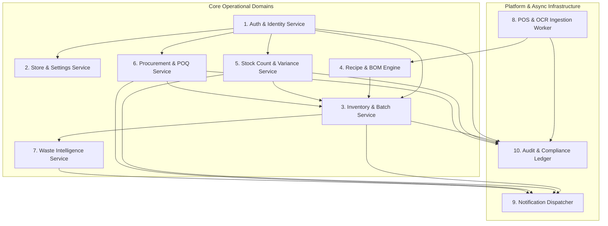

# StockPulse — Microservices & Domain Service Catalog

> **Version:** 1.0.0  
> **Status:** Approved Reference  
> **Companion Document:** [BACKEND_ARCHITECTURE.md](file:///d:/Project%20Local/fnb-mobile/docs/architecture/BACKEND_ARCHITECTURE.md)

---

## 1. Service Map & Architecture Overview

The StockPulse backend is decomposed into domain-driven modular services. While packaged for streamlined container deployment on **AWS ECS Fargate** and event-driven execution on **AWS Lambda**, each service maintains strict bounded contexts, explicit database entity ownership, and decoupled event communication.

---

## 2. Detailed Service Specifications

---

### 1. Auth & Identity Service
- **Domain Context**: Identity & Access Management (IAM), Authentication & Multi-Tenancy.
- **Primary Runtime**: AWS ECS Fargate (Node.js 22 LTS / TypeScript)
- **Database Ownership**: `users`, `roles`, `permissions`, `role_permissions`, `biometric_credentials`
- **Cache Ownership**: `session:{userId}`, `refresh_family:{tokenHash}`, `token_blacklist:{jti}`
- **Core Responsibilities**:
  - Authenticate users via email/password, biometrics, or refresh token rotation.
  - Issue RS256-signed short-lived JWT Access Tokens (15 min) and long-lived Refresh Tokens (30 days).
  - Enforce password policies (bcrypt work factor 12) and account lockout after 5 failed attempts.
  - Store and verify biometric public keys for hardware-backed Expo SecureStore login.
  - Manage user profiles, store assignments, and active session invalidation.
- **Inbound Communication**: REST API (`/api/v1/auth/*`, `/api/v1/team/*`)
- **Outbound Events Emitted**:
  - `user.authenticated`
  - `user.created`
  - `user.role_changed`
  - `session.revoked`
- **Scaling Policy**: Auto-scale based on CPU utilization $> 60\%$ or active connections $> 500$. (Min: 2, Max: 10 tasks across 3 AZs).

---

### 2. Store & Settings Service
- **Domain Context**: Tenant Management, Multi-Store Hierarchy & Operational Configuration.
- **Primary Runtime**: AWS ECS Fargate (Node.js 22 LTS / TypeScript)
- **Database Ownership**: `organizations`, `stores`, `store_settings`, `categories`, `suppliers`
- **Cache Ownership**: `store_config:{storeId}` (TTL: 1 hour)
- **Core Responsibilities**:
  - Multi-store hierarchy, address, tax rate ($19.0\%$), currency symbol (€), and timezone (`Europe/Berlin`).
  - Store-level operational settings: stock count schedules (`Daily 22:00`), default units (`Metric kg/L`), BBD warning window (`7 days`), and safety stock multiplier ($1.2\times$).
  - Category definitions and display order.
  - Supplier master catalog and contact information.
- **Inbound Communication**: REST API (`/api/v1/stores/*`, `/api/v1/settings/*`, `/api/v1/suppliers/*`)
- **Outbound Events Emitted**:
  - `store.created`
  - `store.settings_updated`
  - `supplier.updated`
- **Scaling Policy**: Auto-scale based on CPU utilization $> 70\%$. (Min: 2, Max: 6 tasks).

---

### 3. Inventory & Batch Service
- **Domain Context**: Real-Time Stock Tracking, Batches, Expiration (BBD) & Stock Movements.
- **Primary Runtime**: AWS ECS Fargate (Node.js 22 LTS / TypeScript)
- **Database Ownership**: `inventory_items`, `inventory_batches`, `inventory_transactions` (partitioned ledger)
- **Cache Ownership**: `stock_levels:{storeId}`, `expiring_batches:{storeId}`
- **Core Responsibilities**:
  - Maintain real-time physical, theoretical, target, and safety stock levels for all SKUs.
  - Track individual inventory batches with First-Expiring-First-Out (FEFO) sorting and Best Before Dates (BBD).
  - Atomic stock balance adjustments with reason codes (`DELIVERY_IN`, `POS_DEDUCTION`, `COUNT_VARIANCE`, `SPOILAGE_DISCARD`, `MANUAL_ADJUSTMENT`).
  - Append-only transactional ledger recording before/after stock quantities and financial cost impact.
  - Dynamic stock status categorization: `healthy`, `low`, `critical`, `overstock`.
- **Inbound Communication**: REST API (`/api/v1/inventory/*`, `/api/v1/batches/*`)
- **Outbound Events Emitted**:
  - `inventory.stock_updated`
  - `inventory.safety_threshold_breached`
  - `inventory.stock_depleted`
  - `batch.expiring_soon` (within 24h, 3d, 7d)
  - `batch.expired`
- **Scaling Policy**: Auto-scale based on CPU utilization $> 60\%$ or request count $> 1000\text{ req/min}$. (Min: 3, Max: 20 tasks across 3 AZs).

---

### 4. Recipe & BOM (Bill of Materials) Engine
- **Domain Context**: Menu Engineering, Sub-Recipes, Ingredient Proportions & Theoretical Costing.
- **Primary Runtime**: AWS ECS Fargate (Node.js 22 LTS / TypeScript)
- **Database Ownership**: `recipes`, `recipe_ingredients`, `recipe_cost_history`
- **Cache Ownership**: `recipe_matrix:{storeId}`
- **Core Responsibilities**:
  - Recipe configuration for dishes, drinks, and sub-assemblies (e.g. burger sauce, pizza dough).
  - Ingredient requirement matrices with precision unit conversions (e.g. $0.22\text{ kg Salmon} + 0.05\text{ kg Tomatoes}$ per portion).
  - Dynamic calculation of theoretical raw material consumption based on POS sales volume.
  - Calculation of real-time Cost of Goods Sold (COGS) based on current ingredient batch costs.
- **Inbound Communication**: REST API (`/api/v1/recipes/*`)
- **Outbound Events Emitted**:
  - `recipe.created`
  - `recipe.updated`
  - `bom.deduction_calculated`
- **Scaling Policy**: Auto-scale based on CPU utilization $> 70\%$. (Min: 2, Max: 10 tasks).

---

### 5. POS & OCR Ingestion Worker
- **Domain Context**: Asynchronous Multi-Modal AI Document Processing & Receipt Scanning.
- **Primary Runtime**: AWS Lambda (Container Image) / Google Vertex AI Gemini 1.5 Pro / AWS Bedrock
- **Database Ownership**: `ocr_reports`, `ocr_items`, `ocr_deductions`
- **File Storage**: Amazon S3 (`stockpulse-receipts-prod`)
- **Core Responsibilities**:
  - Process S3 upload notifications for end-of-shift Z-reports and supplier delivery invoices.
  - Image normalization: auto-rotation, deskew, noise reduction, and contrast enhancement.
  - Multi-modal structured JSON extraction: shift, date, register ID, line items, quantities, and totals.
  - Fuzzy catalog matching against active store recipes using Levenshtein distance and semantic embeddings.
  - Calculate confidence scores ($0.0 - 1.0$) and flag ambiguous lines for manual human-in-the-loop review.
  - Emit preview BOM deductions for supervisor approval in the mobile app.
- **Inbound Communication**: S3 EventBridge $\rightarrow$ Amazon SQS (`ocr-ingestion-queue.fifo`)
- **Outbound Events Emitted**:
  - `ocr.processing_started`
  - `ocr.processing_completed`
  - `ocr.review_required`
  - `ocr.confirmed_and_deducted`
- **Scaling Policy**: Concurrency auto-scaling based on SQS queue depth (up to 50 concurrent Lambda workers).

---

### 6. Stock Count & Variance Reconciliation Service
- **Domain Context**: Stocktaking Sessions, Blind Counting, Variance Analytics & Shrinkage Detection.
- **Primary Runtime**: AWS ECS Fargate (Node.js 22 LTS / TypeScript) + WebSocket Gateway
- **Database Ownership**: `count_schedules`, `stock_count_sessions`, `stock_count_items`
- **Cache Ownership**: `active_count_session:{sessionId}` (Redis Hash for live multi-user counts)
- **Core Responsibilities**:
  - Manage scheduled audit intervals (Daily high-value meat/seafood, Weekly category counts, Monthly full storetakes).
  - Coordinate blind counting sessions on mobile devices (hiding theoretical stock from staff to ensure count integrity).
  - Calculate variance quantity ($\Delta = \text{Counted} - \text{Theoretical}$) and financial discrepancy value ($\Delta \times \text{Cost per unit}$).
  - Multi-user collaborative counting via WebSockets (locking items being counted by another team member).
  - On approval, execute atomic ledger sync to align theoretical stock with physical count.
- **Inbound Communication**: REST API (`/api/v1/stock-counts/*`) and WebSocket Gateway
- **Outbound Events Emitted**:
  - `stock_count.started`
  - `stock_count.item_counted`
  - `stock_count.completed`
  - `variance.critical_threshold_exceeded` ($> €50\text{ or } > 10\%$)
- **Scaling Policy**: Auto-scale based on active WebSocket connections and CPU utilization $> 65\%$. (Min: 2, Max: 15 tasks).

---

### 7. Procurement & POQ (Purchase Order Quantity) Service
- **Domain Context**: Replenishment Intelligence, Supplier Purchase Orders & Goods Receipt Check-in.
- **Primary Runtime**: AWS ECS Fargate (Node.js 22 LTS / TypeScript)
- **Database Ownership**: `purchase_orders`, `purchase_order_lines`, `goods_receipts`, `goods_receipt_items`
- **Core Responsibilities**:
  - Algorithmic POQ calculation based on target stock, physical inventory, safety thresholds, and consumption velocity:
    $$\text{POQ} = \max(0, \text{Target Stock} - \text{Physical Stock})$$
  - Purchase order lifecycle management (`draft` $\rightarrow$ `sent` $\rightarrow$ `confirmed` $\rightarrow$ `received` $\rightarrow$ `cancelled`).
  - Generate supplier-ready PDF purchase orders and dispatch via automated email.
  - Goods receipt verification against original PO lines, logging delivery discrepancies and short-ships.
  - Automated generation of new FEFO inventory batches with expiration dates during goods receipt check-in.
- **Inbound Communication**: REST API (`/api/v1/procurement/*`, `/api/v1/goods-receipt/*`)
- **Outbound Events Emitted**:
  - `po.created`
  - `po.dispatched_to_supplier`
  - `goods_receipt.completed`
  - `batches.created_from_delivery`
- **Scaling Policy**: Auto-scale based on CPU utilization $> 70\%$. (Min: 2, Max: 8 tasks).

---

### 8. Waste Intelligence & Expiry Mitigation Service
- **Domain Context**: Spoilage Recording, Loss Analytics & AI-Driven Promotion Suggestions.
- **Primary Runtime**: AWS ECS Fargate (Node.js 22 LTS / TypeScript)
- **Database Ownership**: `waste_logs`, `waste_suggestions`
- **Core Responsibilities**:
  - Record food waste incidents with reason codes (`EXPIRED`, `PREP_SPOILAGE`, `CUSTOMER_RETURN`, `STORAGE_FAILURE`).
  - Calculate cumulative financial loss from waste and track waste-to-revenue ratios.
  - AI Waste Reduction Engine: Monitor batches with $< 48\text{ hours}$ remaining and match against high-margin recipes to generate daily specials (e.g. *Promote Pan-Seared Salmon daily special to utilize 4.2 kg before tomorrow's expiry*).
- **Inbound Communication**: REST API (`/api/v1/waste/*`, `/api/v1/suggestions/*`)
- **Outbound Events Emitted**:
  - `waste.logged`
  - `waste_suggestion.generated`
  - `waste_suggestion.accepted`
- **Scaling Policy**: Auto-scale based on CPU utilization $> 70\%$. (Min: 2, Max: 6 tasks).

---

### 9. Notification & Dispatch Service
- **Domain Context**: Push Notifications, Device Token Registry & Real-Time Alert Routing.
- **Primary Runtime**: AWS Lambda (Node.js 22 LTS)
- **Database Ownership**: `notifications`, `device_tokens`, `notification_preferences`
- **External Integrations**: Apple Push Notification service (APNs), Firebase Cloud Messaging v1 (FCM), Amazon SNS
- **Core Responsibilities**:
  - Manage mobile device push tokens (iOS APNs / Android FCM) with automatic invalidation on uninstall.
  - Route alerts based on user role and store context (e.g. critical variance sent only to Managers; count reminders sent to all staff).
  - Smart alert coalescing: bundle multiple expiring batch alerts into a single consolidated daily digest.
  - Maintain persistent in-app notification inbox with read/unread status.
- **Inbound Communication**: EventBridge $\rightarrow$ Amazon SQS (`push-dispatch-queue`) & REST API (`/api/v1/notifications/*`)
- **Outbound Events Emitted**:
  - `notification.delivered`
  - `notification.opened`
- **Scaling Policy**: Concurrency auto-scale based on SQS queue depth (up to 100 concurrent workers).

---

### 10. Audit Ledger & Compliance Service
- **Domain Context**: Immutable Transaction Journaling, Forensic Search & Regulatory Compliance.
- **Primary Runtime**: AWS Lambda / Amazon Kinesis Data Firehose
- **Database Ownership**: Amazon S3 (`stockpulse-audit-prod` with Object Lock WORM), Amazon OpenSearch Service
- **Core Responsibilities**:
  - Ingest all state-changing domain events from the transactional outbox.
  - Enrich event metadata with actor ID, role, IP address, user agent, store tenant ID, and state before/after diffs.
  - Maintain cryptographic HMAC-SHA256 hash chaining to guarantee mathematical immutability.
  - Stream logs into Amazon OpenSearch for instant auditor filtering and compliance export generation.
- **Inbound Communication**: Kinesis Data Stream $\rightarrow$ Firehose $\rightarrow$ S3 & OpenSearch
- **Outbound Events Emitted**:
  - `audit.batch_archived`
- **Scaling Policy**: Auto-scaling Kinesis shards and OpenSearch data nodes.

---

## 3. Service Operational Summary

| Service | Protocol | DB / Storage | Auth Level | SLA |
|---|---|---|---|:---:|
| **Auth & Identity** | REST | PostgreSQL, Redis | Public & Token Refresh | 99.99% |
| **Store & Settings** | REST | PostgreSQL | `manager`, `admin` | 99.95% |
| **Inventory & Batches** | REST | PostgreSQL, Redis | All Authenticated | 99.99% |
| **Recipe & BOM Engine** | REST | PostgreSQL | `supervisor`, `manager`, `admin` | 99.95% |
| **Stock Count & Variance**| REST, WSS | PostgreSQL, Redis | All Authenticated | 99.95% |
| **Procurement & POQ** | REST | PostgreSQL | All Authenticated | 99.90% |
| **POS & OCR Ingestion** | S3, SQS, REST | S3, PostgreSQL | `staff`, `supervisor`, `manager` | 99.90% |
| **Waste Intelligence** | REST | PostgreSQL | All Authenticated | 99.90% |
| **Notification Engine** | SQS, REST | PostgreSQL, APNs/FCM | All Authenticated | 99.99% |
| **Audit Ledger** | Kinesis, S3 | S3 WORM, OpenSearch | `auditor`, `superadmin` | 99.99% |
