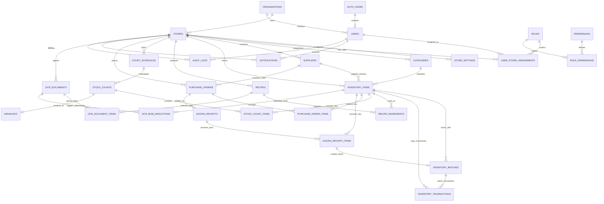

# StockPulse — Complete Supabase PostgreSQL Production Schema & RLS

> **Version:** 1.0.0  
> **Database:** Supabase PostgreSQL 16+  
> **Target Environment:** Multi-Store Food & Beverage Inventory with Row-Level Security (RLS)  
> **Companion Documents:**  
> - [DOMAIN_MODEL.md](file:///d:/Project%20Local/fnb-mobile/docs/architecture/DOMAIN_MODEL.md)  
> - [NESTJS_MODULE_STRUCTURE.md](file:///d:/Project%20Local/fnb-mobile/docs/architecture/NESTJS_MODULE_STRUCTURE.md)  
> - [BACKEND_ARCHITECTURE.md](file:///d:/Project%20Local/fnb-mobile/docs/architecture/BACKEND_ARCHITECTURE.md)  

---

## 1. Entity-Relationship Diagram (ERD)



---

## 2. Supabase PostgreSQL DDL Script

```sql
-- ============================================================================
-- StockPulse Supabase PostgreSQL Schema & Security Baseline
-- ============================================================================

-- Enable Required Supabase & PostgreSQL Extensions
CREATE EXTENSION IF NOT EXISTS "uuid-ossp";
CREATE EXTENSION IF NOT EXISTS "pgcrypto";
CREATE EXTENSION IF NOT EXISTS "pg_trgm";

-- ----------------------------------------------------------------------------
-- 1. Organizations & Stores
-- ----------------------------------------------------------------------------
CREATE TABLE organizations (
    id UUID PRIMARY KEY DEFAULT gen_random_uuid(),
    name VARCHAR(255) NOT NULL,
    tax_identifier VARCHAR(100),
    plan_tier VARCHAR(50) NOT NULL DEFAULT 'enterprise',
    created_at TIMESTAMPTZ NOT NULL DEFAULT NOW(),
    updated_at TIMESTAMPTZ NOT NULL DEFAULT NOW(),
    version INTEGER NOT NULL DEFAULT 1,
    deleted_at TIMESTAMPTZ,
    deleted_by UUID
);

CREATE TABLE stores (
    id UUID PRIMARY KEY DEFAULT gen_random_uuid(),
    organization_id UUID NOT NULL REFERENCES organizations(id) ON DELETE CASCADE,
    code VARCHAR(50) NOT NULL,
    name VARCHAR(255) NOT NULL,
    address TEXT,
    currency VARCHAR(3) NOT NULL DEFAULT 'EUR',
    currency_symbol VARCHAR(10) NOT NULL DEFAULT '€',
    tax_rate NUMERIC(5,2) NOT NULL DEFAULT 19.00,
    timezone VARCHAR(100) NOT NULL DEFAULT 'Europe/Berlin',
    is_active BOOLEAN NOT NULL DEFAULT TRUE,
    created_at TIMESTAMPTZ NOT NULL DEFAULT NOW(),
    created_by UUID,
    updated_at TIMESTAMPTZ NOT NULL DEFAULT NOW(),
    updated_by UUID,
    version INTEGER NOT NULL DEFAULT 1,
    deleted_at TIMESTAMPTZ,
    deleted_by UUID
);
CREATE UNIQUE INDEX uq_store_code ON stores(code) WHERE deleted_at IS NULL;

CREATE TABLE store_settings (
    id UUID PRIMARY KEY DEFAULT gen_random_uuid(),
    store_id UUID UNIQUE NOT NULL REFERENCES stores(id) ON DELETE CASCADE,
    count_schedule VARCHAR(100) DEFAULT 'Daily 22:00',
    default_units VARCHAR(50) DEFAULT 'Metric (kg, L)',
    bbd_alert_days INTEGER NOT NULL DEFAULT 7,
    safety_stock_multiplier NUMERIC(3,2) NOT NULL DEFAULT 1.20,
    created_at TIMESTAMPTZ NOT NULL DEFAULT NOW(),
    updated_at TIMESTAMPTZ NOT NULL DEFAULT NOW()
);

-- ----------------------------------------------------------------------------
-- 2. RBAC Roles, Permissions & Users (Supabase Auth Integration)
-- ----------------------------------------------------------------------------
CREATE TABLE roles (
    id UUID PRIMARY KEY DEFAULT gen_random_uuid(),
    code VARCHAR(50) UNIQUE NOT NULL,
    name VARCHAR(100) NOT NULL,
    description TEXT,
    is_system BOOLEAN NOT NULL DEFAULT TRUE,
    created_at TIMESTAMPTZ NOT NULL DEFAULT NOW()
);

CREATE TABLE permissions (
    id UUID PRIMARY KEY DEFAULT gen_random_uuid(),
    code VARCHAR(100) UNIQUE NOT NULL,
    module VARCHAR(50) NOT NULL,
    name VARCHAR(100) NOT NULL,
    description TEXT,
    created_at TIMESTAMPTZ NOT NULL DEFAULT NOW()
);

CREATE TABLE role_permissions (
    role_id UUID NOT NULL REFERENCES roles(id) ON DELETE CASCADE,
    permission_id UUID NOT NULL REFERENCES permissions(id) ON DELETE CASCADE,
    PRIMARY KEY (role_id, permission_id)
);

CREATE TABLE users (
    id UUID PRIMARY KEY REFERENCES auth.users(id) ON DELETE CASCADE,
    organization_id UUID NOT NULL REFERENCES organizations(id) ON DELETE CASCADE,
    default_store_id UUID NOT NULL REFERENCES stores(id) ON DELETE RESTRICT,
    email VARCHAR(255) NOT NULL,
    name VARCHAR(255) NOT NULL,
    role VARCHAR(50) NOT NULL REFERENCES roles(code),
    avatar_text VARCHAR(10) NOT NULL DEFAULT 'U',
    phone VARCHAR(50),
    biometrics_enabled BOOLEAN NOT NULL DEFAULT TRUE,
    biometrics_public_key TEXT,
    is_active BOOLEAN NOT NULL DEFAULT TRUE,
    last_active_at TIMESTAMPTZ,
    created_at TIMESTAMPTZ NOT NULL DEFAULT NOW(),
    created_by UUID,
    updated_at TIMESTAMPTZ NOT NULL DEFAULT NOW(),
    updated_by UUID,
    version INTEGER NOT NULL DEFAULT 1,
    deleted_at TIMESTAMPTZ,
    deleted_by UUID
);
CREATE UNIQUE INDEX uq_users_email ON users(email) WHERE deleted_at IS NULL;

CREATE TABLE user_store_assignments (
    id UUID PRIMARY KEY DEFAULT gen_random_uuid(),
    user_id UUID NOT NULL REFERENCES users(id) ON DELETE CASCADE,
    store_id UUID NOT NULL REFERENCES stores(id) ON DELETE CASCADE,
    role_code VARCHAR(50) NOT NULL REFERENCES roles(code),
    created_at TIMESTAMPTZ NOT NULL DEFAULT NOW(),
    CONSTRAINT uq_user_store_assignment UNIQUE (user_id, store_id)
);

-- ----------------------------------------------------------------------------
-- 3. Categories, Suppliers & Inventory Items
-- ----------------------------------------------------------------------------
CREATE TABLE categories (
    id UUID PRIMARY KEY DEFAULT gen_random_uuid(),
    store_id UUID NOT NULL REFERENCES stores(id) ON DELETE CASCADE,
    name VARCHAR(255) NOT NULL,
    description TEXT,
    color VARCHAR(20) DEFAULT '#3b82f6',
    display_order INTEGER NOT NULL DEFAULT 0,
    created_at TIMESTAMPTZ NOT NULL DEFAULT NOW(),
    deleted_at TIMESTAMPTZ
);
CREATE UNIQUE INDEX uq_categories_store_name ON categories(store_id, name) WHERE deleted_at IS NULL;

CREATE TABLE suppliers (
    id UUID PRIMARY KEY DEFAULT gen_random_uuid(),
    store_id UUID NOT NULL REFERENCES stores(id) ON DELETE CASCADE,
    supplier_code VARCHAR(50) NOT NULL,
    name VARCHAR(255) NOT NULL,
    contact_name VARCHAR(255),
    phone VARCHAR(50),
    email VARCHAR(255),
    lead_time_days INTEGER NOT NULL DEFAULT 1,
    payment_terms VARCHAR(100),
    last_delivery_date DATE,
    created_at TIMESTAMPTZ NOT NULL DEFAULT NOW(),
    deleted_at TIMESTAMPTZ
);
CREATE UNIQUE INDEX uq_suppliers_code ON suppliers(store_id, supplier_code) WHERE deleted_at IS NULL;

CREATE TABLE inventory_items (
    id UUID PRIMARY KEY DEFAULT gen_random_uuid(),
    store_id UUID NOT NULL REFERENCES stores(id) ON DELETE CASCADE,
    category_id UUID REFERENCES categories(id) ON DELETE SET NULL,
    supplier_id UUID REFERENCES suppliers(id) ON DELETE SET NULL,
    sku VARCHAR(100) NOT NULL,
    name VARCHAR(255) NOT NULL,
    unit VARCHAR(20) NOT NULL CHECK (unit IN ('kg', 'g', 'L', 'ml', 'pcs', 'can', 'bottle')),
    physical_stock NUMERIC(12,3) NOT NULL DEFAULT 0.000,
    theoretical_stock NUMERIC(12,3) NOT NULL DEFAULT 0.000,
    target_stock NUMERIC(12,3) NOT NULL DEFAULT 0.000,
    safety_stock NUMERIC(12,3) NOT NULL DEFAULT 0.000,
    cost_per_unit NUMERIC(10,2) NOT NULL DEFAULT 0.00,
    status VARCHAR(20) NOT NULL DEFAULT 'healthy' CHECK (status IN ('healthy', 'low', 'critical', 'overstock')),
    version INTEGER NOT NULL DEFAULT 1,
    created_at TIMESTAMPTZ NOT NULL DEFAULT NOW(),
    created_by UUID REFERENCES users(id),
    updated_at TIMESTAMPTZ NOT NULL DEFAULT NOW(),
    updated_by UUID REFERENCES users(id),
    deleted_at TIMESTAMPTZ,
    deleted_by UUID
);
CREATE UNIQUE INDEX uq_inventory_sku ON inventory_items(store_id, sku) WHERE deleted_at IS NULL;
CREATE INDEX idx_inventory_name_trgm ON inventory_items USING GIN (name gin_trgm_ops);

-- ----------------------------------------------------------------------------
-- 4. Batches & Append-Only Movement Ledger
-- ----------------------------------------------------------------------------
CREATE TABLE inventory_batches (
    id UUID PRIMARY KEY DEFAULT gen_random_uuid(),
    store_id UUID NOT NULL REFERENCES stores(id) ON DELETE CASCADE,
    item_id UUID NOT NULL REFERENCES inventory_items(id) ON DELETE CASCADE,
    batch_number VARCHAR(100) NOT NULL,
    quantity NUMERIC(12,3) NOT NULL CHECK (quantity >= 0),
    initial_quantity NUMERIC(12,3) NOT NULL,
    cost_per_unit NUMERIC(10,2) NOT NULL,
    expiry_date DATE NOT NULL,
    status VARCHAR(20) NOT NULL DEFAULT 'active' CHECK (status IN ('active', 'consumed', 'wasted', 'expired')),
    received_at TIMESTAMPTZ NOT NULL DEFAULT NOW(),
    created_at TIMESTAMPTZ NOT NULL DEFAULT NOW()
);
CREATE INDEX idx_batches_fefo ON inventory_batches(store_id, item_id, expiry_date ASC) WHERE status = 'active';

CREATE TABLE inventory_transactions (
    id UUID PRIMARY KEY DEFAULT gen_random_uuid(),
    store_id UUID NOT NULL REFERENCES stores(id) ON DELETE CASCADE,
    item_id UUID NOT NULL REFERENCES inventory_items(id) ON DELETE CASCADE,
    batch_id UUID REFERENCES inventory_batches(id) ON DELETE SET NULL,
    transaction_number VARCHAR(100) NOT NULL,
    transaction_type VARCHAR(50) NOT NULL CHECK (transaction_type IN (
        'PURCHASE_RECEIPT', 'POS_DEDUCTION', 'COUNT_VARIANCE', 'WASTE_DISCARD', 'MANUAL_ADJUSTMENT'
    )),
    delta NUMERIC(12,3) NOT NULL,
    previous_stock NUMERIC(12,3) NOT NULL,
    new_stock NUMERIC(12,3) NOT NULL,
    cost_impact NUMERIC(10,2) NOT NULL DEFAULT 0.00,
    actor_id UUID REFERENCES users(id) ON DELETE SET NULL,
    actor_name VARCHAR(255),
    reference_type VARCHAR(50),
    reference_id VARCHAR(100),
    note TEXT,
    created_at TIMESTAMPTZ NOT NULL DEFAULT NOW()
);

-- ----------------------------------------------------------------------------
-- 5. Recipes & Bill of Materials (BOM)
-- ----------------------------------------------------------------------------
CREATE TABLE recipes (
    id UUID PRIMARY KEY DEFAULT gen_random_uuid(),
    store_id UUID NOT NULL REFERENCES stores(id) ON DELETE CASCADE,
    recipe_code VARCHAR(50) NOT NULL,
    name VARCHAR(255) NOT NULL,
    category VARCHAR(100) NOT NULL DEFAULT 'Main Course',
    portions_sold_today INTEGER NOT NULL DEFAULT 0,
    standard_cost NUMERIC(10,2) NOT NULL DEFAULT 0.00,
    target_margin_pct NUMERIC(5,2) NOT NULL DEFAULT 70.00,
    is_active BOOLEAN NOT NULL DEFAULT TRUE,
    created_at TIMESTAMPTZ NOT NULL DEFAULT NOW(),
    created_by UUID REFERENCES users(id),
    updated_at TIMESTAMPTZ NOT NULL DEFAULT NOW(),
    updated_by UUID REFERENCES users(id),
    version INTEGER NOT NULL DEFAULT 1,
    deleted_at TIMESTAMPTZ,
    deleted_by UUID
);
CREATE UNIQUE INDEX uq_recipes_code ON recipes(store_id, recipe_code) WHERE deleted_at IS NULL;

CREATE TABLE recipe_ingredients (
    id UUID PRIMARY KEY DEFAULT gen_random_uuid(),
    recipe_id UUID NOT NULL REFERENCES recipes(id) ON DELETE CASCADE,
    item_id UUID NOT NULL REFERENCES inventory_items(id) ON DELETE RESTRICT,
    quantity_required NUMERIC(10,4) NOT NULL CHECK (quantity_required > 0),
    unit VARCHAR(20) NOT NULL,
    yield_percentage NUMERIC(5,2) NOT NULL DEFAULT 100.00,
    cost_contribution NUMERIC(10,2) NOT NULL DEFAULT 0.00,
    created_at TIMESTAMPTZ NOT NULL DEFAULT NOW(),
    CONSTRAINT uq_recipe_ingredient UNIQUE (recipe_id, item_id)
);

-- ----------------------------------------------------------------------------
-- 6. Stock Counts & Variances
-- ----------------------------------------------------------------------------
CREATE TABLE count_schedules (
    id UUID PRIMARY KEY DEFAULT gen_random_uuid(),
    store_id UUID NOT NULL REFERENCES stores(id) ON DELETE CASCADE,
    schedule_code VARCHAR(50) NOT NULL,
    label VARCHAR(255) NOT NULL,
    frequency VARCHAR(50) NOT NULL DEFAULT 'daily' CHECK (frequency IN ('daily', 'weekly', 'monthly')),
    due_time VARCHAR(20) NOT NULL DEFAULT '22:00',
    created_at TIMESTAMPTZ NOT NULL DEFAULT NOW(),
    created_by UUID REFERENCES users(id),
    updated_at TIMESTAMPTZ NOT NULL DEFAULT NOW(),
    updated_by UUID REFERENCES users(id),
    version INTEGER NOT NULL DEFAULT 1,
    deleted_at TIMESTAMPTZ,
    deleted_by UUID
);

CREATE TABLE stock_counts (
    id UUID PRIMARY KEY DEFAULT gen_random_uuid(),
    store_id UUID NOT NULL REFERENCES stores(id) ON DELETE CASCADE,
    schedule_id UUID REFERENCES count_schedules(id) ON DELETE SET NULL,
    count_number VARCHAR(50) NOT NULL UNIQUE,
    conducted_by UUID NOT NULL REFERENCES users(id),
    status VARCHAR(30) NOT NULL DEFAULT 'in_progress' CHECK (status IN ('draft', 'in_progress', 'completed', 'approved', 'rejected')),
    count_type VARCHAR(20) NOT NULL DEFAULT 'blind' CHECK (count_type IN ('blind', 'standard')),
    total_items_counted INTEGER NOT NULL DEFAULT 0,
    total_variance_value NUMERIC(10,2) NOT NULL DEFAULT 0.00,
    completed_at TIMESTAMPTZ,
    approved_by UUID REFERENCES users(id),
    created_at TIMESTAMPTZ NOT NULL DEFAULT NOW(),
    created_by UUID REFERENCES users(id),
    updated_at TIMESTAMPTZ NOT NULL DEFAULT NOW(),
    updated_by UUID REFERENCES users(id),
    version INTEGER NOT NULL DEFAULT 1
);

CREATE TABLE stock_count_items (
    id UUID PRIMARY KEY DEFAULT gen_random_uuid(),
    stock_count_id UUID NOT NULL REFERENCES stock_counts(id) ON DELETE CASCADE,
    item_id UUID NOT NULL REFERENCES inventory_items(id) ON DELETE RESTRICT,
    expected_qty NUMERIC(12,3) NOT NULL,
    counted_qty NUMERIC(12,3) NOT NULL,
    variance_qty NUMERIC(12,3) GENERATED ALWAYS AS (counted_qty - expected_qty) STORED,
    unit_cost NUMERIC(10,2) NOT NULL,
    variance_value NUMERIC(10,2) GENERATED ALWAYS AS ((counted_qty - expected_qty) * unit_cost) STORED,
    notes TEXT,
    counted_by UUID NOT NULL REFERENCES users(id),
    counted_at TIMESTAMPTZ NOT NULL DEFAULT NOW(),
    CONSTRAINT uq_stock_count_item UNIQUE (stock_count_id, item_id)
);

CREATE TABLE variances (
    id UUID PRIMARY KEY DEFAULT gen_random_uuid(),
    store_id UUID NOT NULL REFERENCES stores(id) ON DELETE CASCADE,
    stock_count_id UUID UNIQUE NOT NULL REFERENCES stock_counts(id) ON DELETE CASCADE,
    variance_number VARCHAR(50) NOT NULL UNIQUE,
    total_net_shrinkage NUMERIC(10,2) NOT NULL,
    approved_by UUID NOT NULL REFERENCES users(id),
    approved_at TIMESTAMPTZ NOT NULL DEFAULT NOW(),
    ledger_synced_at TIMESTAMPTZ NOT NULL DEFAULT NOW(),
    notes TEXT,
    created_at TIMESTAMPTZ NOT NULL DEFAULT NOW()
);

-- ----------------------------------------------------------------------------
-- 7. Purchase Orders & Purchase Order Items
-- ----------------------------------------------------------------------------
CREATE TABLE purchase_orders (
    id UUID PRIMARY KEY DEFAULT gen_random_uuid(),
    store_id UUID NOT NULL REFERENCES stores(id) ON DELETE CASCADE,
    supplier_id UUID NOT NULL REFERENCES suppliers(id) ON DELETE RESTRICT,
    order_number VARCHAR(50) NOT NULL UNIQUE,
    order_date DATE NOT NULL,
    expected_delivery_date DATE,
    status VARCHAR(30) NOT NULL DEFAULT 'draft' CHECK (status IN ('draft', 'sent', 'confirmed', 'partially_received', 'received', 'cancelled')),
    subtotal NUMERIC(10,2) NOT NULL DEFAULT 0.00,
    tax_amount NUMERIC(10,2) NOT NULL DEFAULT 0.00,
    total_amount NUMERIC(10,2) NOT NULL DEFAULT 0.00,
    approved_by UUID REFERENCES users(id),
    approved_at TIMESTAMPTZ,
    created_at TIMESTAMPTZ NOT NULL DEFAULT NOW(),
    created_by UUID REFERENCES users(id),
    updated_at TIMESTAMPTZ NOT NULL DEFAULT NOW(),
    updated_by UUID REFERENCES users(id),
    version INTEGER NOT NULL DEFAULT 1,
    deleted_at TIMESTAMPTZ,
    deleted_by UUID
);

CREATE TABLE purchase_order_items (
    id UUID PRIMARY KEY DEFAULT gen_random_uuid(),
    purchase_order_id UUID NOT NULL REFERENCES purchase_orders(id) ON DELETE CASCADE,
    item_id UUID NOT NULL REFERENCES inventory_items(id) ON DELETE RESTRICT,
    quantity_ordered NUMERIC(12,3) NOT NULL CHECK (quantity_ordered > 0),
    quantity_received NUMERIC(12,3) NOT NULL DEFAULT 0.000,
    unit VARCHAR(20) NOT NULL,
    unit_price NUMERIC(10,2) NOT NULL,
    total_price NUMERIC(10,2) NOT NULL DEFAULT 0.00,
    CONSTRAINT uq_po_item UNIQUE (purchase_order_id, item_id)
);

-- ----------------------------------------------------------------------------
-- 8. Goods Receipts
-- ----------------------------------------------------------------------------
CREATE TABLE goods_receipts (
    id UUID PRIMARY KEY DEFAULT gen_random_uuid(),
    store_id UUID NOT NULL REFERENCES stores(id) ON DELETE CASCADE,
    purchase_order_id UUID REFERENCES purchase_orders(id) ON DELETE SET NULL,
    supplier_id UUID NOT NULL REFERENCES suppliers(id) ON DELETE RESTRICT,
    receipt_number VARCHAR(50) NOT NULL UNIQUE,
    invoice_number VARCHAR(100) NOT NULL,
    receipt_date DATE NOT NULL,
    total_amount NUMERIC(10,2) NOT NULL DEFAULT 0.00,
    status VARCHAR(30) NOT NULL DEFAULT 'verified' CHECK (status IN ('draft', 'verified', 'discrepancy')),
    received_by UUID NOT NULL REFERENCES users(id),
    created_at TIMESTAMPTZ NOT NULL DEFAULT NOW(),
    created_by UUID REFERENCES users(id),
    updated_at TIMESTAMPTZ NOT NULL DEFAULT NOW(),
    updated_by UUID REFERENCES users(id),
    version INTEGER NOT NULL DEFAULT 1
);

CREATE TABLE goods_receipt_items (
    id UUID PRIMARY KEY DEFAULT gen_random_uuid(),
    goods_receipt_id UUID NOT NULL REFERENCES goods_receipts(id) ON DELETE CASCADE,
    po_item_id UUID REFERENCES purchase_order_items(id) ON DELETE SET NULL,
    item_id UUID NOT NULL REFERENCES inventory_items(id) ON DELETE RESTRICT,
    quantity_received NUMERIC(12,3) NOT NULL CHECK (quantity_received >= 0),
    unit VARCHAR(20) NOT NULL,
    price_per_unit NUMERIC(10,2) NOT NULL,
    batch_number VARCHAR(100) NOT NULL,
    expiry_date DATE NOT NULL,
    created_batch_id UUID REFERENCES inventory_batches(id),
    is_accepted BOOLEAN NOT NULL DEFAULT TRUE
);

-- ----------------------------------------------------------------------------
-- 9. OCR Documents (Google Cloud Document AI)
-- ----------------------------------------------------------------------------
CREATE TABLE ocr_documents (
    id UUID PRIMARY KEY DEFAULT gen_random_uuid(),
    store_id UUID NOT NULL REFERENCES stores(id) ON DELETE CASCADE,
    document_number VARCHAR(50) NOT NULL UNIQUE,
    document_type VARCHAR(50) NOT NULL DEFAULT 'pos_z_report' CHECK (document_type IN ('pos_z_report', 'supplier_invoice')),
    storage_path TEXT NOT NULL,
    mime_type VARCHAR(100) NOT NULL DEFAULT 'image/jpeg',
    file_size_bytes INTEGER NOT NULL,
    status VARCHAR(30) NOT NULL DEFAULT 'uploaded' CHECK (status IN ('uploaded', 'processing', 'review_pending', 'confirmed', 'rejected')),
    confidence_score NUMERIC(4,3) NOT NULL DEFAULT 0.000,
    total_portions INTEGER NOT NULL DEFAULT 0,
    extracted_date DATE,
    extracted_shift VARCHAR(50),
    confirmed_by UUID REFERENCES users(id),
    confirmed_at TIMESTAMPTZ,
    created_at TIMESTAMPTZ NOT NULL DEFAULT NOW(),
    created_by UUID REFERENCES users(id),
    updated_at TIMESTAMPTZ NOT NULL DEFAULT NOW(),
    updated_by UUID REFERENCES users(id),
    version INTEGER NOT NULL DEFAULT 1
);

CREATE TABLE ocr_document_items (
    id UUID PRIMARY KEY DEFAULT gen_random_uuid(),
    ocr_document_id UUID NOT NULL REFERENCES ocr_documents(id) ON DELETE CASCADE,
    line_number INTEGER NOT NULL,
    art_nr VARCHAR(100),
    raw_text VARCHAR(255) NOT NULL,
    matched_recipe_id UUID REFERENCES recipes(id) ON DELETE SET NULL,
    matched_item_id UUID REFERENCES inventory_items(id) ON DELETE SET NULL,
    quantity INTEGER NOT NULL CHECK (quantity >= 0),
    confidence NUMERIC(4,3) NOT NULL,
    unit_price NUMERIC(10,2),
    is_confirmed BOOLEAN NOT NULL DEFAULT FALSE
);

CREATE TABLE ocr_bom_deductions (
    id UUID PRIMARY KEY DEFAULT gen_random_uuid(),
    ocr_document_id UUID NOT NULL REFERENCES ocr_documents(id) ON DELETE CASCADE,
    item_id UUID NOT NULL REFERENCES inventory_items(id) ON DELETE RESTRICT,
    delta_quantity NUMERIC(12,3) NOT NULL,
    unit VARCHAR(20) NOT NULL,
    theoretical_before NUMERIC(12,3) NOT NULL,
    theoretical_after NUMERIC(12,3) NOT NULL,
    cost_eur NUMERIC(10,2) NOT NULL,
    applied_at TIMESTAMPTZ NOT NULL DEFAULT NOW()
);

-- ----------------------------------------------------------------------------
-- 10. Notifications & Audit Logs
-- ----------------------------------------------------------------------------
CREATE TABLE notifications (
    id UUID PRIMARY KEY DEFAULT gen_random_uuid(),
    store_id UUID NOT NULL REFERENCES stores(id) ON DELETE CASCADE,
    user_id UUID REFERENCES users(id) ON DELETE CASCADE,
    notification_number VARCHAR(50) NOT NULL UNIQUE,
    type VARCHAR(50) NOT NULL,
    title VARCHAR(255) NOT NULL,
    message TEXT NOT NULL,
    urgency VARCHAR(20) NOT NULL DEFAULT 'normal' CHECK (urgency IN ('normal', 'critical')),
    route VARCHAR(255),
    is_read BOOLEAN NOT NULL DEFAULT FALSE,
    read_at TIMESTAMPTZ,
    created_at TIMESTAMPTZ NOT NULL DEFAULT NOW()
);

CREATE TABLE audit_logs (
    id UUID PRIMARY KEY DEFAULT gen_random_uuid(),
    organization_id UUID NOT NULL REFERENCES organizations(id) ON DELETE CASCADE,
    store_id UUID NOT NULL REFERENCES stores(id) ON DELETE CASCADE,
    event_number VARCHAR(50) NOT NULL,
    actor_id UUID REFERENCES users(id) ON DELETE SET NULL,
    actor_role VARCHAR(50),
    ip_address INET,
    user_agent TEXT,
    event_action VARCHAR(100) NOT NULL,
    entity_type VARCHAR(100) NOT NULL,
    entity_id VARCHAR(100) NOT NULL,
    state_before JSONB,
    state_after JSONB,
    state_diff JSONB,
    reason_code VARCHAR(100),
    prev_hash VARCHAR(64) NOT NULL,
    current_hash VARCHAR(64) NOT NULL,
    created_at TIMESTAMPTZ NOT NULL DEFAULT NOW()
);
```

---

## 3. Supabase Row-Level Security (RLS) Strategy

### 3.1 Supabase RLS Helper Functions

```sql
-- Helper 1: Extract User's Assigned Store ID from JWT / Database
CREATE OR REPLACE FUNCTION get_auth_store_id()
RETURNS UUID AS $$
    SELECT COALESCE(
        NULLIF(current_setting('app.current_store_id', true), '')::UUID,
        (SELECT default_store_id FROM users WHERE id = auth.uid())
    );
$$ LANGUAGE sql STABLE SECURITY DEFINER;

-- Helper 2: Check if Authenticated User has SuperAdmin Role
CREATE OR REPLACE FUNCTION is_superadmin()
RETURNS BOOLEAN AS $$
    SELECT EXISTS (
        SELECT 1 FROM users WHERE id = auth.uid() AND role = 'superadmin'
    );
$$ LANGUAGE sql STABLE SECURITY DEFINER;
```

### 3.2 Row-Level Security Policies

```sql
-- Enable RLS across all store-partitioned tables
ALTER TABLE stores ENABLE ROW LEVEL SECURITY;
ALTER TABLE store_settings ENABLE ROW LEVEL SECURITY;
ALTER TABLE users ENABLE ROW LEVEL SECURITY;
ALTER TABLE categories ENABLE ROW LEVEL SECURITY;
ALTER TABLE suppliers ENABLE ROW LEVEL SECURITY;
ALTER TABLE inventory_items ENABLE ROW LEVEL SECURITY;
ALTER TABLE inventory_batches ENABLE ROW LEVEL SECURITY;
ALTER TABLE inventory_transactions ENABLE ROW LEVEL SECURITY;
ALTER TABLE recipes ENABLE ROW LEVEL SECURITY;
ALTER TABLE stock_counts ENABLE ROW LEVEL SECURITY;
ALTER TABLE variances ENABLE ROW LEVEL SECURITY;
ALTER TABLE purchase_orders ENABLE ROW LEVEL SECURITY;
ALTER TABLE goods_receipts ENABLE ROW LEVEL SECURITY;
ALTER TABLE ocr_documents ENABLE ROW LEVEL SECURITY;
ALTER TABLE notifications ENABLE ROW LEVEL SECURITY;
ALTER TABLE audit_logs ENABLE ROW LEVEL SECURITY;

-- 1. Stores Policy: User can only read their assigned stores
CREATE POLICY "stores_select_policy" ON stores
    FOR SELECT USING (
        id IN (SELECT store_id FROM user_store_assignments WHERE user_id = auth.uid())
        OR id = (SELECT default_store_id FROM users WHERE id = auth.uid())
        OR is_superadmin()
    );

-- 2. Inventory Items: Full isolation by Store ID
CREATE POLICY "inventory_items_store_isolation" ON inventory_items
    FOR ALL USING (
        store_id = get_auth_store_id() OR is_superadmin()
    );

-- 3. Batches: Full isolation by Store ID
CREATE POLICY "batches_store_isolation" ON inventory_batches
    FOR ALL USING (
        store_id = get_auth_store_id() OR is_superadmin()
    );

-- 4. Stock Counts & Variances: Store Isolation
CREATE POLICY "stock_counts_isolation" ON stock_counts
    FOR ALL USING (
        store_id = get_auth_store_id() OR is_superadmin()
    );

CREATE POLICY "variances_isolation" ON variances
    FOR ALL USING (
        store_id = get_auth_store_id() OR is_superadmin()
    );

-- 5. Purchase Orders & Goods Receipts: Store Isolation
CREATE POLICY "purchase_orders_isolation" ON purchase_orders
    FOR ALL USING (
        store_id = get_auth_store_id() OR is_superadmin()
    );

CREATE POLICY "goods_receipts_isolation" ON goods_receipts
    FOR ALL USING (
        store_id = get_auth_store_id() OR is_superadmin()
    );

-- 6. OCR Documents: Store Isolation
CREATE POLICY "ocr_documents_isolation" ON ocr_documents
    FOR ALL USING (
        store_id = get_auth_store_id() OR is_superadmin()
    );

-- 7. Notifications: User or Store level access
CREATE POLICY "notifications_user_isolation" ON notifications
    FOR ALL USING (
        user_id = auth.uid() 
        OR (user_id IS NULL AND store_id = get_auth_store_id())
        OR is_superadmin()
    );

-- 8. Audit Logs: Read-only for Auditors & Managers within Store
CREATE POLICY "audit_logs_read_isolation" ON audit_logs
    FOR SELECT USING (
        store_id = get_auth_store_id() OR is_superadmin()
    );
```

---

## 4. Performance Indexing Matrix

| Table Name | Index Name | Index Type | Index Target | Purpose |
|---|---|---|---|---|
| `inventory_items` | `idx_inv_sku_active` | Partial B-Tree | `(store_id, sku) WHERE deleted_at IS NULL` | High-speed barcode/SKU lookup |
| `inventory_items` | `idx_inv_name_trgm` | GIN / Trigram | `name gin_trgm_ops` | Sub-millisecond mobile fuzzy search |
| `inventory_batches`| `idx_batches_fefo` | B-Tree | `(store_id, item_id, expiry_date ASC)` | FEFO ingredient allocation |
| `stock_counts` | `idx_counts_store_status`| B-Tree | `(store_id, status)` | Filter active audit sessions |
| `purchase_orders` | `idx_po_store_status` | B-Tree | `(store_id, status)` | Quick PO status filtering |
| `notifications` | `idx_notif_unread` | Partial B-Tree | `(user_id, is_read) WHERE is_read = FALSE` | Mobile app unread badge count |
| `audit_logs` | `idx_audit_store_date`| B-Tree | `(store_id, created_at DESC)` | High-speed compliance audit query |

---

## 5. Supabase Realtime Publications

```sql
-- Enable Supabase Realtime CDC on collaborative tables
ALTER PUBLICATION supabase_realtime ADD TABLE inventory_items;
ALTER PUBLICATION supabase_realtime ADD TABLE stock_counts;
ALTER PUBLICATION supabase_realtime ADD TABLE stock_count_items;
ALTER PUBLICATION supabase_realtime ADD TABLE notifications;
```
